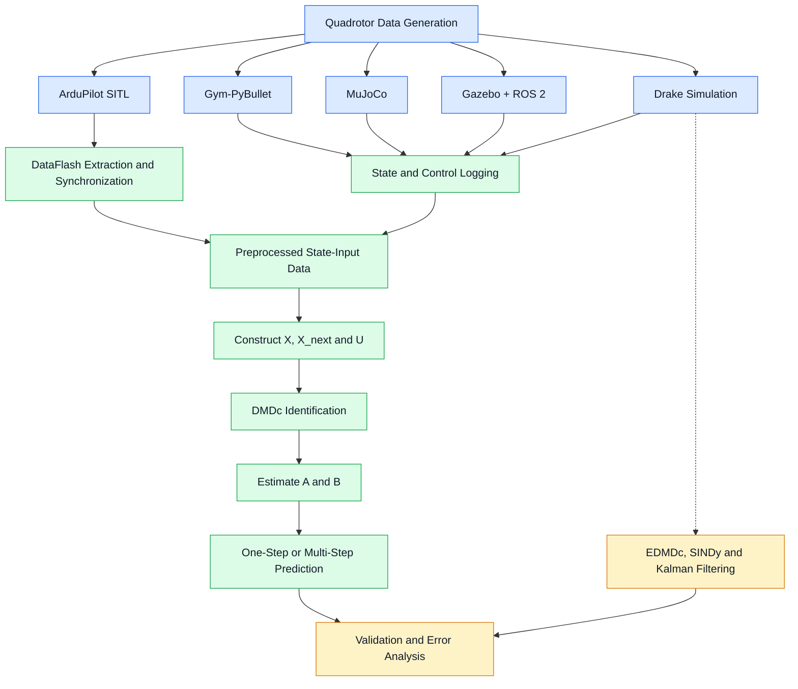
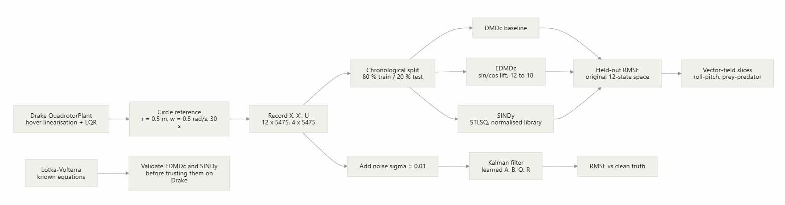

<p align="center">
  
</p>

# Drone System Identification Using DMDc

## Team Members

| Name | Roll Number | Email |
|---|---|---|
| Deeksha Prabhu | CB.SC.U4AIE24015 | cb.sc.u4aie24015@cb.students.amrita.edu |
| K. Supriya | CB.SC.U4AIE24025 | cb.sc.u4aie24025@cb.students.amrita.edu |
| Shivanandana A | CB.SC.U4AIE24049 | cb.sc.u4aie24049@cb.students.amrita.edu |
| Diya Prakash | CB.SC.U4AIE24111 | cb.sc.u4aie24111@cb.students.amrita.edu |
| V R Sridevi | CB.SC.U4AIE24166 | cb.sc.u4aie24166@cb.students.amrita.edu |


---

### Data-Driven Modeling and Prediction of Quadrotor Dynamics Across Multiple Simulation Environments

This project investigates **data-driven system identification of quadrotor dynamics** using Dynamic Mode Decomposition with Control (DMDc). Flight data is collected from different simulation environments and an autopilot Software-In-The-Loop (SITL) setup, then used to identify mathematical models that approximate the relationship between the drone's current state, control inputs, and future state.

The primary model is

$$
\boxed{x_{k+1}=Ax_k+Bu_k}
$$

where \(A\) represents the state-transition dynamics and \(B\) represents the influence of control inputs.

The project explores this workflow across Gym-PyBullet, MuJoCo, Gazebo, and ArduPilot SITL. An additional Drake-based implementation explores extended DMDc, Sparse Identification of Nonlinear Dynamics (SINDy), Kalman filtering, and nonlinear-system validation.

The implementations preserve the state representation and control-input conventions of their respective environments rather than forcing every simulator into a single state vector.


## Table of Contents

1. [Abstract](#1-abstract)
2. [Introduction](#2-introduction)
3. [Project Objectives](#3-project-objectives)
4. [System Architecture](#4-system-architecture)
5. [Quadrotor Dynamics and State Representation](#5-quadrotor-dynamics-and-state-representation)
6. [DMDc Theory and Mathematical Formulation](#6-dmdc-theory-and-mathematical-formulation)
7. [Simulation Environments and Implementations](#7-simulation-environments-and-implementations)
8. [Experimental Results](#8-experimental-results)
9. [Validation Methodology](#9-validation-methodology)
10. [Limitations](#10-limitations)
11. [Future Work](#11-future-work)
12. [Repository Structure](#12-repository-structure)
13. [Installation and Execution](#13-installation-and-execution)
14. [Technologies and Libraries](#14-technologies-and-libraries)
15. [References](#15-references)
16. [Conclusion](#16-conclusion)

---

# 1. Abstract

Quadrotors are nonlinear, dynamically coupled systems whose motion depends on translational dynamics, rotational dynamics, gravity, and the forces generated by individual rotors. Developing an accurate mathematical model can require detailed knowledge of the vehicle's physical parameters and actuator characteristics.

This project investigates **data-driven system identification of quadrotor dynamics** using Dynamic Mode Decomposition with Control (DMDc). Rather than deriving every relationship from first principles, the approach estimates a discrete-time mathematical model from recorded state transitions and control inputs.

The principal model is

$$
\boxed{x_{k+1}=Ax_k+Bu_k}
$$

where $x_k$ represents the current state, $u_k$ represents the applied control input, and the matrices $A$ and $B$ describe the learned state-transition and input relationships.

The project explores this approach across multiple simulation environments and an autopilot Software-In-The-Loop (SITL) workflow:

* **Gym-PyBullet:** PID-controlled quadrotor simulation, translational-state identification, and one-step and recursive prediction.
* **MuJoCo:** 8-state hover/attitude identification, 12-state circular-flight identification, reduced-order DMDc, and Koopman-based feature lifting.
* **Gazebo Harmonic with ROS 2 Jazzy:** PID-controlled flight, actuator-data collection, and translational-state prediction.
* **ArduPilot SITL:** Quaternion-based attitude and angular-rate identification from synchronized DataFlash logs.
* **Drake:** Full-state quadrotor simulation, DMDc and EDMDc comparisons, SINDy, nonlinear-system experiments, and Kalman filtering.

The implementations share a mathematical foundation, but differ in their state representations, control-input definitions, training datasets, and validation procedures.

The results illustrate the strengths and limitations of data-driven identification. Some experiments use separate training and validation datasets or chronological holdout testing, while others currently evaluate models on the same recorded trajectory or use a prediction rollout without a fully independent test set. These distinctions are important when interpreting the reported errors.

**Primary objective:** To investigate how mathematical models of quadrotor dynamics can be identified from observed state and control data, and to evaluate how accurately those models reproduce subsequent system behaviour.

**Scope:** The project focuses on simulation-based system identification, prediction, validation, and selected nonlinear-system extensions. The Drake implementation uses LQR to generate a controlled trajectory, but that is distinct from designing and validating a closed-loop controller using the learned DMDc model.


---

# 2. Introduction

A quadrotor is an unmanned aerial vehicle propelled by four independently controlled rotors. By varying the thrust generated by individual motors, the vehicle can change its altitude, orientation, and horizontal motion.

Its motion can be described using six degrees of freedom:

* **Position:** Location along the three spatial axes.
* **Linear velocity:** Rate of change of position.
* **Orientation:** Roll, pitch, and yaw.
* **Angular velocity:** Rotational rates about the body axes.

The dynamics are challenging to model accurately because translational and rotational motion are coupled. For example, a change in pitch alters the direction of the resultant thrust and therefore changes horizontal acceleration.

Traditional modeling approaches often use Newton-Euler or Lagrangian mechanics. These approaches require physical parameters such as mass, inertia, aerodynamic coefficients, and motor characteristics.

Data-driven system identification instead uses observed system behaviour to estimate a mathematical model.

For this project, the general workflow is:

$$
\text{Data Collection}
\rightarrow
\text{Preprocessing}
\rightarrow
\text{System Identification}
\rightarrow
\text{Model Validation}
$$

The same underlying DMDc formulation is applied across multiple environments, but the state variables, actuator representations, data sources, and validation procedures remain simulator-dependent.

This makes it possible to study both the usefulness and the limitations of learning quadrotor dynamics from different sources of simulated flight data.

---

# 3. Project Objectives

The principal objectives are:

1. Generate quadrotor flight data using multiple simulation environments.
2. Record the system states and the corresponding control inputs.
3. Construct consecutive state and input snapshot matrices from the collected data.
4. Implement Dynamic Mode Decomposition with Control for identifying system dynamics.
5. Estimate the state-transition matrix \(A\) and input matrix \(B\).
6. Investigate singular value decomposition and model-order selection where supported by the implementation.
7. Evaluate learned models using one-step and multi-step predictions.
8. Compare predicted trajectories against actual simulated trajectories or recorded flight measurements.
9. Examine model behaviour through RMSE, trajectory plots, singular values, and eigenvalue diagnostics.
10. Explore nonlinear feature lifting and sparse equation identification using the Drake experiments.
11. Investigate Kalman filtering for state estimation under simulated measurement noise.
12. Identify the limitations of linear models and determine potential improvements for future data-driven control applications.

---

# 4. System Architecture

The project follows a common system-identification workflow, with separate data-generation and preprocessing procedures for each environment.

## 4.1 Overall Architecture



## 4.2 Common Identification Pipeline

Each DMDc implementation follows the same basic stages.

### Stage 1: Generate Flight Data

The quadrotor is simulated, controlled, or observed through an autopilot SITL environment.

The control mechanism varies between implementations:

* PID-based reference tracking in Gym-PyBullet.
* Manual commands in MuJoCo.
* PID-based flight control in Gazebo.
* The native ArduPilot flight controller in SITL.
* LQR-controlled circular trajectory tracking in Drake.

### Stage 2: Collect State and Input Measurements

The system records a sequence of states and their corresponding control inputs.

A sample is represented by

$$
(x_k,u_k,x_{k+1})
$$

where:

* $\(x_k\)$ is the current state.
* $\(u_k\)$ is the control input applied at the current step.
* $\(x_{k+1}\)$ is the next state.

The state variables differ between platforms.

### Stage 3: Preprocess the Data

Depending on the environment, preprocessing may involve:

* Extracting measurements from simulation or flight logs.
* Synchronizing measurements with different timestamps.
* Constructing consistent current-state and next-state pairs.
* Transforming actuator outputs into the input coordinates used by the model.
* Standardizing variables.
* Dividing data into training and validation sets.

### Stage 4: Identify the Model

DMDc uses the collected state transitions and control inputs to estimate \(A\) and \(B\).

### Stage 5: Validate the Model

After estimating the model matrices, each implementation evaluates its predictions against recorded system behaviour.

The exact validation procedure differs between environments. A prediction error should therefore always be interpreted alongside the dataset, state representation, and prediction horizon used to calculate it.

| Environment    | Validation approach                                                                                                                                                                                                                                |
| -------------- | -------------------------------------------------------------------------------------------------------------------------------------------------------------------------------------------------------------------------------------------------- |
| Gym-PyBullet   | Calculates one-step prediction and recursive rollout errors on the collected trajectory. The supplied results are not from an independent held-out flight, and state-input timing alignment requires correction.                                   |
| MuJoCo         | Includes separate training and validation datasets for the 8-state experiments and separate training and validation trajectories for circular-flight experiments. Manual-data quality and archive provenance must be checked for the relevant run. |
| Gazebo         | Compares the actual translational trajectory against DMDc predictions. The documented run fits the model using the complete collected dataset and performs a rollout from the trajectory midpoint, rather than an independent held-out test.       |
| ArduPilot SITL | Uses a chronological training/testing split and evaluates one-step-ahead predictions on the held-out portion of the DataFlash-derived dataset.                                                                                                     |
| Drake          | Includes a later held-out evaluation using the final 20% of the circular-flight dataset, as well as separate nonlinear-system and state-estimation experiments. Older exploratory results use different evaluation procedures.                     |

The main distinction is between **one-step prediction**, which uses the measured current state at every step, and **recursive multi-step prediction**, which repeatedly uses the model's previous predicted state.

A model may achieve a small one-step error while accumulating substantial error during recursive prediction. Independent validation also provides stronger evidence of generalization than evaluation on the same dataset used for identification.


---

# 5. Quadrotor Dynamics and State Representation

## 5.1 General State Description

A complete quadrotor state can be described using position, linear velocity, orientation, and angular velocity:

$$
x_{\mathrm{full}}=
\begin{bmatrix}
x&y&z&
v_x&v_y&v_z&
\phi&\theta&\psi&
p&q&r
\end{bmatrix}^{T}
$$

where:

| Variable        | Description                                     |
| --------------- | ----------------------------------------------- |
| $\(x,y,z\)$       | Position along the three spatial axes           |
| $\(v_x,v_y,v_z\)$ | Linear velocity components                      |
| $\(\phi\)$        | Roll angle                                      |
| $\(\theta\)$      | Pitch angle                                     |
| $\(\psi\)$        | Yaw angle                                       |
| $\(p,q,r\)$       | Angular velocity components about the body axes |

Not every implementation uses all twelve variables.

A smaller state can be easier to estimate and interpret, but it may also omit dynamics that are important for accurately predicting the system.

## 5.2 State Representation Across Environments

The identified state vector depends on the experiment and the information required to describe the system's dynamics. Consequently, the project does not use one identical state representation across all environments.

| Environment / Experiment | State Representation                                                         | Physical State Dimension |
| ------------------------ | ---------------------------------------------------------------------------- | -----------------------: |
| Gym-PyBullet             | $[x,y,z,v_x,v_y,v_z]^T$                                                      |                        6 |
| Gazebo                   | $[x,y,z,v_x,v_y,v_z]^T$                                                      |                        6 |
| MuJoCo — Hover/Attitude  | $[z_{\mathrm{error}},v_z,\mathrm{roll},\mathrm{pitch},\mathrm{yaw},p,q,r]^T$ |                        8 |
| MuJoCo — Circular Flight | $[x,y,z,v_x,v_y,v_z,\mathrm{roll},\mathrm{pitch},\mathrm{yaw},p,q,r]^T$      |                       12 |
| ArduPilot SITL           | $[q_0,q_1,q_2,q_3,\omega_x,\omega_y,\omega_z]^T$                             |                        7 |
| Drake — Quadrotor        | $[x,y,z,\phi,\theta,\psi,v_x,v_y,v_z,\omega_x,\omega_y,\omega_z]^T$          |                       12 |

The MuJoCo Koopman-DMDc experiments additionally lift the 12-dimensional physical state into an 18-dimensional feature representation by adding sine and cosine features for roll, pitch, and yaw. This is a change in the regression feature dimension, not an increase in the number of independent physical state variables.

The ArduPilot representation uses four quaternion components to describe orientation, whereas other implementations use Euler-angle attitude variables or omit attitude from the identified state entirely.

**Comparison principle:** Models should be compared using their actual state definitions and corresponding validation procedures. A six-state translational model and a twelve-state full-state model describe different quantities and cannot be treated as equivalent merely because both use DMDc.


## 5.3 Control Input

In general, a quadrotor has four independently controlled motors.

The input vector is

$$
u_k=
\begin{bmatrix}
u_1&u_2&u_3&u_4
\end{bmatrix}^{T}
$$

The physical meaning of these values depends on the simulator.

They may represent:

* Rotor RPM values.
* Motor thrust commands.
* Actuator speed commands.
* Raw motor output signals.
* Transformed coordinates derived from individual motor outputs.

These inputs should not automatically be treated as physically interchangeable. For example, a raw motor-output channel is not necessarily equal to actual motor RPM or physical thrust.

## 5.4 State Dimension and Model Matrices

For a model with $n$ state variables and $m$ control inputs, the state-transition matrix has dimensions $n\times n$, while the input matrix has dimensions $n\times m$.

$$
A\in\mathbb{R}^{n\times n},
\qquad
B\in\mathbb{R}^{n\times m}
$$

The dimensions of the principal models implemented in this project are summarized below.

| Environment / Model                  | State or Feature Dimension | $A$ Matrix   | $B$ Matrix  |
| ------------------------------------ | -------------------------: | ------------ | ----------- |
| Gym-PyBullet DMDc                    |                          6 | $6\times6$   | $6\times4$  |
| Gazebo DMDc                          |                          6 | $6\times6$   | $6\times4$  |
| MuJoCo Hover/Attitude DMDc           |                          8 | $8\times8$   | $8\times4$  |
| MuJoCo Circular-Flight DMDc          |                         12 | $12\times12$ | $12\times4$ |
| MuJoCo Koopman-DMDc, Circular Flight |         18 lifted features | $18\times18$ | $18\times4$ |
| ArduPilot SITL DMDc                  |                          7 | $7\times7$   | $7\times4$  |
| Drake DMDc                           |                         12 | $12\times12$ | $12\times4$ |
| Drake EDMDc, Trigonometric Features  |         18 lifted features | $18\times18$ | $18\times4$ |

The table lists the main model configurations described in the implementation sections. Reduced-order models may additionally use lower-dimensional projected matrices.

The lifted dimensions refer to the feature space used during regression. The corresponding physical state dimensions remain unchanged.


---

# 6. DMDc Theory and Mathematical Formulation

## 6.1 The Discrete-Time State-Space Model

Dynamic Mode Decomposition with Control approximates the system dynamics using

$$
\boxed{x_{k+1}=Ax_k+Bu_k}
$$

The matrices describe two relationships.

**State-transition matrix \(A\)**

$$
Ax_k
$$

captures how the current state contributes to the next state.

**Input matrix \(B\)**

$$
Bu_k
$$

captures how the control inputs influence the next state.

The matrices are estimated from recorded data rather than assumed to be known beforehand.

The resulting model is a linear or locally linear approximation of the underlying dynamics. It does not imply that a real quadrotor is globally linear.

## 6.2 Constructing the Snapshot Matrices

Suppose \(N\) consecutive state transitions have been collected.

Using a column-based mathematical convention, construct the current-state matrix:

$$
X=
\begin{bmatrix}
x_0&x_1&\cdots&x_{N-1}
\end{bmatrix}
$$

The corresponding next-state matrix is

$$
X_{\mathrm{next}}=
\begin{bmatrix}
x_1&x_2&\cdots&x_N
\end{bmatrix}
$$

The control-input matrix is

$$
U=
\begin{bmatrix}
u_0&u_1&\cdots&u_{N-1}
\end{bmatrix}
$$

For \(n\) state variables and \(m\) inputs,

$$
X,X_{\mathrm{next}}\in\mathbb{R}^{n\times N}
$$

and

$$
U\in\mathbb{R}^{m\times N}
$$

The same dataset can be stored with samples as rows in a CSV or NumPy array. The implementation then arranges or transposes the data as required by the identification equations.

## 6.3 Augmented Regression Matrix

The DMDc model requires the state and control input to be considered together.

They are stacked into the augmented matrix:

$$
\Omega=
\begin{bmatrix}
X\\
U
\end{bmatrix}
$$

The state-transition equation becomes

$$
X_{\mathrm{next}}=AX+BU
$$

Define the combined operator

$$
G=
\begin{bmatrix}
A&B
\end{bmatrix}
$$

Then

$$
X_{\mathrm{next}}\approx G\Omega
$$

This converts the identification problem into a least-squares regression problem.

## 6.4 Estimating the System Matrices

The combined operator can be estimated using the Moore-Penrose pseudoinverse:

$$
\boxed{G=X_{\mathrm{next}}\Omega^\dagger}
$$

where $\(\Omega^\dagger\)$ is the pseudoinverse of the augmented matrix.

Once \(G\) has been estimated, it is divided into two parts:

$$
G=
\begin{bmatrix}
A&B
\end{bmatrix}
$$

The first \(n\) columns form \(A\), and the remaining \(m\) columns form \(B\).

This produces the required state-space model.

## 6.5 Singular Value Decomposition

Singular Value Decomposition (SVD) is useful when estimating the pseudoinverse of the augmented matrix.

The decomposition is

$$
\Omega=U_\Omega\Sigma V^T
$$

where:

* $\(U_\Omega\)$ contains left singular vectors.
* $\(\Sigma\)$ contains singular values.
* $\(V\)$ contains right singular vectors.

When a truncated decomposition is used,

$$
\Omega\approx U_r\Sigma_rV_r^T
$$

the corresponding pseudoinverse approximation is

$$
\Omega^\dagger\approx
V_r\Sigma_r^{-1}U_r^T
$$

The estimated operator becomes

$$
G\approx
X_{\mathrm{next}}V_r\Sigma_r^{-1}U_r^T
$$

Truncation retains selected singular directions and discards others. It can reduce the influence of poorly conditioned directions, but an excessively low rank may remove important system dynamics.

The project uses different numerical implementations across its branches. Some explicitly use SVD-based identification and rank selection, while others use NumPy's pseudoinverse, which itself relies on SVD-based numerical computation. These implementations should not be assumed to use identical rank-truncation settings.

## 6.6 Model Prediction

Once the matrices have been identified, the predicted state is
$$\boxed{\hat{x}_{k+1}=A\hat{x}_k+Bu_k}$$

There are two important prediction modes.

### One-Step-Ahead Prediction

The actual measured state at time \(k\) and the corresponding input are used to predict the next state.

$$
\hat{x}_{k+1}=Ax_k+Bu_k
$$

This evaluates the model's ability to predict a single state transition.

### Recursive Multi-Step Prediction

The predicted state is fed back into the model:

$$
\hat{x}_{k+1}=A\hat{x}_k+Bu_k
$$

$$
\hat{x}_{k+2}=A\hat{x}_{k+1}+Bu_{k+1}
$$

The process continues across the validation trajectory.

Recursive prediction is more demanding because errors can accumulate at every step. A model that predicts individual transitions accurately may still diverge during a long open-loop rollout.
<!-- BEGIN -->
DMDc assumes $x_{k+1}=Ax_k+Bu_k$. Section 7.5 relaxes this by regressing on a nonlinear dictionary of the state (EDMDc), on a sparse library (SINDy), and by adding a state estimator (Kalman filter).
<!-- END -->

## 6.7 Model Evaluation

The principal error metric used in the project is Root Mean Squared Error (RMSE).

$$
\mathrm{RMSE}=\sqrt{\frac{1}{N}\sum_{i=1}^{N}(x_i-\hat{x}_i)^2}
$$

where:

* $x_i$ is the actual value.
* $\hat{x}_i$ is the predicted value.
* $N$ is the number of evaluated samples.

RMSE measures the magnitude of the difference between actual and predicted values. A lower value indicates a closer numerical match for the state variable and evaluation procedure being considered.

RMSE values should be interpreted in their original context. State variables may have different physical units and numerical scales, and different experiments may use different prediction horizons or data splits. An aggregate error from a normalized or lifted feature representation should not be compared directly with an error calculated in the original physical state space.

For this project, prediction errors should therefore be reported alongside the state definition, the dataset used for evaluation, and whether the calculation uses one-step prediction or recursive rollout.


---

# 7. Simulation Environments and Implementations

## 7.1 Gym-PyBullet Implementation

**Directory:** `Gympybullet/`

This implementation develops a simulation-based workflow for identifying a mathematical model of quadrotor motion using Dynamic Mode Decomposition with Control (DMDc).

The drone is simulated using the `gym-pybullet-drones` framework and controlled using a PID controller. During flight, the drone's simulated states and applied motor RPM commands are recorded. These measurements are then used to estimate a discrete-time input–output model.

The complete workflow is:

    Reference Position / Trajectory
                  |
                  v
           PID Controller
                  |
                  v
        Four Motor RPM Commands
                  |
                  v
      Gym-PyBullet Drone Simulation
                  |
                  v
        State and Input Data Logging
                  |
                  v
       SVD-Based DMDc Identification
                  |
                  v
          Learned Matrices A and B
                  |
                  v
      Prediction and Error Evaluation

This implementation includes Gym-PyBullet simulation, PID-controlled data collection, DMDc identification, and prediction evaluation.

Lotka–Volterra and SINDy are not included in this implementation.

---

### 7.1.2 Objectives

The main objectives are:

1. Simulate a quadrotor in a three-dimensional physics environment.
2. Control its movement using desired positions or trajectories.
3. Record position, velocity, orientation, angular velocity, and motor commands.
4. Construct state and control-input snapshot matrices.
5. Identify a linear discrete-time model using SVD-based DMDc.
6. Predict drone position and velocity using the identified model.
7. Compare predictions with the recorded PyBullet simulation response.
8. Save the model and diagnostic plots for further analysis.

The identified model is intended as an approximation of the simulated drone response over the conditions represented in the collected dataset. It is not a replacement for the complete nonlinear quadrotor physics model.

---

### 7.1.3 Software and Libraries

| Component | Purpose |
|---|---|
| Python | Implements simulation, data processing, identification, and evaluation |
| `gym-pybullet-drones` | Provides quadrotor environments, drone models, and controllers |
| PyBullet | Simulates rigid-body motion and the response to applied rotor forces |
| NumPy | Performs matrix operations, SVD, and prediction calculations |
| pandas | Creates and reads the flight-data CSV |
| Matplotlib | Generates prediction and singular-value plots |
| `CtrlAviary` | Provides the environment receiving motor RPM commands |
| `DSLPIDControl` | Calculates motor commands from the measured state and reference |

The external framework supplies the simulation environment and PID controller. The project scripts define the experiment, collect data, identify the DMDc model, and evaluate predictions.

---

### 7.1.4 Project Structure

The consolidated project is organized as follows:

    Gympybullet/
    ├── project/
    │   ├── run_pid_dmdc.py
    │   └── dmdc_identify.py
    ├── data/
    │   └── pid_dmdc_log.csv
    ├── results/
    │   ├── dmdc_model.npz
    │   ├── dmdc_position_prediction.png
    │   ├── dmdc_velocity_prediction.png
    │   └── dmdc_singular_values.png
    └── README.md

Additional matrix exports such as `A_matrix.csv` and `B_matrix.csv` may also be maintained. However, the identification-script version described here saves the matrices in `dmdc_model.npz` and does not automatically create those CSV exports.

---

### 7.1.5 Roles of the Two Python Scripts

| Script | Role |
|---|---|
| `run_pid_dmdc.py` | Runs the PID-controlled drone simulation and records the flight data |
| `dmdc_identify.py` | Reads the recorded dataset, identifies the DMDc model, evaluates predictions, and saves results |

The scripts are executed in this order:

    run_pid_dmdc.py
            |
            v
    data/pid_dmdc_log.csv
            |
            v
    dmdc_identify.py
            |
            v
    Identified model and prediction plots

The simulation script generates the measurements. The identification script analyzes those measurements; it does not run the drone physics simulation.

---

### 7.1.6 Simulation Configuration

| Parameter | Value |
|---|---|
| Environment | `CtrlAviary` |
| Drone model | `DroneModel.CF2X` |
| Number of drones | 1 |
| Physics mode | `Physics.PYB` |
| Physics frequency | 240 Hz |
| Control frequency | 48 Hz |
| Initial position | `[0.0, 0.0, 0.10]` m |
| Initial roll, pitch, yaw | `[0.0, 0.0, 0.0]` rad |
| Reset seed | 42 |
| Obstacles | Disabled |
| Video recording | Disabled |
| GUI | Enabled using `--gui` |

The control interval is:

$$
\Delta t = \frac{1}{48} \approx 0.02083 \text{ s}
$$

The physics engine performs five updates per control interval:

$$
\frac{240}{48} = 5
$$

The controller calculates a new action at 48 Hz, while the physics engine advances the drone motion at 240 Hz.

---

### 7.1.7 Reference Position and Trajectory Generation

#### Initial Position-Step Experiment

The original experiment used piecewise-constant position targets:

| Time interval | Desired position `[x, y, z]` in metres |
|---|---|
| `0 ≤ t < 2 s` | `[0.0, 0.0, 0.30]` |
| `2 ≤ t < 5 s` | `[0.0, 0.0, 0.70]` |
| `5 ≤ t < 8 s` | `[0.30, 0.0, 0.70]` |
| `8 ≤ t < 11 s` | `[0.30, 0.0, 0.40]` |
| `t ≥ 11 s` | `[0.0, 0.0, 0.40]` |

These changes create altitude and horizontal-motion transients. The PID controller responds by varying the motor commands, generating state–input data for identification.

#### Circular-Flight Extension

The reference was subsequently modified to include circular motion at a fixed altitude.

The circular position reference is:

$$
p_{\mathrm{ref}}(t) =
\begin{bmatrix}
R\cos(\omega\tau) \\
R\sin(\omega\tau) \\
h
\end{bmatrix},
\qquad
\tau = t - t_{\mathrm{start}}
$$

The corresponding reference velocity is:

$$
v_{\mathrm{ref}}(t) =
\begin{bmatrix}
-R\omega\sin(\omega\tau) \\
R\omega\cos(\omega\tau) \\
0
\end{bmatrix}
$$

The supplied circular-flight configuration uses:

| Parameter | Value |
|---|---|
| Radius | 0.35 m |
| Altitude | 0.70 m |
| Angular speed | 0.35 rad/s |
| Initial hover segment | 0–3 s |
| Circular-reference segment | 3–17 s |
| Return-to-centre hover | After 17 s |
| Default total duration | 22 s |

The yaw reference follows the tangent direction:

$$
\psi_{\mathrm{ref}}(t) = \omega\tau + \frac{\pi}{2}
$$

The 14-second circular segment covers approximately 4.9 radians, or 281 degrees. Therefore, this configuration follows a circular arc rather than completing a full revolution.

The reference changes abruptly between the initial hover, circular segment, and final hover. Tracking transients can occur at these transitions.

---

### 7.1.8 PID Controller Operation

The PID controller forms a closed-loop feedback system.

At each control step:

1. Read the current simulated drone state.
2. Obtain the desired position, velocity, and yaw reference.
3. Calculate tracking errors.
4. Calculate corrective control actions.
5. Generate four motor RPM commands.
6. Apply those commands to the simulated drone.
7. Read the updated state.
8. Repeat.

The position error is:

$$
e_p(t) = p_{\mathrm{ref}}(t) - p(t)
$$

A PID correction combines proportional, integral, and derivative contributions:

$$
c(t) =
K_P e(t)
+
K_I \int_0^t e(\tau)\,d\tau
+
K_D \frac{de(t)}{dt}
$$

- Proportional action responds to the present error.
- Integral action responds to accumulated error.
- Derivative action responds to the rate of error change.

The project uses `DSLPIDControl.computeControlFromState()` to obtain motor commands from the current state and target references.

The four-motor command vector is:

$$
u_k =
\begin{bmatrix}
RPM_{1,k} \\
RPM_{2,k} \\
RPM_{3,k} \\
RPM_{4,k}
\end{bmatrix}
$$

The PID controller determines the action. PyBullet determines the physical motion caused by that action.

The controller does not directly overwrite the drone's actual position.

---

### 7.1.9 Simulation Input and Output

#### High-Level Reference

The desired position or trajectory specifies where the drone should move.

Examples include:

- Hovering at a fixed altitude.
- Moving to a different horizontal position.
- Following a circular reference.

#### Simulation Control Input

The low-level input to the `CtrlAviary` environment is the four-motor RPM command.

    Desired movement
           |
           v
       PID controller
           |
           v
    Four commanded RPMs
           |
           v
    Drone physics simulation

#### Simulation Response

The environment returns an observation containing the updated drone state.

The project records:

- Position.
- Orientation quaternion.
- Linear velocity.
- Angular velocity.
- Applied motor RPM commands.
- Reference values.

For model evaluation, the recorded PyBullet response is treated as simulation ground truth. It is not a real-world flight measurement.

---

### 7.1.10 Flight-Data Logging

The simulation script writes:

    data/pid_dmdc_log.csv

The dataset contains the following quantities:

| Category | Columns | Description |
|---|---|---|
| Time | `time` | Logged control-loop time |
| Position reference | `target_x`, `target_y`, `target_z` | Desired position |
| Position | `x`, `y`, `z` | Recorded simulated position |
| Orientation | `qx`, `qy`, `qz`, `qw` | Orientation quaternion |
| Linear velocity | `vx`, `vy`, `vz` | Recorded simulated linear velocity |
| Angular velocity | `wx`, `wy`, `wz` | Recorded simulated angular velocity |
| Control input | `rpm1`, `rpm2`, `rpm3`, `rpm4` | Commanded motor speeds |

The circular-flight version additionally records reference velocity and target roll, pitch, and yaw.

The logged quaternion and angular-velocity values are available for future analysis, but the current DMDc state uses only position and linear velocity.

---

### 7.1.11 State and Input Definitions for DMDc

The identification script selects these state columns:

    x, y, z, vx, vy, vz

The state vector is:

$$
x_k =
\begin{bmatrix}
p_{x,k} \\
p_{y,k} \\
p_{z,k} \\
v_{x,k} \\
v_{y,k} \\
v_{z,k}
\end{bmatrix}
\in \mathbb{R}^{6}
$$

The selected control-input columns are:

    rpm1, rpm2, rpm3, rpm4

The input vector is:

$$
u_k =
\begin{bmatrix}
RPM_{1,k} \\
RPM_{2,k} \\
RPM_{3,k} \\
RPM_{4,k}
\end{bmatrix}
\in \mathbb{R}^{4}
$$

The target positions are reference signals for PID control. They are not used directly as the DMDc control-input vector in this implementation.

DMDc predicts position and velocity from the measured state and supplied RPM commands. It does not calculate the RPM required to reach a target.

---

### 7.1.12 DMDc Model

The identified discrete-time model is:

$$
x_{k+1} \approx A x_k + B u_k
$$

| Quantity | Dimensions | Meaning |
|---|---|---|
| Current state `x_k` | `6 × 1` | Current position and velocity |
| Input `u_k` | `4 × 1` | Four motor RPM commands |
| Matrix `A` | `6 × 6` | Learned state-transition mapping |
| Matrix `B` | `6 × 4` | Learned input-effect mapping |
| Next state `x_(k+1)` | `6 × 1` | Predicted next position and velocity |

The model combines:

- The contribution associated with the current measured state: `A @ x_k`.
- The contribution associated with the applied input: `B @ u_k`.

These are fitted mappings for the collected dataset. Their entries should not automatically be interpreted as unique physical parameters, especially because attitude and other relevant variables are omitted from the model state.

---

### 7.1.13 Snapshot-Matrix Construction

For `N` recorded states, the identification script constructs current-state and next-state matrices:

$$
X =
\begin{bmatrix}
x_0 & x_1 & \cdots & x_{N-2}
\end{bmatrix}
$$

$$
X' =
\begin{bmatrix}
x_1 & x_2 & \cdots & x_{N-1}
\end{bmatrix}
$$

The input matrix must contain the commands applied during those transitions:

$$
U =
\begin{bmatrix}
u_0 & u_1 & \cdots & u_{N-2}
\end{bmatrix}
$$

Their dimensions are:

$$
X, X' \in \mathbb{R}^{6 \times (N-1)}
$$

$$
U \in \mathbb{R}^{4 \times (N-1)}
$$

The full dataset relationship is:

$$
X' \approx A X + B U
$$

Each column represents one time transition.

Correct timing between state, input, and next state is essential. The alignment issue in the originally shared logging code is documented in Section 7.1.20.

---

### 7.1.14 SVD-Based Identification

The current-state and input matrices are stacked:

$$
\Omega =
\begin{bmatrix}
X \\
U
\end{bmatrix}
\in \mathbb{R}^{10 \times (N-1)}
$$

Define the combined operator:

$$
G =
\begin{bmatrix}
A & B
\end{bmatrix}
$$

Then:

$$
X' \approx G\Omega
$$

The least-squares estimate is:

$$
G = X'\Omega^\dagger
$$

where `Ω†` is the Moore–Penrose pseudoinverse.

The code calculates the pseudoinverse through Singular Value Decomposition:

$$
\Omega = U_{\Omega}\Sigma_{\Omega}V_{\Omega}^{T}
$$

For retained rank `r`:

$$
G \approx X'V_r\Sigma_r^{-1}U_r^{T}
$$

After estimating `G`:

- The first six columns form `A`.
- The last four columns form `B`.

The shared implementation uses rank 10, retaining all ten available directions when sufficiently many samples exist.

Therefore, the current implementation uses SVD for full-state regression; it does not explicitly reduce the six-state model to a smaller latent-state model.

---

### 7.1.15 One-Step Prediction

One-step prediction uses the actual recorded state at every sample:

$$
\hat{x}_{k+1} = A x_k + B u_k
$$

This evaluates:

> Given the current measured state and applied motor input, how accurately does the model predict the immediately next state?

The model is supplied with the actual state again at the following prediction step, preventing previous prediction errors from accumulating through the state sequence.

---

### 7.1.16 Multi-Step Rollout

The rollout starts from the first recorded state:

$$
\hat{x}_0 = x_0
$$

Subsequent predictions use the model's own previous state:

$$
\hat{x}_{k+1} = A\hat{x}_k + Bu_k
$$

This evaluates long-horizon prediction under the recorded motor-input sequence.

The PID controller is not rerun using the predicted states. Therefore, the rollout is not a new closed-loop controller experiment; it is a model simulation driven by logged inputs.

Small model errors can accumulate during rollout, causing position and velocity predictions to drift from the PyBullet trajectory.

---

### 7.1.17 Evaluation Metrics

The script calculates Root Mean Square Error separately for each state component:

$$
RMSE_j =
\sqrt{
\frac{1}{M}
\sum_{k=1}^{M}
\left(\hat{x}_{j,k} - x_{j,k}\right)^2
}
$$

Two RMSE vectors are reported:

1. One-step RMSE.
2. Multi-step rollout RMSE.

The state order is:

    [x, y, z, vx, vy, vz]

| State | RMSE unit |
|---|---|
| `x`, `y`, `z` | metres |
| `vx`, `vy`, `vz` | metres per second |

These metrics compare predicted states with recorded simulation states. They do not measure RPM prediction error.

The current script prints the metrics to the terminal. It does not automatically save them to a separate metrics file.

---

### 7.1.18 Previously Recorded Experimental Results

A previously shared run produced:

| Quantity | Shape |
|---|---|
| State data | `(6, 672)` |
| Input data | `(4, 672)` |
| Current-state snapshots | `(6, 671)` |
| Next-state snapshots | `(6, 671)` |
| Input snapshots | `(4, 671)` |
| Matrix `A` | `(6, 6)` |
| Matrix `B` | `(6, 4)` |

At 48 control updates per second, 672 logged rows correspond to a 14-second run.

These results should not be identified as the default 22-second circular-flight results unless the associated dataset confirms that configuration.

#### Reported Prediction Errors

| State | One-step RMSE | Rollout RMSE | Unit |
|---|---:|---:|---|
| X position | 0.0001316 | 0.1907420 | m |
| Y position | 0.0000229 | 0.0043767 | m |
| Z position | 0.0002484 | 0.1738306 | m |
| X velocity | 0.0105376 | 0.1782020 | m/s |
| Y velocity | 0.0018424 | 0.0174026 | m/s |
| Z velocity | 0.0198657 | 0.1802519 | m/s |

The reported one-step position errors were below 0.25 mm. Rollout errors increased to approximately 19.1 cm in X position and 17.4 cm in altitude.

These are preliminary same-dataset results, not independent test-set results.

They must also be reassessed after correcting the state–input timing issue described below.

A small error for an axis does not necessarily indicate strong predictive capability if that axis experienced little movement during data collection.

---

### 7.1.19 Generated Outputs

| File | Purpose |
|---|---|
| `data/pid_dmdc_log.csv` | Recorded simulated states, references, and motor commands |
| `results/dmdc_model.npz` | Stores `A`, `B`, singular values, and state/input column names |
| `results/dmdc_position_prediction.png` | Compares recorded position with DMDc rollout |
| `results/dmdc_velocity_prediction.png` | Compares recorded velocity with DMDc rollout |
| `results/dmdc_singular_values.png` | Displays singular values of the combined state–input matrix |

#### Position Prediction Plot

Contains comparisons for:

- X position.
- Y position.
- Z position.

#### Velocity Prediction Plot

Contains comparisons for:

- X velocity.
- Y velocity.
- Z velocity.

#### Singular-Value Plot

Shows the numerical structure of the combined matrix `Ω = [X; U]`.

It is a diagnostic for data scaling and rank selection, not a direct prediction-accuracy metric.

---

### 7.1.20 Implementation Checks and Limitations

#### 1. State–Input Timing Alignment

The originally shared simulation code logs `next_state` after applying `rpm`.

Each CSV row therefore contains:

    State after applying action k + action k

However, the originally shared identification code uses:

    X = states[:, :-1]
    X_next = states[:, 1:]
    U = inputs[:, :-1]

This pairs consecutive post-action states with an input from the preceding transition.

For the existing post-step logging format, the input for transitions between recorded rows should instead be selected as:

    U = inputs[:, 1:]

A clearer long-term implementation is to save each transition explicitly:

    Current state before action
    Applied motor RPM
    Next state after action

The model and evaluation metrics should be regenerated after correcting this alignment.

#### 2. Timestamp Convention

The shared logger records the loop time `t` together with the post-step state.

Thus, the recorded state corresponds to the end of the control interval, while `t` marks its beginning.

This convention should be documented or changed so that timestamps consistently identify when each state was measured.

#### 3. Same-Dataset Evaluation

The current identification script fits and evaluates the model using the same recorded trajectory.

This provides a fit check but does not demonstrate generalization.

A stronger evaluation should train on one experiment and test on a separate flight trajectory.

#### 4. Limited State Representation

The model uses position and linear velocity only.

Attitude and angular velocity influence drone acceleration but are not included in the current identified state.

#### 5. Linear Approximation

The model uses constant matrices `A` and `B`.

It cannot fully capture nonlinear rotor thrust, orientation-dependent acceleration, and coupled rotational motion across all operating conditions.

#### 6. Numerical Scaling

Raw motor RPM values are much larger than position and velocity values.

Consequently, the singular values can be dominated by input scale. State and input scaling should be considered before drawing rank-selection conclusions from the SVD plot.

#### 7. Small Singular Values

The shared implementation directly inverts retained singular values.

A numerical tolerance should be introduced to avoid dividing by very small singular values in poorly excited or nearly dependent datasets.

#### 8. Environment Resets

The simulation code resets the environment if termination or truncation occurs.

Transitions across a reset must not be included as ordinary physical transitions in the identification dataset.

#### 9. Physical Interpretation

A fitted coefficient does not automatically identify a unique physical parameter.

Feedback-dependent inputs, omitted variables, and correlations among motor commands can affect the learned matrices.

---

### 7.1.21 Running the Project

Run the scripts from the `Gympybullet` directory using the Python environment containing the required dependencies.

#### Circular-Flight Simulation with GUI

    python project/run_pid_dmdc.py --gui --duration 22

#### Simulation without GUI

    python project/run_pid_dmdc.py --duration 22

#### DMDc Identification

    python project/dmdc_identify.py

The simulation must run before identification so that the flight CSV exists.

The scripts use paths relative to the current working directory. Running them from another directory may save or read files in an unexpected location.

The default commands overwrite the existing flight CSV, model, and prediction plots. Preserve earlier experiments separately when comparing different trajectories.

---

### 7.1.22 Achievements

The implementation establishes:

1. A single-quadrotor Gym-PyBullet simulation.
2. PID-controlled position and trajectory tracking.
3. Logging of simulated states and four motor RPM commands.
4. A six-state, four-input DMDc formulation.
5. SVD-based estimation of the model matrices.
6. One-step prediction evaluation.
7. Multi-step rollout evaluation.
8. Position, velocity, and singular-value plots.
9. A saved numerical model for further analysis.

The main learned relationship is:

$$
\text{Current Position and Velocity}
+
\text{Applied Motor Commands}
\longrightarrow
\text{Next Position and Velocity}
$$

The work demonstrates a complete simulation-to-identification pipeline. Final model-quality claims require corrected state–input timing and independent trajectory validation.

---

### 7.1.23 Future Improvements

Possible improvements within the DMDc workflow include:

- Correcting and explicitly recording state–input–next-state timing.
- Saving metrics and experiment configurations automatically.
- Training and testing on separate trajectories.
- Scaling state and input variables.
- Applying singular-value tolerances or regularized regression.
- Evaluating different retained ranks.
- Including attitude and angular velocity where appropriate.
- Using smoother transitions between reference segments.
- Generating varied trajectories to improve data coverage.
- Comparing against a simple persistence baseline.
- Reporting prediction error over multiple rollout horizons.

These are proposed improvements and should not be reported as completed features unless implemented and tested.

---

### 7.1.24 Framework Acknowledgement

The simulation uses the open-source
[gym-pybullet-drones](https://github.com/learnsyslab/gym-pybullet-drones)
framework and the PyBullet physics engine.

The framework provides the drone environment and PID controller. This project contributes the experiment configuration, reference trajectories, flight-data logging, DMDc identification workflow, and prediction evaluation.

## 7.2 MuJoCo-Based Quadrotor System Identification with DMDc and Koopman Models

### Overview

This module investigates **data-driven system identification for a quadrotor simulated in MuJoCo**. Flight-state measurements and four motor commands are collected from controlled and manually driven experiments. The resulting datasets are used to estimate discrete-time dynamical models with **Dynamic Mode Decomposition with Control (DMDc)** and to explore a **Koopman-based lifted representation** for handling angular nonlinearities.

The implementation contains several related experiments: an 8-state hover/attitude model, a reduced-order DMDc model, a manually collected-data variant, a 12-state circular-trajectory model, and a trigonometric Koopman-DMDc model. All current experiments are simulation based; this module does not demonstrate deployment on a physical drone.

### Workflow

```text
MuJoCo Quadrotor Model (quadrotor.xml)
                 |
                 v
     Controlled / Manual Experiments
                 |
                 v
       State and Motor-Input CSVs
                 |
                 v
         Data Loading and Checks
                 |
                 v
       DMDc System Identification
                 |
       +---------+----------+
       |                    |
       v                    v
 Reduced-Order DMDc   Koopman-DMDc Lifting
       |                    |
       +---------+----------+
                 v
     Validation, Error Metrics,
     Eigenvalues and Diagnostic Plots
```

### Simulation Model

The MuJoCo model is defined in `quadrotor.xml`. It contains a free-moving quadrotor body, a ground plane, four motor sites, visual propellers, and four virtual motor actuators. The configured quadrotor mass is **1.0 kg**, with diagonal inertia values of `0.02`, `0.02`, and `0.04`. The actuator command range is **0 to 8** per motor.

The simulation uses a **0.002 s timestep (500 Hz)**, the Runge–Kutta 4 integrator, and gravity of approximately `-9.81 m/s²` on the vertical axis. `inspect_model.py` loads the XML and prints model dimensions and actuator names. The accompanying `MJMODEL.TXT` is a text report of the compiled MuJoCo model configuration and dimensions.

Two state representations are used for different experiments:

**8-state hover/attitude representation**

$$
x_k = [z_{error},\ v_z,\ roll,\ pitch,\ yaw,\ p,\ q,\ r]^T
$$

Here, `z_error` is the vertical position relative to the one-metre reference altitude, `v_z` is vertical velocity, `roll/pitch/yaw` are Euler angles, and `p/q/r` are the three angular-velocity components.

**12-state circular-flight representation**

$$
x_k = [x,\ y,\ z,\ v_x,\ v_y,\ v_z,\ roll,\ pitch,\ yaw,\ p,\ q,\ r]^T
$$

This state includes three-dimensional position and velocity in addition to attitude and angular velocity, enabling evaluation over a circular reference trajectory.

In both representations, the control vector contains the four motor commands. The identification scripts express each applied motor input as a deviation from nominal hover thrust. If `u_i^raw` is the command saved by the simulator, the model input is:

$$
u_k = [\Delta u_1,\ \Delta u_2,\ \Delta u_3,\ \Delta u_4]^T,\qquad
\Delta u_i = u_i^{raw} - \frac{mg}{4}
$$

For the configured mass and gravity, the nominal per-motor hover value is approximately `2.4525`.

### DMDc Formulation

For the training trajectory, consecutive state snapshots are constructed as

$$
X = [x_0, x_1, \ldots, x_{N-1}],\qquad
X' = [x_1, x_2, \ldots, x_N]
$$

and the corresponding control snapshots are collected in `U`. DMDc estimates a linear discrete-time model:

$$
\boxed{x_{k+1} \approx A x_k + B u_k}
$$

The implementation forms the augmented state-input matrix

$$
\Omega = \begin{bmatrix} X \\ U \end{bmatrix}
$$

and uses Singular Value Decomposition (SVD) and a truncated pseudoinverse to estimate

$$
G = X'\Omega^{\dagger} = \begin{bmatrix} A & B \end{bmatrix}
$$

The matrix `A` describes the learned state transition, while `B` captures the effect of the motor inputs. Rank selection is based on retained singular-value energy in the SVD-based pipelines. The reduced-order implementation applies a second SVD to obtain a lower-dimensional basis and reduced matrices, reducing the order of the model used for rollout prediction.

### Implemented Experiments

| Script                                                | Implementation                                                                                                                                                                                                                                                                                                                                                         |
| ----------------------------------------------------- | ---------------------------------------------------------------------------------------------------------------------------------------------------------------------------------------------------------------------------------------------------------------------------------------------------------------------------------------------------------------------- |
| `run_simulation.py`                                   | Runs a hover/attitude experiment with a feedback controller and small, deterministic multisine motor excitation. It saves `training.csv` and `validation.csv`; each generated dataset contains 6,000 samples for a 12-second run at the 0.002-second timestep. The validation run opens a MuJoCo viewer.                                                               |
| `manual_control.py`                                   | Opens the MuJoCo viewer for interactive keyboard control and records state and motor-input data to `data/manual_training.csv`. The keyboard adjusts throttle, roll, pitch, and yaw targets; `R` resets the targets toward level hover.                                                                                                                                 |
| `dmdc_pipeline.py`                                    | Fits the 8-state DMDc model using `training.csv` and `validation.csv`, computes the full matrices and a **rank-4 reduced-order model**, predicts the validation trajectory, and saves RMSE, eigenvalue, and singular-value diagnostics under `results/`.                                                                                                               |
| `dmdc_manual_pipeline.py`                             | Runs the same general reduced-order DMDc workflow on `manual_training.csv` and `manual_validation.csv`, with a configured ROM rank of 8. It currently writes to the same `results/` directory as `dmdc_pipeline.py`.                                                                                                                                                   |
| `dmdc_circle_baseline.py` / `dmdc_circle_pipeline.py` | Implements standard 12-state DMDc for circular flight. It performs SVD rank selection, one-step prediction, recursive rollout and short-horizon tests, as well as eigenvalue and conditioning diagnostics. The two uploaded files are byte-for-byte identical copies of the same pipeline. Outputs are written under `results_dmdc_circle/`.                           |
| `dmdc_koopman_pipeline.py`                            | Fits a DMDc baseline and a ridge-regularized Koopman-DMDc model using the 12-state circular-flight datasets. It adds six trigonometric observables for roll, pitch and yaw (12 to 18 lifted dimensions), reconstructs physical states from the lifted representation, and compares model predictions. Outputs are written to `results_koopman/`.                       |
| `manual_control_koopman.py`                           | Generates circular-trajectory training and validation data. The flight sequence uses a 5-second takeoff, 20 seconds of circular flight and a 5-second landing. The circle is configured with a 1-metre radius, a 10-second period and a reference altitude of 1.5 metres. The script prompts for `T` (training trajectory), `V` (validation trajectory) or `Q` (quit). |
| `koopman_circle_pipeline.py`                          | Fits a Koopman-DMDc model for the 12-state circular-flight data. Its trigonometric dictionary adds `sin` and `cos` of roll, pitch and yaw, lifting the state from **12 to 18 dimensions**. It uses SVD/truncated-pseudoinverse identification and saves validation plots and model diagnostics in `results_koopman_circle/`.                                           |
| `circle_data_audit.py`                                | Audits `circle_training.csv` and `circle_validation.csv`: required columns, missing values, sampling interval, state/input ranges, differences between datasets, and trajectory geometry/angular progress.                                                                                                                                                             |
| `inspect_model.py`                                    | Checks that `quadrotor.xml` loads correctly and reports the MuJoCo state dimensions, body information and four actuator names.                                                                                                                                                                                                                                         |

### Dataset Organization

The supplied `data.zip` contains these CSV files:

| Dataset                                               | Purpose and notes                                                                                                                                                                                                            |
| ----------------------------------------------------- | ---------------------------------------------------------------------------------------------------------------------------------------------------------------------------------------------------------------------------- |
| `training.csv`, `validation.csv`                      | 8-state hover/attitude experiments generated by `run_simulation.py`; 6,000 rows each in the supplied bundle.                                                                                                                 |
| `manual_training.csv`                                 | Manually controlled 8-state data. The supplied copy contains 484 rows, so it is a short recording and may not provide broad enough excitation for a reliable model.                                                          |
| `manual_training_backup.csv`, `manual_validation.csv` | Additional manual recordings. The uploaded versions contain timestamp resets/segments; use the loader's cleaning behavior and inspect the retained sample count before interpreting results.                                 |
| `koopman_training.csv`, `koopman_validation.csv`      | 8-state datasets associated with the earlier Koopman experiment. The uploaded versions contain non-increasing timestamp intervals, so the retained segment should be checked after loading.                                  |
| `circle_training.csv`, `circle_validation.csv`        | 12-state circular-flight experiments. Each contains 15,001 samples over approximately 30 seconds, sampled every 0.002 seconds. The files include time, physical state, reference position/velocity, and four motor commands. |

The circle datasets contain `x_ref`, `y_ref`, `z_ref`, `vx_ref`, `vy_ref`, and `vz_ref` in addition to the physical state and inputs. These reference columns are useful for auditing and trajectory visualization; the current model state vector is defined separately in each identification script.

### Validation and Saved Results

The pipelines evaluate model predictions against recorded validation data rather than relying only on the training fit. Depending on the script, evaluation includes one-step predictions, recursive rollouts, per-state RMSE, relative error, short-horizon error, eigenvalue checks and matrix-conditioning diagnostics.

The uploaded result archives contain the following output groups:

| Results folder / archive                                 | Main artifacts                                                                                                                                                                                                                                                                                                                                                                 |
| -------------------------------------------------------- | ------------------------------------------------------------------------------------------------------------------------------------------------------------------------------------------------------------------------------------------------------------------------------------------------------------------------------------------------------------------------------ |
| `results/` (`results.zip`)                               | `A.npy`, `B.npy`, reduced matrices `A_tilde.npy` and `B_tilde.npy`, reduced basis, state-wise validation plots, `validation_rmse.csv`, an RMSE chart, singular-value energy plot, eigenvalue plot and `model_summary.txt`.                                                                                                                                                     |
| `results_dmdc_circle/` (`results_dmdc_circle.zip`)       | Circular DMDc matrices, singular values, eigenvalues, per-state validation plots, an XY trajectory plot and `dmdc_validation_summary.csv` with one-step and full-recursive errors.                                                                                                                                                                                             |
| `results_koopman/` (`results_koopman.zip`)               | Saved standard and lifted model matrices, reconstruction matrix, singular values, state prediction plots and a model comparison CSV. The supplied summary identifies an 8-state / 14-dimensional run, whereas the currently uploaded script uses a 12-state / 18-dimensional representation; regenerate these results before presenting them as results of the current script. |
| `results_koopman_circle/` (`results_koopman_circle.zip`) | Lifted Koopman matrices, reconstruction matrix, eigenvalues, singular values, state plots, XY trajectory plot and `summary.txt`. The supplied summary reports physical dimension 12, lifted dimension 18, selected SVD rank 6, approximately 99.94% retained energy and a condition number of about `6.06 × 10^9`.                                                             |

For the supplied standard 8-state DMDc result, `model_summary.txt` records an augmented-matrix rank of 10 and a rank-4 reduced-order model retaining 98.39% of the state-snapshot singular-value energy. The saved validation RMSE values are:

| State     |   RMSE |
| --------- | -----: |
| `z_error` | 0.0506 |
| `vz`      | 0.1093 |
| `roll`    | 0.1319 |
| `pitch`   | 0.3973 |
| `yaw`     | 0.3109 |
| `p`       | 0.3120 |
| `q`       | 0.1147 |
| `r`       | 0.1060 |

The circular DMDc results show why both short-step and long-horizon evaluation matter: the saved one-step RMSE is small for several states, but the recursive rollout drifts over time, particularly in horizontal position and velocity. For example, the recorded full-recursive RMSE is approximately `1.06` for `x`, `0.81` for `y`, `0.51` for `vx`, and `0.53` for `vy`. The model should therefore be described as an identified approximation whose long-term prediction quality still requires improvement, not as a fully accurate flight predictor.

### Repository Structure

The files and folders visible in the supplied project screenshots, together with the folders represented by the supplied dataset/result archives, are organized conceptually as follows:

```text
DMDc_Quadrotor_MuJoCo/
├── quadrotor.xml
├── MJMODEL.TXT
├── run_simulation.py
├── manual_control.py
├── inspect_model.py
├── dmdc_pipeline.py
├── dmdc_manual_pipeline.py
├── dmdc_koopman_pipeline.py
├── dmdc_koopman_pipeline.zip
├── dmdc_circle_baseline.py
├── dmdc_circle_pipeline.py
├── koopman_circle_pipeline.py
├── manual_control_koopman.py
├── circle_data_audit.py
├── z2.png
├── .gitignore
├── data/
│   ├── training.csv
│   ├── validation.csv
│   ├── manual_training.csv
│   ├── manual_training_backup.csv
│   ├── manual_validation.csv
│   ├── koopman_training.csv
│   ├── koopman_validation.csv
│   ├── circle_training.csv
│   └── circle_validation.csv
├── results/
├── results_dmdc_circle/
├── results_koopman/
├── results_koopman_circle/
├── Gympybullet/          # Separate Gym-PyBullet DMDc implementation
└── drake_koopman_sindy/  # Separate experimental directory
```

The datasets and results were also supplied as `data.zip`, `results.zip`, `results_dmdc_circle.zip`, `results_koopman.zip`, and `results_koopman_circle.zip`. `dmdc_koopman_pipeline.zip` is an archive of a script, not a separate model. `z2.png` is a supporting image asset. `Gympybullet/` is a separate PyBullet-based workflow, while `drake_koopman_sindy/` is another separate directory and should have its own description of the code actually maintained there.

### Running the Main MuJoCo Workflows

Install the main dependencies in the Python environment used for the project:

```bash
pip install mujoco numpy pandas matplotlib scipy
```

From the project root, the main commands are:

```bash
# Inspect the MuJoCo model
python inspect_model.py

# Generate the 8-state training and validation data
python run_simulation.py

# Identify and evaluate the rank-4 reduced DMDc model
python dmdc_pipeline.py

# Start interactive manual data collection
python manual_control.py

# Generate circular training and validation trajectories (choose T, V, then Q)
python manual_control_koopman.py

# Check circular data quality and trajectory geometry
python circle_data_audit.py

# Run circular-trajectory identification
python dmdc_circle_pipeline.py
python dmdc_koopman_pipeline.py
python koopman_circle_pipeline.py
```

`dmdc_manual_pipeline.py` requires both manual training and validation CSVs to be present. Run it only after ensuring those files contain sufficient, clean data. Run `dmdc_koopman_pipeline.py` on the circular datasets when you want to compare its ridge-regularized Koopman model with standard DMDc. Regenerate `results_koopman/` from the current script before citing its archived performance metrics, because the supplied output summary appears to come from an earlier 8-state version.

### Limitations and Interpretation

* DMDc identifies a linear approximation of the simulated dynamics. It does not reproduce the full nonlinear rotor/rigid-body dynamics over every flight condition.
* One-step accuracy does not guarantee stable long-horizon prediction; the circular DMDc rollout demonstrates accumulated error.
* The circular Koopman result reports a high condition number, indicating that the fitted problem is numerically ill-conditioned and that the model should be evaluated cautiously.
* The short manual-training recording may not sufficiently excite all state/input relationships. Longer experiments and independent validation trajectories are preferable.
* This project establishes simulation-based identification and analysis. Hardware integration and real-flight validation are outside the scope of the current implementation.

### Summary

This project brings together MuJoCo simulation, manual and controller-based data collection, SVD-based DMDc identification, reduced-order modeling, trigonometric Koopman lifting, circular trajectory experiments, and structured validation artifacts. It provides a basis for comparing linear and lifted data-driven models, while also exposing practical issues—data quality, numerical conditioning, state/schema alignment and rollout drift—that must be addressed before making strong predictive-performance claims.

---

## Gazebo and ROS 2

**ROS 2 Package:** `quad_dmdc_sim`

The Gazebo implementation uses Gazebo Harmonic and ROS 2 Jazzy to simulate a quadrotor, execute PID-controlled flight, collect state and motor-command data, and identify a translational dynamics model using Dynamic Mode Decomposition with Control (DMDc).

The identified model is used to predict the drone's motion and compare the predicted trajectory with the actual simulation results.

### 7.3.1 Simulation Environment

The implementation uses:

- **Operating System:** Ubuntu 24.04
- **ROS Version:** ROS 2 Jazzy
- **Simulator:** Gazebo Harmonic
- **Programming Language:** Python 3
- **Libraries:** NumPy and Matplotlib

The ROS 2 package is named `quad_dmdc_sim`.

The complete workflow is:

$$
\begin{aligned}
&\text{PID-Controlled Quadrotor Flight}\\
&\quad\downarrow\\
&\text{Gazebo State and Motor Logging}\\
&\quad\downarrow\\
&X,\ X_{\mathrm{next}},\ U\\
&\quad\downarrow\\
&\text{SVD-Based DMDc Identification}\\
&\quad\downarrow\\
&\text{System Matrices } A,\ B\\
&\quad\downarrow\\
&\text{Multi-Step Trajectory Prediction}\\
&\quad\downarrow\\
&\text{RMSE and Result Visualization}
\end{aligned}
$$

### 7.3.2 Flight Controller

A PID-based flight controller is used to stabilize the quadrotor and follow the desired flight trajectory.

The controller uses position, velocity, orientation, and angular-rate information to maintain stable flight.

A quadrotor must change its roll and pitch angles to accelerate horizontally. Therefore, attitude control is necessary even though the DMDc model uses only translational states.

The controller includes corrections to the motor-mixing logic. Previously, roll and pitch were cross-coupled, and the pitch feedback polarity was inverted. This caused instability, including flips and crashes.

The corrected controller separates the roll and pitch control channels and provides more stable flight behaviour.

### 7.3.3 State and Input Representation

The DMDc model considers six translational state variables:

$$
\mathbf{x}_k=
\begin{bmatrix}
x & y & z & v_x & v_y & v_z
\end{bmatrix}^{T}
$$

where:

- $x,y,z$ represent the drone's position.
- $v_x,v_y,v_z$ represent translational velocities.

The control input consists of four motor commands:

$$
\mathbf{u}_k=
\begin{bmatrix}
u_1 & u_2 & u_3 & u_4
\end{bmatrix}^{T}
$$

The discrete-time DMDc model is:

$$
\mathbf{x}_{k+1}=A\mathbf{x}_k+B\mathbf{u}_k
$$

The system matrices have dimensions:

$$
A\in\mathbb{R}^{6\times6}
$$

$$
B\in\mathbb{R}^{6\times4}
$$

Here, matrix $A$ represents the relationship between consecutive states, while matrix $B$ represents the influence of the motor inputs.

Roll, pitch, yaw, and angular velocity are used internally by the flight controller but are not included in the six-state DMDc representation.

### 7.3.4 Flight Sequence

The quadrotor follows a predefined flight sequence:

$$
\begin{aligned}
&\text{Takeoff}\\
&\downarrow\\
&\text{Hover}\\
&\downarrow\\
&\text{Move Along X}\\
&\downarrow\\
&\text{Move Along Y}\\
&\downarrow\\
&\text{Return}\\
&\downarrow\\
&\text{Descend}\\
&\downarrow\\
&\text{Stop Motors}
\end{aligned}
$$

The PID controller continuously adjusts the motor commands to follow the target positions while maintaining flight stability.

Small periodic motor excitation is also applied during data collection to help capture the effect of control inputs on the quadrotor dynamics.

### 7.3.5 Data Collection

During the simulated flight, the system records consecutive translational states and the corresponding motor commands.

The collected dataset is saved as:

`data/collected_data.npz`

The recorded matrices are:

| Array | Dimensions | Description |
|---|---|---|
| `X` | $6\times N$ | Current state measurements |
| `X_next` | $6\times N$ | Next-state measurements |
| `U` | $4\times N$ | Applied motor commands |

Each column represents one recorded state transition.

The data-collection implementation requests 6,000 simulation steps, although the final number of samples may differ if invalid measurements are skipped.

These measurements are subsequently used to identify the system matrices through DMDc.

### 7.3.6 DMDc Model Identification

Dynamic Mode Decomposition with Control is used to estimate a linear model of the quadrotor's translational dynamics.

The recorded state and input matrices are combined as:

$$
\Omega=
\begin{bmatrix}
X\\
U
\end{bmatrix}
$$

Singular Value Decomposition (SVD) is applied:

$$
\Omega=P\Sigma V^T
$$

The pseudoinverse is obtained as:

$$
\Omega^\dagger=V\Sigma^\dagger P^T
$$

The combined system matrix is calculated using:

$$
G=X_{\mathrm{next}}\Omega^\dagger
$$

where:

$$
G=
\begin{bmatrix}
A&B
\end{bmatrix}
$$

The resulting identified model is:

$$
\boxed{\mathbf{x}_{k+1}=A\mathbf{x}_k+B\mathbf{u}_k}
$$

The learned matrices are used to perform multi-step prediction.

Starting from an observed initial state, the model repeatedly predicts the next state using the previously predicted state and the recorded control inputs.

Prediction error can be measured using Root Mean Square Error (RMSE):

$$
RMSE=
\sqrt{
\frac{1}{N}
\sum_{k=1}^{N}
\left(y_k-\hat{y}_k\right)^2
}
$$

where:

- $y_k$ is the actual measured value.
- $\hat{y}_k$ is the predicted value.
- $N$ is the number of evaluated samples.

### 7.3.7 Generated Outputs

The DMDc identification pipeline generates the following files:

| File | Purpose |
|---|---|
| `models_out/dmdc_model.npz` | Stores identified DMDc matrices |
| `plots/position.png` | Actual versus predicted position |
| `plots/velocity.png` | Actual versus predicted velocity |
| `plots/singular_values.png` | Singular-value analysis |
| `plots/eigenvalues.png` | Eigenvalue analysis |

The script also reports the RMSE for the multi-step state prediction.

### 7.3.8 Experimental Results and Analysis

#### Position Prediction: Actual vs DMDc

The following graph compares the actual position recorded during the Gazebo simulation with the trajectory predicted using the identified DMDc model.


The blue solid line represents the actual drone position, while the orange dashed line represents the predicted position.

The comparison is performed for the X, Y, and Z translational coordinates.

**X-Axis Position Analysis**

The actual X position remains within a relatively limited range and shows small oscillations and changes during the flight.

However, the predicted X position initially increases before gradually decreasing and diverging into negative values.

This indicates that the identified model accumulates significant prediction error over the multi-step rollout.

**Y-Axis Position Analysis**

The actual Y position exhibits continuous oscillatory behaviour throughout the flight.

The DMDc model captures some of the oscillatory patterns during the earlier stages of prediction.

However, the predicted oscillations gradually develop a significant offset from the actual trajectory.

This suggests that the model partially captures the oscillatory characteristics but fails to maintain accurate long-term predictions.

**Z-Axis Position Analysis**

The actual Z position shows distinct altitude levels and a sharp descent during the later stages of flight.

The DMDc prediction changes more gradually and does not accurately reproduce the sudden altitude transitions.

This demonstrates the limitations of the identified linear model in representing the complete vertical dynamics of the quadrotor.

#### Overall Result Interpretation

The experimental results demonstrate that the DMDc pipeline successfully generates a discrete-time state-space model using the collected Gazebo simulation data.

However, the predicted trajectories increasingly differ from the actual drone positions during multi-step prediction.

Possible reasons include:

- The nonlinear nature of quadrotor dynamics.
- The exclusion of roll, pitch, yaw, and angular velocity from the identified state.
- The influence of attitude changes on translational acceleration.
- Accumulation of prediction errors over repeated time steps.
- Limitations of a single linear model across different flight conditions.

Therefore, the current DMDc model provides a baseline for translational dynamics identification but requires further improvement for accurate long-term trajectory prediction.

**Evaluation Note:** The current identification script fits the DMDc model using the complete collected dataset and performs a prediction rollout starting from the midpoint of the trajectory. Consequently, this represents a second-half multi-step prediction rather than a fully independent held-out test.

### 7.3.9 ROS 2 and Gazebo Communication

ROS 2 topics are used to communicate between the Gazebo simulation, flight controller, and data-collection components.

**Odometry Topic**

`/x500_dmdc/odometry`

Message type:

`nav_msgs/msg/Odometry`

This topic provides drone state information, including position and orientation.

The implementation uses the odometry publisher rather than a separate pose-publisher plugin.

**Motor Command Topic**

`/x500_dmdc/command/motor_speed`

Message type:

`actuator_msgs/msg/Actuators`

This topic communicates the four motor-speed commands to the simulated quadrotor through the ROS-Gazebo bridge.

The controller uses odometry feedback to calculate the required motor commands, while the data-collection module stores the translational state and actuator inputs for DMDc identification.

### 7.3.10 Conclusion

The Gazebo and ROS 2 implementation demonstrates an end-to-end workflow for quadrotor simulation, PID-controlled flight, data collection, DMDc identification, and trajectory prediction.

The system successfully collects translational state measurements and motor commands, estimates the DMDc matrices $A$ and $B$, and produces predicted trajectories using the identified model.

The experimental results reveal significant differences between the predicted and actual positions during longer prediction horizons.

These results highlight the limitations of the current six-state linear approximation and provide a foundation for future improvements involving richer state representations, additional flight data, and more accurate system identification.

---

## 7.4 ArduPilot Software-In-The-Loop Implementation

**Directory:** `ardupilot_project/`

The ArduPilot implementation uses recorded DataFlash logs generated through ArduCopter Software-In-The-Loop simulation.

Unlike the other simulation branches, the data pipeline begins with recorded flight-log messages rather than directly logging arrays from a Python simulation.

The objective is to identify the quadrotor's attitude and rotational dynamics from observed attitude, angular-rate, and motor-output information.

### 7.4.1 Data Source

The implementation uses ArduPilot DataFlash `.BIN` logs [8], read with `pymavlink` [9].

The project contains four raw log files.

The DataFlash messages used by the extraction script are:

| Message | Information Extracted | Logged units / use                                                     |
| ------- | --------------------- | ---------------------------------------------------------------------- |
| `ATT`   | Roll, pitch, and yaw  | Degrees; passed to the extractor's Euler-to-quaternion conversion     |
| `RATE`  | `R`, `P`, and `Y`     | Degrees per second; used as angular-rate state                         |
| `RCOU`  | `C1`–`C4`             | Output-channel PWM values in microseconds; motor-output proxies        |

The committed repository contains `ardupilot_project/` but not the ArduPilot
source tree or SITL build. In the local development workspace, the separate
`ardupilot/` checkout contains the source, `Tools/autotest/sim_vehicle.py`, and
an ArduCopter SITL build. Users cloning this repository must obtain and build
ArduPilot separately. The `ardupilot_project/` analysis scripts process
existing logs; they do not launch SITL.

### 7.4.2 Extracting and Synchronizing Flight Data

The script `scripts/extract_final.py` performs the following operations:

1. Reads the input DataFlash log.
2. Extracts the required ATT, RATE, and RCOU messages.
3. Converts attitude angles into quaternion components.
4. Uses the ATT timestamps as the common sampling timeline.
5. Interpolates angular rates and motor-output channels onto that timeline.
6. Maintains quaternion sign continuity between successive samples.
7. Saves the synchronized signals into a CSV file.

In the local ArduPilot source checkout, the logger writes `ATT.Roll`,
`ATT.Pitch`, and `ATT.Yaw` in degrees, and `RATE.R`, `RATE.P`, and `RATE.Y` in
degrees per second (see
`ardupilot/libraries/AP_AHRS/AP_AHRS_Logging.cpp` and
`ardupilot/libraries/AC_AttitudeControl/AC_AttitudeControl_Logging.cpp`; the
source checkout is not committed here).

In `scripts/extract_final.py`, yaw is converted from degrees to radians before
the Euler-to-quaternion calculation; roll and pitch values are passed directly
from the ATT messages to that calculation. The quaternion formula uses radians
for all three angles. Extracted RATE values remain in degrees per second.
`dmdc.py` reports angular-rate RMSE with a `rad/s` label, and `plot_final.py`
labels its angular-rate axes `rad/s`.

The resulting dataset contains

```text
time_us, q0, q1, q2, q3, wx, wy, wz, motor1, motor2, motor3, motor4
```

There are twelve columns:

* One timestamp.
* Seven state variables.
* Four motor-output variables.

### 7.4.3 Quaternion State Representation

The state vector is

$$
x_k=
\begin{bmatrix}
q_0&q_1&q_2&q_3&
\omega_x&\omega_y&\omega_z
\end{bmatrix}^{T}
$$

The extractor constructs a scalar-first quaternion from roll, pitch, and yaw
using a ZYX Euler-angle conversion; its input-angle unit error is described in
Section 7.4.2. The three angular-rate variables are the `RATE` log values in
degrees per second, despite the ω notation.

The quaternion representation avoids the particular singularity associated with Euler-angle parameterizations.

Because $q$ and $-q$ represent the same physical orientation, the preprocessing script checks successive quaternion samples and flips the sign when necessary to maintain numerical continuity.

### 7.4.4 Motor Input Transformation

The four raw output channels are transformed into collective and differential coordinates.

The transformation matrix is

$$
T=
\frac12
\begin{bmatrix}
1&1&1&1\\
1&-1&1&-1\\
1&1&-1&-1\\
1&-1&-1&1
\end{bmatrix}
$$

The transformed inputs are calculated using

$$
U=MT^T
$$

where $M$ contains the original motor-output samples.

The first transformed coordinate is a collective combination, while the remaining coordinates are differential combinations. These are linear combinations of PWM output values, not calibrated thrust or torque inputs.

Their exact physical interpretation depends on the motor ordering and configuration. The transformation alone does not establish the physical sign or meaning of each roll, pitch, or yaw channel.

### 7.4.5 Data Splitting and Normalization

The implementation divides the dataset chronologically:

* First 70%: Training.
* Remaining 30%: Testing.

Chronological splitting preserves the temporal ordering of the time-series data.

The state and transformed input variables are standardized separately using
statistics computed from the training set:

$$
\tilde{z}_j=
\frac{z_j-\mu_j}{\sigma_j},
\qquad z\in\{x,u\}
$$

where $\mu_j$ and $\sigma_j$ are the training-set mean and standard
deviation of variable $j$. A standard deviation below $10^{-12}$ is
replaced with 1 in the scripts.

The same training-derived statistics are applied to the test data, avoiding the use of test-set statistics during model fitting.

### 7.4.6 DMDc Identification

The implementation constructs the augmented matrix from the standardized state and control data.

For seven state variables and four inputs,

$$
A\in\mathbb{R}^{7\times7}
$$

$$
B\in\mathbb{R}^{7\times4}
$$

With state snapshots in columns, the script estimates the combined operator using NumPy's pseudoinverse with `rcond=1e-8`:

$$
\begin{bmatrix}A&B\end{bmatrix}
=X_{2,\mathrm{train}}\Omega^\dagger,\qquad
\Omega=
\begin{bmatrix}
X_{1,\mathrm{train}}\\
U_{1,\mathrm{train}}
\end{bmatrix}
$$

where $X_{1,\mathrm{train}}$ and $X_{2,\mathrm{train}}$ contain consecutive
standardized training-state snapshots and $U_{1,\mathrm{train}}$ contains the
aligned standardized inputs. The resulting combined matrix is separated into
$A$ and $B$.

NumPy's pseudoinverse uses SVD-based numerical computation. This implementation should not be confused with a separate truncated-SVD algorithm that explicitly selects a user-defined model rank.

### 7.4.7 Validation

The current validation is one-step-ahead prediction.

For each held-out pair, with the actual current test state and the aligned test input,

$$
\hat{x}_{k+1}=A\tilde{x}_k+B\tilde{u}_k
$$

Here, $\tilde{x}_k$ and $\tilde{u}_k$ are normalized values. The predicted
quaternion is converted back to the original feature scale, normalized to unit
length when possible, and then returned to normalized coordinates. Predictions
are not fed back into the next step, so this is one-step validation, not a
recursive rollout.

The script reports per-state RMSE and $R^2$ in normalized coordinates. It
also rescales angular-rate RMSE by its training standard deviation and labels
that output `rad/s`; the plotted angular-rate axes use the same label.
Quaternion orientation error is computed as
$2\arccos(|q_{\mathrm{true}}^\mathsf{T}q_{\mathrm{pred}}|)$ in degrees after
normalizing both quaternions. The script also prints eigenvalues and the
spectral radius of $A$.

### 7.4.8 Generated Outputs

The primary output directory is `results/final/`.

| File or Directory                  | Purpose                                       |
| ---------------------------------- | --------------------------------------------- |
| `A.csv`                            | State-transition matrix in normalized coordinates |
| `B.csv`                            | Input matrix in normalized coordinates        |
| `true.csv`                         | Actual held-out standardized states           |
| `pred.csv`                         | Predicted held-out standardized states        |
| `quaternion_prediction.png`        | Actual versus predicted normalized quaternion components |
| `angular_rate_prediction.png`      | One-step angular-rate predictions in normalized state coordinates |
| `orientation_error.png`            | Quaternion orientation error in degrees |
| `inputs.png`                       | Transformed, unnormalized PWM output coordinates |
| `plots/`                           | Additional visualizations generated by `plot_final.py` |

The `plots/` directory contains `actual_vs_predicted_attitude.png`,
`actual_vs_predicted_rates.png`, `attitude_error.png`,
`quaternion_components.png`, and `attitude_3d.png`.

RMSE and $R^2$ results are presented in Section 8.4.

---

## 7.5 Drake-Based Identification and Nonlinear-System Experiments

**Directory:** `drake_koopman_sindy/`

The Drake implementation extends the project beyond the basic DMDc workflow.

It combines a simulated quadrotor, LQR-controlled trajectory tracking, data-driven identification, nonlinear feature representations, sparse equation discovery, state estimation, and vector-field visualization.

Unlike the other implementations, this branch also investigates a separate nonlinear predator-prey system with known governing equations.
<!-- BEGIN -->
Toy Examples Leading to the Drake Experiments
#### Toy 1: DMDc by hand (a 2-state, 1-input system)

Take the true system

$$A = \begin{bmatrix} 0.9 & 0.1 \\ 0 & 0.8 \end{bmatrix}, \quad B = \begin{bmatrix} 0 \\ 0.5 \end{bmatrix}, \quad x_{k+1} = Ax_k + Bu_k.$$

Three snapshots $(x_k, u_k) \mapsto x_{k+1}$:

| $k$ | $x_k$ | $u_k$ | $x_{k+1}$ |
| :--- | :--- | :---: | :--- |
| 1 | $(1,0)$ | 1 | $(0.9, \; 0.5)$ |
| 2 | $(0,1)$ | 0 | $(0.1, \; 0.8)$ |
| 3 | $(1,1)$ | 2 | $(1.0, \; 1.8)$ |

&nbsp;

$$\Omega = \begin{bmatrix} 1 & 0 & 1 \\ 0 & 1 & 1 \\ 1 & 0 & 2 \end{bmatrix}, \quad X' = \begin{bmatrix} 0.9 & 0.1 & 1.0 \\ 0.5 & 0.8 & 1.8 \end{bmatrix}, \quad G = X'\Omega^+ = \begin{bmatrix} A & B \end{bmatrix}.$$

Since $\det \Omega = 1 \neq 0$ the regression is exact and returns the true $A, B$. The eigenvalues $0.9$ and $0.8$ are inside the unit circle, so the identified system is stable and the state decays like $0.9^k$. The Drake DMDc does the same with a $12 \times 16$ matrix $G$.

#### Toy 2: Why a nonlinear system needs a lift (Koopman)

$$\dot{x}_1 = \mu x_1, \quad \dot{x}_2 = \lambda (x_2 - x_1^2).$$

This is nonlinear in $x_1$. Add the observable $y = x_1^2$, so $\dot{y} = 2x_1\dot{x}_1 = 2\mu y$. In the lifted coordinates $(x_1, x_2, y)$ the system is exactly linear:

$$\frac{d}{dt} \begin{bmatrix} x_1 \\ x_2 \\ y \end{bmatrix} = \begin{bmatrix} \mu & 0 & 0 \\ 0 & \lambda & -\lambda \\ 0 & 0 & 2\mu \end{bmatrix} \begin{bmatrix} x_1 \\ x_2 \\ y \end{bmatrix}.$$

Plain DMDc on $(x_1, x_2)$ cannot represent this; EDMDc with the dictionary $\Psi = [x_1, x_2, x_1^2]$ can. The Drake EDMDc applies the same idea with sin and cos of the attitude angles.

#### Toy 3: Why $\sin\theta$ is added for the quadrotor

Horizontal acceleration depends on thrust tilt, roughly $a_x \propto \sin\theta$. A linear model uses $\sin\theta \approx \theta$. At $\theta = 0.3\text{ rad}$, $\sin 0.3 = 0.2955$, so the linear model is off by about 1.5%; it gets worse as angles grow. Adding $\sin\theta$, $\cos\theta$ lets a linear regression represent the tilt-to-acceleration coupling without assuming small angles.

#### Toy 4: SINDy recovers a sparse law, and the threshold matters

Library $\Theta = [1, x, y, x^2, xy, y^2]$, data from Lotka-Volterra ($\alpha = 1.1, \beta = 0.4, \delta = 0.1, \gamma = 0.4$), noise-free derivative estimates. STLSQ returns

$$\dot{x} = 1.099 \, x - 0.400 \, xy, \quad \dot{y} = -0.400 \, y + 0.100 \, xy$$

with 4 of 12 coefficients active for thresholds 0.01 and 0.05. With threshold 0.1 the true coefficient $\delta = 0.1$ is pruned and the $\dot{y}$ equation collapses to zero. The rule: **the threshold must sit below the smallest true coefficient and above the noise floor.**

#### Toy 5: One-dimensional Kalman update

Model predicts $\hat{x}^- = 2.0$ with variance $P^- = 1$. Sensor reads $z = 3.0$ with variance $R = 1$.

$$K = \frac{P^-}{P^- + R} = 0.5, \quad \hat{x} = \hat{x}^- + K(z - \hat{x}^-) = 2.5, \quad P = (1 - K)P^- = 0.5.$$

Trusting the sensor less (larger $R$) shrinks $K$ and keeps the estimate near the model. The Drake filter does this for 12 states at once with $Q = 0.001\mathbf{I}, R = 0.01\mathbf{I}$.

#### Toy 6: Why EDMDc can become ill-conditioned

For small angles $\sin\theta \approx \theta$ (at $\theta = 0.1$: $0.09983$ vs $0.1$, a gap of $1.7 \times 10^{-4}$) and $\cos\theta \approx 1 - \theta^2/2$. The lifted columns are almost linear combinations of existing ones, so $\Omega$ is nearly rank deficient and $\Omega^+$ has huge entries. This is what produced a maximum eigenvalue near $10^4$ in Section 7.5.9, and why a small ridge term fixes it.

<!-- END -->

### 7.5.1 Quadrotor Simulation

The simulation is implemented in

`drake_sim/circle_tracking.py`

A quadrotor plant is instantiated using Drake's `QuadrotorPlant`.

The state vector is

$$
x=
\begin{bmatrix}
x&y&z&
\phi&\theta&\psi&
v_x&v_y&v_z&
\omega_x&\omega_y&\omega_z
\end{bmatrix}^{T}
$$

The state contains twelve variables:

* Three position components.
* Three attitude angles.
* Three linear velocity components.
* Three angular velocity components.

The four control inputs correspond to rotor thrust commands.

### 7.5.2 Hover Operating Point and LQR

The simulation initializes a nominal hover state at an altitude of 1 metre.

The recorded configuration uses a quadrotor mass of approximately \(0.7750\,\mathrm{kg}\).

Assuming equal rotor contributions, the nominal thrust per rotor is

$$
T_{\mathrm{hover}}=\frac{mg}{4}
$$

Using \(g=9.81\,\mathrm{m/s^2}\),

$$
T_{\mathrm{hover}}\approx1.9007\,\mathrm{N}
$$

Drake linearizes the plant around the hover operating point and uses the resulting local linear model to design an LQR controller.

The control law is

$$
u=u_{\mathrm{hover}}-K(x-x_{\mathrm{ref}})
$$

where \(K\) is the feedback gain matrix.

The recorded gain matrix has dimensions \(4\times12\), corresponding to four control inputs and twelve state variables.

**Scope distinction:** LQR is used here to generate controlled simulation data. The project does not establish a completed LQR controller designed from the learned DMDc matrices and validated as the final controller.

### 7.5.3 Circular Trajectory

The reference horizontal position is defined as

$$
x_{\mathrm{ref}}(t)=0.5\cos(0.5t)
$$

$$
y_{\mathrm{ref}}(t)=0.5\sin(0.5t)
$$

The reference altitude is

$$
z_{\mathrm{ref}}(t)=1
$$

This produces a circular reference with radius \(0.5\,\mathrm{m}\) and angular frequency \(0.5\,\mathrm{rad/s}\).

The simulation runs for 30 seconds, and Meshcat provides three-dimensional visualization and trajectory replay.

*Figure 7.5-3. One-step RMSE of the three methods on the Drake circle data

### 7.5.4 Recorded Data

The simulation records current states, next states, and inputs.

| Array | Shape | Purpose |
| :--- | :---: | :--- |
| `X_drake.npy` | ($12 \times 5475$) | Current states |
| `Xprime_drake.npy` | ($12 \times 5475$) | Corresponding next states |
| `U_drake.npy` | ($4 \times 5475$) | Control inputs |

These arrays are used in subsequent identification experiments.

### 7.5.5 DMDc: Linear Baseline

**File:** `identification/edmdc.py`

The module implements a plain DMDc baseline alongside EDMDc.

For the Drake data, the baseline estimates a linear model with

$$
A\in\mathbb{R}^{12\times12}
$$

$$
B\in\mathbb{R}^{12\times4}
$$

The estimated model is used to calculate one-step fitting error and examine the eigenvalues of the identified state-transition matrix.

The purpose of the baseline is to provide a point of comparison for models that incorporate nonlinear features.

### 7.5.6 EDMDc: Nonlinear Feature Lifting

Extended Dynamic Mode Decomposition with Control (EDMDc) augments the original state representation with nonlinear features.

The implementation adds trigonometric features for selected attitude variables.

For roll, pitch, and yaw, the feature dictionary includes their sine and cosine:

$$
\Psi(x)=
\begin{bmatrix}
x\\
\sin(\phi)\\
\cos(\phi)\\
\sin(\theta)\\
\cos(\theta)\\
\sin(\psi)\\
\cos(\psi)
\end{bmatrix}
$$

The implementation increases the state-feature dimension from 12 to 18.

The learned relationship becomes

$$
\Psi(x_{k+1})
\approx
A_{\Psi}\Psi(x_k)+Bu_k
$$

The lifted model remains linear in its estimated coefficients while representing additional nonlinear observables.

The implementation also includes a polynomial dictionary for selected products of state variables, including the prey-predator interaction term in the Lotka-Volterra experiment.
<!-- BEGIN -->
For an autonomous map $x_{k+1}=F(x_k)$, the Koopman operator $\mathcal K$ acts on scalar observables $g$:

$$(\mathcal K g)(x)=g\big(F(x)\big).$$

$\mathcal K$ is linear even when $F$ is not (Koopman, 1931), but it is infinite dimensional. EDMD (Williams et al., 2015) approximates it on the span of a finite dictionary $\Psi(x)=[\psi_1(x),\dots,\psi_p(x)]^T$ by least squares:

$$\min_{K}\;\big\|\Psi(X')-K\,\Psi(X)\big\|_F^2\;\Rightarrow\;K=\Psi(X')\Psi(X)^{+}.$$

With control, the EDMDc regression used here is

$$\Psi(x_{k+1})\approx A_\Psi\Psi(x_k)+Bu_k,\qquad
G=[A_\Psi\;\;B]=\Psi(X')\begin{bmatrix}\Psi(X)\\end{bmatrix}^{+}.$$

The first twelve rows of $\Psi(x_{k+1})$ are the original states, so predictions are read off directly and errors can be reported in the original 12-state space. The dictionary only approximates the invariant subspace, so closure is not guaranteed; that is why validation on held-out data (Section 7.5.9) is needed.
<!-- END -->

### 7.5.7 SINDy: Sparse Identification of Nonlinear Dynamics

**File:** `identification/sindy.py`

SINDy attempts to identify a compact collection of mathematical terms that explain observed system dynamics.

The implementation constructs a candidate feature matrix from selected terms such as:

* Constant terms.
* Individual state variables.
* Control inputs.
* Quadratic state products.
* Sine and cosine features.

The feature library is represented by \(\Theta\).

The algorithm estimates the coefficient matrix \(\Xi\) through least-squares regression and Sequentially Thresholded Least Squares (STLSQ).

The procedure repeatedly:

1. Estimates coefficients using least squares.
2. Removes coefficients whose magnitudes fall below a specified threshold.
3. Refits the remaining coefficients.
4. Repeats until the configured iteration limit is reached.

Depending on the configuration, SINDy can estimate continuous-time derivatives or directly fit a discrete-time next-state mapping.

When a time step is supplied, the derivative is approximated using

$$
\dot{x}_k\approx
\frac{x_{k+1}-x_k}{\Delta t}
$$

Without a time step, the implementation directly fits the next state.

The objective is to discover potentially interpretable dynamical equations rather than simply producing an unrestricted linear regression model.
<!-- BEGIN -->
SINDy assumes the dynamics are a sparse combination of library terms:

$$\dot x = \Xi^{T}\Theta(x,u),\qquad \min_{\Xi}\;\|\dot X-\Theta\Xi\|_F^2+\lambda\|\Xi\|_0 .$$

The $\ell_0$ problem is combinatorial, so STLSQ (Brunton et al., 2016) alternates: (i) least squares, (ii) set $|\xi_{ij}|<\tau$ to zero, (iii) refit the survivors on the remaining support, until the support stops changing. The threshold $\tau$ is the single sparsity knob. Library columns should be normalised before thresholding, otherwise $\tau$ means different things for features of different scale (this is why validation_fixes.py divides each column by its norm).
<!-- END -->

### 7.5.8 Lotka-Volterra Nonlinear Validation

**File:** `identification/lotka_volterra.py`

The Lotka-Volterra experiment provides a nonlinear test system with known governing equations.

The states are:

* \(x\): Prey population.
* \(y\): Predator population.

The system is defined as

$$
\frac{dx}{dt}=\alpha x-\beta xy+u_1
$$

$$
\frac{dy}{dt}=\delta xy-\gamma y+u_2
$$

The parameters used in the experiment are

$$
\alpha=1.1,\qquad
\beta=0.4,\qquad
\delta=0.1,\qquad
\gamma=0.4
$$

The system is integrated using SciPy's `solve_ivp`. Small time-varying control signals are applied, and Gaussian noise is added to the generated state data.

The identification methods evaluated include:

* Plain DMDc.
* EDMDc with trigonometric features.
* EDMDc with trigonometric and polynomial features.
* SINDy with a quadratic feature library.

The phase portrait provides a visual comparison of the predator-prey dynamics.

#### Reported Results

| Method                                       | Reported One-Step RMSE |
| -------------------------------------------- | ---------------------: |
| Plain DMDc                                   |                 0.1150 |
| EDMDc, trigonometric features                |                 0.0950 |
| EDMDc, trigonometric and polynomial features |                 0.1388 |
| SINDy                                        |                 0.0286 |

These figures require careful interpretation.

The EDMDc errors are calculated in lifted feature space, while the DMDc and SINDy errors are calculated in the original state space. The values are therefore not a fully equivalent performance comparison.

Additionally, the SINDy output reports eight active terms out of eight candidate features. The result does not establish successful sparse-term elimination, even though the identified coefficients approximate several of the known Lotka-Volterra coefficients.

<!-- BEGIN -->
Interpretation. The phase portrait shows closed orbits: prey and predator oscillate out of phase. A sparse fit with a suitable threshold (0.01 to 0.05 on a noise-free derivative) keeps exactly four of the twelve library terms, $x$, $xy$ in $\dot x$ and $y$, $xy$ in $\dot y$, with coefficients $1.099,-0.400,-0.400,0.100$ against the true $1.1,-0.4,-0.4,0.1$. The earlier "8 of 8 active" result was a threshold problem, not a limit of SINDy. Note that your noisy run must be re-checked with the same threshold before the number is quoted for it.<!-- END -->

### 7.5.9 Comparison Across Identification Methods

**File:** `identification/compare_methods.py`

The comparison script evaluates DMDc, EDMDc, and SINDy using the recorded Drake quadrotor data.

The implementation reports fitting RMSE, eigenvalue diagnostics, lifted feature dimensions, and active-coefficient counts.

The provided results are:

| Method                        | Reported RMSE | Additional Diagnostic                                                  |
| ----------------------------- | ------------: | ---------------------------------------------------------------------- |
| Plain DMDc                    |      0.000229 | Maximum absolute eigenvalue: 1.2627                                    |
| EDMDc, trigonometric features |      0.000215 | Maximum absolute eigenvalue: 9108.1548; lifted dimension: 18           |
| SINDy                         |      0.000229 | 176 nonzero coefficients across 23 candidate features and 12 equations |

**These are reported in-sample fitting errors, not independent test-set errors.**

The EDMDc error is measured in lifted feature space, unlike the original-state error used for the DMDc and SINDy results. Therefore, the RMSE values should not be treated as directly comparable.

The very large EDMDc maximum absolute eigenvalue also raises a model-stability and conditioning concern that requires further investigation before long-horizon prediction or control.

The SINDy count represents nonzero coefficients across the equations, not 176 distinct input features.
 

<!-- BEGIN -->
Interpretation. On a chronological 80/20 split in the original 12-state space, a persistence predictor ($\hat x_{k+1}=x_k$) scores $4.86\times10^{-4}$ on the test segment. DMDc reaches $2.20\times10^{-4}$, so it explains about half of the one-step change but not much more, because the Drake sampling interval is very short and the state changes by at most $7\times10^{-3}$ per step. EDMDc without regularisation is worse on held-out data ($3.02\times10^{-4}$) and has a maximum eigenvalue magnitude of about $10^{4}$, a symptom of the near-collinear lifted columns (Toy 6). With a ridge penalty $\lambda=10^{-4}$ the held-out error returns to $2.20\times10^{-4}$ and the maximum eigenvalue drops to $1.0000$. SINDy on the drone data stays dense (136 to 243 active coefficients out of 276 depending on threshold) with the same $2.20\times10^{-4}$ test error: the 12 states are strongly correlated along the circular orbit, so many terms explain the data equally well. Conclusion: for one-step prediction on this dataset the three methods are statistically indistinguishable; the real differences are in conditioning (EDMDc) and interpretability (SINDy on a known system).
<!-- END -->

### 7.5.10 Kalman Filtering

**File:** `identification/kalman_filter.py`

The Kalman-filter experiment investigates combining a learned state-transition model with noisy measurements.

Gaussian noise with standard deviation \(0.01\) is added to the saved current-state and next-state arrays. A fixed random seed is used for reproducibility.

A linear state-transition model is estimated from the noisy data.

The prediction step is

$$\hat{x}_{k+1|k} = A\hat{x}_{k|k}+Bu_k
$$

The covariance prediction is

$$P_{k+1|k} = AP_{k|k}A^T+Q
$$

The Kalman gain combines the model prediction with measurement information. The measurement update corrects the estimate using the innovation between the observed state and predicted state.

The implementation assumes constant process- and measurement-noise covariance matrices:

$$
Q=0.001I
$$

$$
R=0.01I
$$

#### Reported Results

| Metric               |    Value |
| -------------------- | -------: |
| Raw noisy RMSE       | 0.014245 |
| Filtered RMSE        | 0.010563 |
| Reported Improvement |    25.8% |

The current calculation does not compare both estimates against aligned clean ground-truth states. It therefore does not yet establish a verified 25.8% reduction in true state-estimation error.
<!-- BEGIN -->
For $x_{k+1}=Ax_k+Bu_k+w_k$, $z_k=x_k+v_k$ with $w\sim\mathcal N(0,Q)$, $v\sim\mathcal N(0,R)$:

$$
\begin{aligned}
\hat x_{k+1|k}&=A\hat x_{k|k}+Bu_k, & P_{k+1|k}&=AP_{k|k}A^{T}+Q,\\
K_{k+1}&=P_{k+1|k}\,(P_{k+1|k}+R)^{-1}, & \hat x_{k+1|k+1}&=\hat x_{k+1|k}+K_{k+1}(z_{k+1}-\hat x_{k+1|k}),\\
P_{k+1|k+1}&=(I-K_{k+1})P_{k+1|k}.
\end{aligned}
$$

Here the measurement matrix is $H=I$ (all 12 states are measured). The filter is optimal for linear-Gaussian systems with known $Q,R$; the learned $(A,B)$ carries its own identification error, and $Q,R$ are constants, which is why an Extended or Adaptive Kalman Filter would be the next step.
<!-- END -->
A stronger evaluation would compare the raw and filtered estimates against the same clean reference sequence at matching time indices.

<!-- BEGIN -->
Interpretation. Scoring both signals against the clean Drake states, the raw noisy measurements have RMSE $0.01003$ (as expected for $\sigma=0.01$) and the filtered estimate has RMSE $0.00328$, a $67.2\%$ reduction. This replaces the earlier $25.8\%$ figure, which compared against the next noisy sample rather than the truth. Gains are largest for $z$, $\theta$, $\psi$, $v_z$ and $\omega_y,\omega_z$ (filtered RMSE about $0.001$); $x$, $\phi$, $v_x$ and $\omega_x$ reach about $0.002$ to $0.005$. The weakest state is $v_y$ (filtered $0.0083$), whose identified dynamics are the least predictive. Constant $Q$ and $R$ and a model learned from noisy data remain limitations.
<!-- END -->

### 7.5.11 Vector-Field Visualization

**File:** `identification/meshgrid_viz.py`

The vector-field implementation visualizes the learned dynamics over selected regions of state space.

For Lotka-Volterra, it evaluates the true equations and SINDy-identified equations over a grid of prey and predator population values.

For the Drake quadrotor, it evaluates the EDMDc model over a two-dimensional grid of roll and pitch angles while holding the other state variables at zero and approximating the input with the mean observed input vector.

The resulting arrows visualize the predicted direction and relative rate of change in the selected variables.

The generated plots are:

* `plots/meshgrid_lotka_volterra.png`
* `plots/meshgrid_drake_rollpitch.png`

The drone vector-field visualization is a two-dimensional slice of the learned twelve-state system, not a complete representation of the full dynamics.
 

<!-- BEGIN -->
Interpretation. In the Lotka-Volterra panel, arrows from the true and identified equations should coincide; any divergence away from the training orbit shows extrapolation error. The drone roll-pitch panel is a 2-D slice (other states set to zero, input set to its mean), so it shows how the identified model pushes roll and pitch back towards hover, not the full 12-D flow.
<!-- END -->

### 7.5.12 Methodology Summary


Design choices and why:

1. **Known-answer check first.** Lotka-Volterra has known coefficients, so any identification error is the method's fault, not the data's.
2. **Same data, three methods.** All methods see identical snapshots, so differences come from the model class.
3. **Chronological split.** The last 20 % of the flight is never used for fitting, which avoids the in-sample optimism noted in earlier sections.
4. **One error space.** EDMDc predictions are projected back to the 12 original states before computing RMSE.
5. **Clean-truth metric for the filter.** Noise is injected into a known clean signal, so the filter can be scored against the truth.

---
# 8. Experimental Results

This section summarizes the results available from the supplied implementations. Numerical metrics are reported only where values were provided.

## 8.1 MuJoCo Validation

The MuJoCo implementation includes several identification experiments with different state representations, training datasets, and model configurations. The results should therefore be interpreted by experiment rather than combined into a single model score.

### 8.1.1 Eight-State Hover/Attitude Model

The supplied standard 8-state DMDc result archive reports an augmented-matrix rank of 10 and a rank-4 reduced-order model retaining 98.39% of the state-snapshot singular-value energy.

The corresponding recorded validation RMSE values are:

| State     | Validation RMSE |
| --------- | --------------: |
| `z_error` |          0.0506 |
| `vz`      |          0.1093 |
| `roll`    |          0.1319 |
| `pitch`   |          0.3973 |
| `yaw`     |          0.3109 |
| `p`       |          0.3120 |
| `q`       |          0.1147 |
| `r`       |          0.1060 |

These values belong to the supplied standard 8-state DMDc result archive. They should not automatically be attributed to the separate manually collected or circular-flight datasets.

### 8.1.2 Twelve-State Circular-Flight Model

The circular-flight experiments use separate training and validation datasets containing 15,001 samples each, spanning approximately 30 seconds at a sampling interval of 0.002 seconds.

The saved DMDc results show substantial recursive rollout drift. Reported full-rollout RMSE values include approximately:

| State      | Full-Recursive RMSE |
| ---------- | ------------------: |
| X position |                1.06 |
| Y position |                0.81 |
| X velocity |                0.51 |
| Y velocity |                0.53 |

These results indicate that acceptable short-step fitting does not necessarily translate into accurate long-horizon trajectory prediction.

### 8.1.3 Koopman-DMDc and Feature Lifting

The circular Koopman-DMDc implementation lifts the 12-dimensional physical state into an 18-dimensional feature representation by adding trigonometric features for roll, pitch, and yaw.

The supplied `results_koopman_circle/` summary reports a selected SVD rank of 6, approximately 99.94% retained energy, and a condition number of approximately $6.06\times10^9$.

The large condition number warrants caution when interpreting numerical stability.

The separate `results_koopman/` archive is documented as an earlier 8-state/14-dimensional run, whereas the currently described script uses a 12-state/18-dimensional representation. Those archived results should be regenerated or clearly labelled as belonging to an earlier implementation before being used to support claims about the current script.

### 8.1.4 Interpretation

The supplied MuJoCo results demonstrate that the identification workflow can fit state-transition models and evaluate them against recorded validation data. They also show that model order, feature representation, data quality, and prediction horizon materially influence the observed results.

The reported values belong to different experiments and should not be combined or ranked without accounting for their datasets, state definitions, and validation procedures. The detailed implementation and experiment descriptions in Section 7.2 remain the primary reference for the individual MuJoCo pipelines.


### 8.2 Gym-PyBullet

The Gym-PyBullet implementation generates PID-controlled quadrotor flight data and identifies a discrete-time model using Dynamic Mode Decomposition with Control (DMDc):

$$
x_{k+1} \approx Ax_k + Bu_k
$$

The model uses six state variables—three positions and three linear velocities—and four motor RPM commands as control inputs.

#### 8.2.1 Identified Model and Dataset

The previously recorded experiment produced the following dataset and model dimensions:

| Quantity | Dimensions | Description |
|---|---:|---|
| State data | `6 × 672` | Position and velocity measurements across 672 samples |
| Input data | `4 × 672` | Four commanded motor RPM values per sample |
| Current-state matrix, `X` | `6 × 671` | Current-state snapshots |
| Next-state matrix, `X_next` | `6 × 671` | Corresponding next-state snapshots |
| Control-input matrix, `U` | `4 × 671` | Inputs associated with state transitions |
| State-transition matrix, `A` | `6 × 6` | Learned state-to-state mapping |
| Control-input matrix, `B` | `6 × 4` | Learned influence of motor commands |

The state and input vectors are:

$$
x_k =
\begin{bmatrix}
p_x & p_y & p_z & v_x & v_y & v_z
\end{bmatrix}_k^{T}
$$

$$
u_k =
\begin{bmatrix}
RPM_1 & RPM_2 & RPM_3 & RPM_4
\end{bmatrix}_k^{T}
$$

At a control frequency of 48 Hz, 672 logged samples correspond to a 14-second experiment. These results describe the previously recorded run and should not be attributed to a different trajectory or duration without rerunning the identification.

#### 8.2.2 Prediction Evaluation

Two prediction modes are evaluated:

| Evaluation mode | Method | Purpose |
|---|---|---|
| One-step prediction | Uses the recorded current state and control input to predict the next state | Measures immediate next-state fit |
| Multi-step rollout | Starts from the recorded initial state and repeatedly uses predicted states with the logged input sequence | Measures accumulated trajectory-prediction error |

One-step prediction uses:

$$
\hat{x}_{k+1} = Ax_k + Bu_k
$$

Multi-step rollout uses:

$$
\hat{x}_{k+1} = A\hat{x}_k + Bu_k
$$

The rollout is driven by the recorded RPM sequence. The PID controller is not recalculated from the predicted states during this evaluation.

#### 8.2.3 Reported Prediction Errors

Root Mean Square Error (RMSE) is calculated separately for each position and velocity component:

$$
RMSE_j =
\sqrt{
\frac{1}{M}
\sum_{k=1}^{M}
\left(\hat{x}_{j,k} - x_{j,k}\right)^2
}
$$

The previously reported numerical results are:

| State component | One-step RMSE | Multi-step rollout RMSE | Unit |
|---|---:|---:|---|
| X position | 0.0001316 | 0.1907420 | m |
| Y position | 0.0000229 | 0.0043767 | m |
| Z position | 0.0002484 | 0.1738306 | m |
| X velocity | 0.0105376 | 0.1782020 | m/s |
| Y velocity | 0.0018424 | 0.0174026 | m/s |
| Z velocity | 0.0198657 | 0.1802519 | m/s |

The reported one-step position RMSE values are below 0.25 mm. During multi-step rollout, the position RMSE increases to approximately 19.1 cm along X and 17.4 cm along Z.

These preliminary results show a small immediate next-state fitting error but substantially larger accumulated rollout error. They do not establish accurate long-horizon prediction on unseen flight data.

A small error along an individual axis must also be interpreted relative to the amount of motion observed along that axis.

#### 8.2.4 Singular-Value Analysis

The identification applies Singular Value Decomposition to the combined state–input matrix:

$$
\Omega =
\begin{bmatrix}
X \\
U
\end{bmatrix}
$$

The previously reported singular values are:

| Index | Singular value |
|---:|---:|
| 1 | 749338.037 |
| 2 | 29622.668 |
| 3 | 17140.007 |
| 4 | 11742.144 |
| 5 | 5.248965 |
| 6 | 4.247443 |
| 7 | 3.196131 |
| 8 | 3.060133 |
| 9 | 0.450705 |
| 10 | 0.101563 |

The implementation retains all ten available singular directions using `rank=10`.

Because raw motor RPM values are much larger numerically than position and velocity values, the singular-value magnitudes reflect measurement scaling as well as variation in the data. The large gap between the first four and remaining singular values does not, by itself, justify selecting a four-dimensional model.

The singular-value plot is a numerical diagnostic, not a prediction-accuracy metric.

#### 8.2.5 Generated Result Files

| Output file | Contents or purpose |
|---|---|
| `data/pid_dmdc_log.csv` | Recorded flight states, reference values, and motor RPM commands |
| `results/dmdc_model.npz` | Identified `A` and `B` matrices, singular values, and state/input column names |
| `results/dmdc_position_prediction.png` | Recorded PyBullet positions compared with DMDc rollout predictions |
| `results/dmdc_velocity_prediction.png` | Recorded PyBullet velocities compared with DMDc rollout predictions |
| `results/dmdc_singular_values.png` | Singular-value spectrum of the combined state–input matrix |

The identification script prints one-step and rollout RMSE values to the terminal. The supplied script does not automatically save a separate metrics file.

#### 8.2.6 Validation Status and Qualifications

**The supplied identification code evaluates the model on the same dataset used for fitting; it does not implement held-out test validation.**

The validation status is therefore:

| Item | Status |
|---|---|
| DMDc model identification | Implemented |
| One-step RMSE calculation | Implemented |
| Multi-step rollout RMSE calculation | Implemented |
| Position and velocity comparison plots | Implemented |
| Singular-value diagnostic plot | Implemented |
| Held-out test dataset | Not implemented in the supplied script |
| Independent flight-trajectory validation | Not demonstrated by the reported results |

A state–input timing issue was also identified in the supplied scripts:

- The simulation logs the state after applying each motor command.
- The original identification script pairs consecutive logged states with `inputs[:, :-1]`.
- For that post-step logging convention, the input associated with the transition between consecutive recorded states is selected using `inputs[:, 1:]`.

The reported numerical values above were obtained before this correction was confirmed. They should be treated as preliminary outputs and regenerated after correcting the timing alignment.

A clearer logging design is to store each transition explicitly as:

    current_state, applied_motor_command, next_state

#### 8.2.7 Discussion

The implementation successfully establishes a workflow from PID-controlled simulation to data-driven model identification and prediction evaluation.

The larger rollout errors may arise from a combination of:

- Accumulation of small prediction errors.
- The use of a constant linear model for nonlinear drone motion.
- Omission of attitude and angular velocity from the identified state.
- State and input scaling differences.
- State–input timing misalignment in the supplied implementation.

## 8.3 Gazebo


The performance of the identified DMDc model was evaluated by comparing the actual quadrotor position obtained from Gazebo with the position predicted by the learned state-space model.

The predicted states are obtained using:

$$
\hat{x}_{k+1}=A\hat{x}_k+Bu_k
$$

where $A$ and $B$ are the identified DMDc matrices, $\hat{x}_k$ is the predicted state, and $u_k$ represents the recorded motor inputs.

#### Observations

**1. X-Axis Position**

The actual X position remains within a relatively small range with periodic oscillations. However, the predicted position initially increases and subsequently decreases into negative values.

This indicates significant prediction drift over longer time steps.

**2. Y-Axis Position**

The actual Y position exhibits continuous oscillatory motion. The DMDc prediction captures some initial oscillatory behaviour but gradually develops a significant offset.

This suggests that the model partially learns the oscillatory dynamics but does not accurately reproduce the long-term trajectory.

**3. Z-Axis Position**

The actual Z position exhibits distinct altitude levels and a sharp descent during the flight.

The predicted altitude changes gradually and fails to reproduce the sudden decrease in height.

This indicates limitations in predicting altitude transitions using the identified linear model.

#### Prediction Error

The prediction error can be evaluated using Root Mean Square Error (RMSE):

$$
RMSE=
\sqrt{
\frac{1}{N}
\sum_{k=1}^{N}
(x_k-\hat{x}_k)^2
}
$$

where:

- $x_k$ represents the actual state component.
- $\hat{x}_k$ represents the predicted state component.
- $N$ represents the number of evaluated time steps.

The plot shows that the prediction error increases over time, particularly along the X and Y axes.

A numerical RMSE value is not reported here because the corresponding numerical output is unavailable.

#### Result Discussion

The DMDc implementation successfully identifies the matrices $A$ and $B$ and generates multi-step trajectory predictions using the collected simulation data.

However, the predicted trajectory deviates significantly from the actual quadrotor motion over longer prediction horizons.

Possible reasons include:

- Nonlinear quadrotor dynamics.
- Exclusion of attitude and angular-velocity states.
- Accumulation of errors during multi-step prediction.
- Limitations of the linear approximation during changing flight conditions.

The current experiment demonstrates the DMDc system-identification workflow but also highlights the need for further model improvement.

**Evaluation Note:** The model was fitted using the complete collected dataset, and a multi-step rollout was performed from the midpoint. Therefore, the result is not an independent held-out evaluation.

#### Conclusion

The Gazebo simulation successfully demonstrates quadrotor flight control, state and input data collection, DMDc model identification, and trajectory prediction.

The experimental results show that the identified linear model can generate predictions but exhibits considerable long-term prediction errors.

Future improvements may include incorporating attitude dynamics, improving training-data coverage, and evaluating the model on independent flight trajectories.

## 8.4 ArduPilot SITL

The ArduPilot implementation identifies attitude dynamics using quaternion and angular-rate information extracted from synchronized DataFlash logs.

It evaluates one-step predictions on the held-out chronological test segment and generates attitude, angular-rate, orientation-error, and input plots.

The reported one-step test results are:

| State / metric | RMSE | $R^2$ |
| -------------- | --------: | --------: |
| $q_0$ | 0.045946 | -783.212681 |
| $q_1$ | 0.132508 | -0.270766 |
| $q_2$ | 0.090884 | 0.407436 |
| $q_3$ | 0.001982 | -5.717617 |
| $\omega_x$ | 0.464438 (normalized-state units) | -349.639089 |
| $\omega_y$ | 0.251966 (normalized-state units) | -273.345671 |
| $\omega_z$ | 0.008455 (normalized-state units) | -8.989679 |

The script additionally reports angular-rate RMSE as $1.298957$, $1.217942$, and $0.088337$ for $x$, $y$, and $z$, respectively, labeling these values in rad/s. Quaternion orientation error is reported as 3.9362° RMSE, 3.6520° mean, and 12.8507° maximum. The identified matrix has spectral radius 0.9825389441443607; its eigenvalues are listed in the DMDc script output.

## 8.5 Drake

Held-out results (last 20 % of the 30 s flight, original 12-state space, produced by `identification/validation_fixes.py`):

| Method | Train RMSE | Test RMSE | Max $\lvert\text{eig}(\mathbf{A})\rvert$ | Active coefficients |
| :--- | :---: | :---: | :---: | :---: |
| Persistence ($\hat{x}_{k+1} = x_k$) | n/a | $4.86 \times 10^{-4}$ | n/a | n/a |
| Plain DMDc | $2.32 \times 10^{-4}$ | $2.20 \times 10^{-4}$ | 1.0831 | 192 (dense) |
| EDMDc (sin/cos), no regularisation | $3.11 \times 10^{-4}$ | $3.02 \times 10^{-4}$ | 10229.94 | dense |
| EDMDc, ridge $\lambda = 10^{-4}$ | $2.33 \times 10^{-4}$ | $2.20 \times 10^{-4}$ | 1.0000 | dense |
| SINDy, threshold 0.03 (normalised) | n/a | $2.20 \times 10^{-4}$ | n/a | 166 of 276 |

&nbsp;

Noise and filtering (noise $\sigma = 0.01$, RMSE against clean states):

| Signal | RMSE |
| :--- | :--- |
| Raw noisy measurement | 0.010028 |
| Kalman estimate | 0.003284 (67.2 % lower) |

&nbsp;


Reading the table: the persistence baseline shows how little the state changes per step, so the useful comparison is **against persistence**, not against zero. Regularised EDMDc and DMDc tie. SINDy matches them while exposing structure only on the Lotka-Volterra system. The earlier DMDc maximum eigenvalue of 1.2627 was measured on the full data set; 1.0831 here is the training segment only.


---

## 8.6 Comparative Study Across Environments

The project implements data-driven system identification across five environments or simulation workflows. Although the same general DMDc formulation is used, the state definitions, control inputs, data-collection procedures, and validation methods differ.

### 8.6.1 Implementation Comparison

| Aspect                        | Gym-PyBullet                                                                           | MuJoCo                                                                  | Gazebo                                                    | ArduPilot SITL                                           | Drake                                                                                       |
| ----------------------------- | -------------------------------------------------------------------------------------- | ----------------------------------------------------------------------- | --------------------------------------------------------- | -------------------------------------------------------- | ------------------------------------------------------------------------------------------- |
| Primary objective             | Identify translational dynamics                                                        | Identify hover/attitude and circular-flight dynamics                    | Identify translational dynamics                           | Identify attitude and rotational dynamics                | Compare linear, lifted, and sparse models                                                   |
| Physical state dimension      | 6                                                                                      | 8 or 12                                                                 | 6                                                         | 7                                                        | 12                                                                                          |
| Control-input representation  | Four motor RPM commands                                                                | Four motor commands; hover-deviation inputs in the configured pipelines | Four motor commands                                       | Transformed `RCOU` output-channel values                 | Four rotor-thrust inputs                                                                    |
| Main identification approach  | DMDc with SVD                                                                          | DMDc, reduced-order DMDc, and Koopman-DMDc                              | DMDc with SVD-based regression                            | DMDc using the pseudoinverse                             | DMDc, EDMDc, and SINDy                                                                      |
| Data source                   | PID-controlled PyBullet simulation                                                     | Controlled, manually collected, and circular-flight simulations         | PID-controlled Gazebo simulation                          | Recorded DataFlash logs                                  | LQR-controlled quadrotor simulation and synthetic nonlinear data                            |
| Validation approach           | One-step and recursive rollout on the recorded dataset                                 | Separate training/validation datasets for designated experiments        | Midpoint rollout after fitting the full collected dataset | Chronological 70/30 split; one-step prediction           | Later held-out 20% trajectory evaluation, plus separate nonlinear and filtering experiments |
| Principal reported limitation | Timing misalignment and lack of independent held-out validation in the supplied script | Different experiment variants, data-quality issues, and rollout drift   | Significant trajectory divergence during rollout          | Unit inconsistency in the angle/rate-processing pipeline | Unregularized EDMDc conditioning and differences between exploratory and held-out results   |

### 8.6.2 Comparison of Reported Results

The following table summarizes the evidence available from the documented experiments. It is intended to compare the kind of evidence each implementation provides, not to rank the simulators by raw RMSE.

| Environment    | Reported Evidence                                                                                                                                                                                                                                                           | Interpretation                                                                                                                                                                                                                                                                                             |
| -------------- | --------------------------------------------------------------------------------------------------------------------------------------------------------------------------------------------------------------------------------------------------------------------------- | ---------------------------------------------------------------------------------------------------------------------------------------------------------------------------------------------------------------------------------------------------------------------------------------------------------- |
| Gym-PyBullet   | The supplied run reports one-step position RMSE below 0.25 mm for each position axis, but recursive rollout RMSE rises to approximately 0.191 m in X and 0.174 m in Z.                                                                                                      | The one-step fitting error is small, but accumulated trajectory error is substantial. The current results are preliminary because the script evaluates the same recorded dataset used for fitting and has a state-input timing issue.                                                                      |
| MuJoCo         | The standard 8-state result archive reports state-wise validation RMSE values. Separate 12-state circular-flight experiments show substantial long-horizon rollout error.                                                                                                   | The identified model's performance depends on the experiment and model representation. Short-step accuracy should not be interpreted as proof of accurate long-term prediction.                                                                                                                            |
| Gazebo         | The actual-versus-predicted position plots show drift in X and Y and an inaccurate reproduction of the sharp Z-axis descent. A numerical RMSE value is not available in the documented output summary.                                                                      | The implementation demonstrates identification and prediction, but the current rollout does not accurately reproduce the complete trajectory. Its midpoint rollout is not an independent held-out test.                                                                                                    |
| ArduPilot SITL | The chronological test results report a quaternion orientation RMSE of 3.9362°, a mean orientation error of 3.6520°, and a maximum of 12.8507°. The reported spectral radius is approximately 0.98254.                                                                      | The pipeline provides a quantitative attitude-prediction evaluation. Angular-rate interpretation requires caution because the extracted data units and reported labels are inconsistent.                                                                                                                   |
| Drake          | The later held-out comparison reports test RMSE of $2.20\times10^{-4}$ for plain DMDc, $3.02\times10^{-4}$ for unregularized EDMDc, $2.20\times10^{-4}$ for ridge-regularized EDMDc, and $2.20\times10^{-4}$ for SINDy. Persistence has a test RMSE of $4.86\times10^{-4}$. | In the specified held-out run, DMDc, regularized EDMDc, and SINDy have similar reported errors. The unregularized EDMDc model has a very large maximum eigenvalue and requires caution. These aggregate errors are in the original 12-state space, which combines variables with different physical units. |

For the Drake comparison above, the values refer specifically to the later held-out evaluation described in Section 8.5. They should not be mixed with earlier full-dataset fitting results without identifying the different experimental procedure.

### 8.6.3 What the Comparison Establishes

Several conclusions can be drawn from the documented experiments.

**First, DMDc provides a common baseline.** Each implementation estimates a model of the next state from the current state and control input, even though the physical interpretation of those variables varies across environments.

**Second, the choice of state representation matters.** A six-state translational model omits attitude and angular-rate variables that can influence acceleration. The 8-state and 12-state MuJoCo experiments retain different portions of the quadrotor dynamics, while the ArduPilot model uses quaternion orientation.

**Third, one-step accuracy and long-horizon accuracy are different objectives.** Both Gym-PyBullet and the MuJoCo and Gazebo experiments illustrate how errors can increase during recursive rollout. The prediction horizon must therefore be reported alongside the error.

**Fourth, richer models require numerical validation.** The Drake experiments show that additional nonlinear features do not automatically produce a better-conditioned model. Regularization and a clearly defined validation procedure are important when comparing DMDc and EDMDc.

**Finally, the numerical errors are not directly interchangeable.** The models use different state variables and actuator definitions, and some errors are calculated on the same dataset used for training while others use separate validation data. A fair cross-environment benchmark would require consistent data splits, matched state definitions where possible, consistent evaluation spaces, and comparable prediction horizons.

---
# 9. Validation Methodology

Validation assesses how closely the identified model reproduces the observed system dynamics. However, the strength of the evidence depends on how the data is divided and how predictions are generated.

## 9.1 Training and Validation Separation

A model is fitted using training data, which provides the state transitions and control inputs used to estimate $A$ and $B$. Validation data is then used to evaluate its predictions.

The distinction between training and testing is important because evaluating a model on the same trajectory used to fit it does not establish generalization to unseen data.

The current status differs between implementations.

| Environment    | Training and Evaluation Procedure                                                                                                 | Qualification                                                                                                                                                                |
| -------------- | --------------------------------------------------------------------------------------------------------------------------------- | ---------------------------------------------------------------------------------------------------------------------------------------------------------------------------- |
| Gym-PyBullet   | Fits and evaluates the model on the collected trajectory using one-step and recursive prediction metrics.                         | The reported results are not an independent held-out evaluation. The state-input alignment should be corrected and the experiment rerun.                                     |
| MuJoCo         | Provides distinct training and validation datasets for the designated 8-state and circular-flight experiments.                    | Manual datasets require attention to sample count, timestamp resets, retained segments, and the provenance of result archives.                                               |
| Gazebo         | Fits the model on the complete collected dataset and performs a multi-step rollout starting from the trajectory midpoint.         | This is not a fully independent held-out test because the fitted model has already used the complete dataset.                                                                |
| ArduPilot SITL | Uses the first 70% of the synchronized dataset for training and the final 30% for testing.                                        | The test evaluates one-step-ahead predictions, not a recursive long-horizon flight. Data-unit inconsistencies also affect interpretation.                                    |
| Drake          | The later `validation_fixes.py` evaluation uses the final 20% of the 30-second flight for testing in the original 12-state space. | The later results should be distinguished from earlier exploratory full-dataset fitting results. The Kalman-filter evaluation also has a separate clean-ground-truth result. |

## 9.2 One-Step Versus Multi-Step Prediction

### One-Step Prediction

One-step prediction uses the measured current state:

$$
\hat{x}_{k+1}=Ax_k+Bu_k
$$

This tests whether the model can predict the next sample from the actual state and the corresponding input.

Because the measured state is supplied again at each step, prediction errors do not accumulate through repeated use of the model's own predictions.

### Recursive Multi-Step Prediction

Recursive prediction feeds each predicted state into the next step:

$$
\hat{x}_{k+1}=A\hat{x}_k+Bu_k
$$

The resulting rollout is compared against the measured trajectory. Prediction errors can compound, causing increasing drift even when one-step errors are small.

These two evaluations should be reported separately. They measure different aspects of model performance and are not interchangeable.

## 9.3 Prediction Metrics and Units

State-wise RMSE should be reported using the original state definition and units wherever possible.

For example, position errors may be measured in metres, linear velocity errors in metres per second, and quaternion orientation errors in degrees after conversion to a physical angular difference.

A single aggregate RMSE across a state vector containing quantities with different units must be interpreted carefully. For cross-model comparisons, the evaluation space and normalization procedure should be stated explicitly.

## 9.4 Eigenvalue and Numerical Diagnostics

The spectral radius is

$$
\rho(A)=\max_i|\lambda_i(A)|
$$

For an autonomous discrete-time linear system, eigenvalues strictly inside the unit circle imply asymptotic stability.

For an identified quadrotor model, however, the spectral radius alone does not establish the stability of the full system. It does not replace recursive rollout testing, input-aware analysis, or closed-loop stability assessment.

The Drake experiments demonstrate why numerical diagnostics are useful: an unregularized EDMDc model can produce very large eigenvalues even when its reported fitting error is small.

## 9.5 Interpretation of the Current Validation Evidence

The current results support different levels of conclusion:

* **Model identification:** Demonstrated in the documented implementations.
* **Next-state prediction:** Evaluated in Gym-PyBullet, MuJoCo, Gazebo, ArduPilot SITL, and Drake experiments.
* **Independent trajectory validation:** Available for designated MuJoCo experiments and the later Drake held-out evaluation, but not demonstrated by the currently documented Gym-PyBullet or Gazebo procedures.
* **Long-horizon predictive accuracy:** Requires separate attention because recursive error increases in the reported Gym-PyBullet, MuJoCo, and Gazebo results.
* **Physical-drone validation:** Not established by the supplied experiments.

The key requirement for further comparison is to evaluate each method on clearly identified data that was not used during model fitting, using a consistent prediction horizon and an explicitly stated error space.

---

# 10. Limitations

The project establishes multiple simulation-based system-identification workflows. However, model accuracy, numerical stability, and generalization depend on the state representation, data quality, input semantics, and validation procedure used in each implementation.

## 10.1 Different State Representations

The implementations do not identify the same state vector.

Gym-PyBullet and Gazebo use six translational states, MuJoCo has both 8-state and 12-state physical models, ArduPilot uses quaternion attitude and angular-rate variables, and Drake uses a 12-state physical representation with additional lifted-model experiments.

Consequently, the identified matrices are not directly interchangeable. A comparison must account for the actual variables represented by each model.

## 10.2 Nonlinear Dynamics and Model Order

Standard DMDc approximates the dynamics using constant matrices $A$ and $B$. A quadrotor is nonlinear, and a single linear model may not reproduce its behaviour accurately across all operating conditions.

The MuJoCo reduced-order experiments also show that retaining fewer dimensions may remove dynamics relevant to prediction. Conversely, the Drake EDMDc experiments show that adding features can introduce numerical-conditioning and stability concerns.

## 10.3 Data Quality and Input Timing

The Gym-PyBullet implementation has a documented state-input timing-alignment issue. Its supplied prediction errors should be regenerated after correcting the transition pairing.

The MuJoCo project also contains manual and earlier Koopman datasets with short recordings or timestamp irregularities. Those datasets need to be audited before their model results are treated as directly comparable.

Gazebo's current procedure fits the model on the complete collected dataset before performing a midpoint rollout. It therefore does not provide fully independent test evidence.

## 10.4 ArduPilot Unit Consistency

The ArduPilot extraction pipeline contains an angle-unit inconsistency that must be considered when interpreting its model.

The DataFlash `ATT` roll, pitch, and yaw signals are recorded in degrees. The extractor converts yaw to radians, but passes roll and pitch directly to a quaternion formula that uses radians for all three angles.

The `RATE` signals are retained in degrees per second, while the DMDc and plotting outputs label angular-rate errors in radians per second. The current representation and those labels are therefore not fully unit-consistent.

These issues should be corrected and the affected results regenerated before the matrices or angular-rate metrics are interpreted physically.

## 10.5 Differences in Validation Strength

The validation procedures differ across the project:

* Gym-PyBullet evaluates the collected trajectory used for fitting.
* MuJoCo includes designated separate training and validation datasets, but not all dataset variants have the same quality or provenance.
* Gazebo performs a rollout after fitting on the complete dataset.
* ArduPilot uses a chronological held-out segment for one-step prediction.
* Drake includes a later held-out evaluation as well as earlier exploratory fitting experiments.

The results must be labelled according to the procedure that produced them.

## 10.6 Error Spaces and Units

RMSE values are not automatically comparable across different state representations.

The 8-state MuJoCo model, the 12-state circular-flight model, the seven-state ArduPilot model, and the 12-state Drake model use different variables and units.

Some historical EDMDc results are also measured in lifted feature space, unlike original-state DMDc errors.

Even where two models are evaluated in the same dimension, an aggregate RMSE may combine position, velocity, and attitude variables with different units. State-wise metrics and clear evaluation definitions are therefore necessary.

## 10.7 Numerical Conditioning and Stability

The unregularized Drake EDMDc model has a very large reported maximum eigenvalue, indicating a potential stability and conditioning concern.

The MuJoCo Koopman-circle result also reports a large condition number. These diagnostics warrant investigation before the models are used for long-horizon rollout or control.

Good fitting performance alone does not establish numerical stability or accurate recursive prediction.

## 10.8 State-Estimation Evaluation

The later Drake Kalman-filter result reports raw noisy-measurement RMSE of 0.010028 and filtered RMSE of 0.003284 against clean states.

Earlier exploratory filtering output used a different error calculation. These results should remain clearly distinguished so that the older figure is not interpreted as the same experiment as the later clean-ground-truth evaluation.

## 10.9 Simulation-to-Hardware Transfer

The documented experiments use simulated or SITL data. They do not establish that the identified matrices will reproduce a physical quadrotor's dynamics.

Real actuators, sensor noise, aerodynamic effects, calibration, and hardware-specific dynamics may introduce differences that require further validation.

## 10.10 Closed-Loop Data-Driven Control

The project identifies models and evaluates their predictions. The Drake simulation already uses LQR for trajectory tracking, but this is not equivalent to a completed controller designed from the learned DMDc model.

Closed-loop control using the identified model remains a separate development and validation task.

---

# 11. Future Work

The next phase of the project should focus on strengthening the reliability, comparability, and generalization of the identified models.

## 11.1 Data Quality and Experiment Reproducibility

Correct the Gym-PyBullet state-input alignment and regenerate the affected identification results. Audit the timestamp ordering and retained sample counts of the relevant MuJoCo datasets. Preserve model outputs alongside their exact source datasets and experiment configurations.

## 11.2 Independent Trajectory Validation

Collect additional training and validation trajectories for implementations that currently evaluate the same recorded dataset used for fitting.

For existing held-out procedures, retain the train/test split and document the prediction horizon, error calculation, and dataset provenance.

## 11.3 Long-Horizon Prediction

Compare one-step error with recursive rollout error for different horizons. Investigate whether additional trajectory excitation, revised state representations, or regularized identification reduces error accumulation.

## 11.4 Model-Order Selection

Evaluate the effect of reduced-rank approximations on state-wise validation error and long-horizon prediction.

Use consistent criteria when comparing standard DMDc, reduced-order models, and lifted-feature models.

## 11.5 Nonlinear Identification

Extend the existing EDMDc and SINDy experiments by examining feature selection, scaling, regularization, and numerical conditioning.

Evaluate all applicable methods in the same original-state space when making direct prediction comparisons.

## 11.6 Corrected Data Units and Coordinate Conventions

Resolve the ArduPilot attitude-angle and angular-rate unit inconsistencies. Confirm motor ordering and input conventions before interpreting transformed motor channels as physical control directions.

## 11.7 Improved State Estimation

Continue evaluating Kalman filtering against aligned clean reference states. Investigate process- and measurement-noise covariance choices and report raw and filtered errors using the same time indices and ground truth.

## 11.8 Cross-Environment Comparison

Where practical, generate comparable trajectories and adopt consistent evaluation conventions across the simulators.

Cross-environment conclusions should account for the different state definitions, control inputs, sampling rates, and physical models.

## 11.9 Data-Driven Control

Investigate whether the identified dynamics can support model-based controller design, including LQR or model predictive control approaches.

This should be treated as distinct from the LQR controller already used to generate Drake simulation data. Any learned-model controller requires its own closed-loop simulation and stability evaluation.

## 11.10 Simulation-to-Hardware Validation

As a later stage, compare the identified simulation models with data from a physical quadrotor. This would help determine how well the models generalize when actuator dynamics, sensor noise, and unmodeled physical effects are present.


---

# 12. Repository Structure

The repository organizes the project into separate simulator and identification implementations.

```text
Drones_S5_AB07_Drone_System_Identification_DMDc/
│
├── README.md
│
├── Gympybullet/
│   ├── project/
│   │   ├── run_pid_dmdc.py
│   │   └── dmdc_identify.py
│   ├── data/
│   └── results/
│
├── DMDc_Quadrotor_MuJoCo/
│   ├── quadrotor.xml
│   ├── run_simulation.py
│   ├── manual_control.py
│   ├── inspect_model.py
│   ├── dmdc_pipeline.py
│   ├── dmdc_manual_pipeline.py
│   ├── dmdc_circle_pipeline.py
│   ├── dmdc_koopman_pipeline.py
│   ├── manual_control_koopman.py
│   ├── koopman_circle_pipeline.py
│   ├── circle_data_audit.py
│   ├── data/
│   ├── results/
│   ├── results_dmdc_circle/
│   ├── results_koopman/
│   └── results_koopman_circle/
│
├── ardupilot_project/
│   ├── raw/
│   ├── processed/
│   ├── scripts/
│   │   ├── extract_final.py
│   │   ├── dmdc.py
│   │   └── plot_final.py
│   ├── results/
│   │   └── final/
│   └── models/
│
├── drake_koopman_sindy/
│   ├── drake_sim/
│   │   └── circle_tracking.py
│   ├── identification/
│   │   ├── edmdc.py
│   │   ├── sindy.py
│   │   ├── compare_methods.py
│   │   ├── lotka_volterra.py
│   │   ├── kalman_filter.py
│   │   └── meshgrid_viz.py
│   ├── data/
│   └── plots/
│
└── .gitignore
```

The directories contain separate implementations and experiment outputs. Individual subproject sections document the associated data files, scripts, matrices, and plots.

Generated files may appear only after the corresponding script has been executed. Likewise, raw simulation logs and other large datasets may be excluded from a Git clone by ignore rules.

**Gazebo note:** The supplied Gazebo implementation uses the ROS 2 package name `quad_dmdc_sim`. Its source location should be added to this tree when the package is committed to the repository or made available through a documented external repository. Until then, Gazebo setup instructions require that package to be obtained separately.


---

# 13. Installation and Execution

Each implementation has its own runtime environment and dependencies. The commands below should be executed in the corresponding project directory or workspace.

## 13.1 Gym-PyBullet

The implementation uses `gym-pybullet-drones`, PyBullet, Python, and the dependencies specified by the subproject.

Navigate to the PyBullet project directory containing `requirements.txt` and install its dependencies:

```bash
pip install -r requirements.txt
```

Run the PID-controlled simulation and data-collection script:

```bash
python project/run_pid_dmdc.py
```

This generates the recorded flight trajectory at:

```text
data/pid_dmdc_log.csv
```

Run DMDc identification:

```bash
python project/dmdc_identify.py
```

The identification script processes the collected flight data and saves the model and plots in the results directory.

If the source files are nested in a project subdirectory in your checkout, first navigate to the directory containing `project/`, `data/`, and `results/`.

## 13.2 MuJoCo

Navigate to the MuJoCo project directory:

```powershell
cd DMDc_Quadrotor_MuJoCo
```

Activate the Python environment in which the MuJoCo dependencies are installed.

To start manual control and collect flight data:

```powershell
python manual_control.py
```

To run the main DMDc identification and validation pipeline:

```powershell
python dmdc_manual_pipeline.py
```

The pipeline uses the training and validation data expected by the script. If those files have not yet been generated, collect the required data first.

The directory also contains `run_simulation.py` and `inspect_model.py` for simulation and model-inspection tasks.

Run the scripts from the expected project directory so that relative file paths resolve correctly.

## 13.3 Gazebo Harmonic with ROS 2 Jazzy

### Requirements

The Gazebo workflow targets Ubuntu 24.04, ROS 2 Jazzy, and Gazebo Harmonic.

Install the required packages:

```bash
sudo apt update

sudo apt install \
  ros-jazzy-ros-gz-sim \
  ros-jazzy-ros-gz-bridge \
  ros-jazzy-actuator-msgs \
  python3-numpy \
  python3-matplotlib
```

Source ROS 2 in every terminal:

```bash
source /opt/ros/jazzy/setup.bash
```

### Build the ROS 2 Package

Place the `quad_dmdc_sim` package inside a ROS 2 workspace.

```bash
mkdir -p ~/ros2_ws/src

cd ~/ros2_ws/src
```

Copy the package into this directory if it is not already present, then build it:

```bash
cd ~/ros2_ws

source /opt/ros/jazzy/setup.bash

colcon build --symlink-install --packages-select quad_dmdc_sim

source install/setup.bash
```

### Step 1: Launch Gazebo

Start the simulation with the graphical interface:

```bash
source /opt/ros/jazzy/setup.bash

source ~/ros2_ws/install/setup.bash

ros2 launch quad_dmdc_sim sim.launch.py gui:=true
```

In another terminal, inspect the available topics:

```bash
source /opt/ros/jazzy/setup.bash

source ~/ros2_ws/install/setup.bash

ros2 topic list | grep x500_dmdc
```

### Step 2: Run the Flight Demonstration

With Gazebo running, execute:

```bash
source /opt/ros/jazzy/setup.bash

source ~/ros2_ws/install/setup.bash

ros2 run quad_dmdc_sim fly_manual
```

The intended flight sequence is takeoff, hover, horizontal movement, return, controlled descent, and motor shutdown.

### Step 3: Collect DMDc Data

Start a fresh simulation in headless mode:

```bash
ros2 launch quad_dmdc_sim sim.launch.py gui:=false
```

In a second terminal, run the collector:

```bash
source /opt/ros/jazzy/setup.bash

source ~/ros2_ws/install/setup.bash

ros2 run quad_dmdc_sim data_collection
```

The collector saves:

```text
data/collected_data.npz
```

The expected array shapes are:

```text
X       : 6 × N
X_next  : 6 × N
U       : 4 × N
```

### Step 4: Run DMDc Identification

From the package directory containing the data and identification module:

```bash
python3 -m quad_dmdc_sim.run_identification
```

Alternatively, after sourcing the workspace:

```bash
ros2 run quad_dmdc_sim run_identification
```

The resulting model is saved in:

```text
models_out/dmdc_model.npz
```

The generated plots include:

```text
plots/position.png
plots/velocity.png
plots/singular_values.png
plots/eigenvalues.png
```

The script also prints the held-out multi-step prediction RMSE.

### Troubleshooting

**No odometry received**

Inspect the available topics:

```bash
ros2 topic list | grep x500_dmdc
```

Check the odometry message:

```bash
ros2 topic echo /x500_dmdc/odometry --once
```

The model uses `nav_msgs/Odometry` on `/x500_dmdc/odometry` rather than relying on a dedicated pose topic.

**No motor response**

Inspect the motor-command topic:

```bash
ros2 topic info /x500_dmdc/command/motor_speed
```

Confirm that the Gazebo motor plugins and ROS bridge are using the expected model-scoped command topic and actuator message type.

**Gazebo cannot find the model**

The launch configuration sets `GZ_SIM_RESOURCE_PATH` to the installed model directory.

Rebuild and source the workspace after modifying the model:

```bash
cd ~/ros2_ws

colcon build --symlink-install --packages-select quad_dmdc_sim

source install/setup.bash
```

**Headless mode opens the GUI**

Use:

```bash
ros2 launch quad_dmdc_sim sim.launch.py gui:=false
```

The launch file should select server-only simulation when `gui` is disabled.

## 13.4 ArduPilot Data Processing

The repository contains the ArduPilot log-processing project, not the ArduPilot
source tree or SITL build. Users cloning this repository must obtain the
ArduPilot source separately, initialize its submodules, install its SITL
build/runtime prerequisites, and build or otherwise provide the ArduCopter SITL
executable. Follow the official ArduPilot setup instructions. The
commands below describe the local workflow; they do not run automatically as
part of the analysis scripts.

For a new local ArduPilot checkout, the source can be obtained with:

```bash
git clone --recurse-submodules https://github.com/ArduPilot/ardupilot.git
```

Install the SITL build prerequisites and build ArduCopter by following the
official Linux setup instructions. On supported Debian-based Linux
systems, the documented prerequisite and SITL build steps are:

```bash
cd /path/to/ardupilot
Tools/environment_install/install-prereqs-ubuntu.sh -y
. ~/.profile
./waf configure --board sitl
./waf copter
```

These operating-system and build dependencies are separate from the Python
packages needed for log analysis. Ensure that it is cloned in the same parent directory as /ardupilot_project.

### Run a local ArduCopter SITL flight

From the separate local ArduPilot source checkout, activate the
`venv-ardupilot` environment (adjust the path if it is stored elsewhere) and
start SITL:

```bash
cd /path/to/ardupilot
source /path/to/venv-ardupilot/bin/activate
./Tools/autotest/sim_vehicle.py -v ArduCopter --console --map
```

In the MAVProxy console, issue the flight commands:

```text
mode guided
arm throttle
takeoff 10
```

The above are example commands used for the drone takeoff. Use such commands for new data collection if required. The simulated flight generates an ArduPilot DataFlash `.BIN` log. The ArduPilot
source checkout, SITL build, and their build/runtime dependencies are separate
from this repository and from the Python analysis dependencies below.

### Process a DataFlash log and generate outputs

The following Python packages are required by the analysis scripts. Install them
into the active Python environment; this does not install or build SITL:

```bash
python3 -m pip install numpy matplotlib pymavlink
```

From the committed project’s `scripts/` directory, run the following commands.
Put the newly generated log there as `flight08.BIN`, or replace that input
argument with its actual path:

```bash
cd /path/to/clone/dmdc_project/ardupilot_project/scripts
python3 extract_final.py flight08.BIN ../processed/flight08_final.csv
python3 dmdc.py
python3 plot_final.py
```

The checked-in processed CSV is extracted from
the flight08.BIN raw logs. Choose the intended input
log deliberately; extraction overwrites the processed CSV, and the later
analysis scripts overwrite results in `../results/final/`.

If using an existing synchronized dataset, skip extraction and run only the last
two commands. The scripts expect to be run with the working directory set to
`ardupilot_project/scripts/`; the processed CSV and results are addressed
relative to that directory. Outputs are written under:

```text
../results/final/
```

## 13.5 Drake Experiments
<!-- BEGIN -->

Tested on Ubuntu/WSL. The analysis scripts need only NumPy, SciPy and Matplotlib; only circle_tracking.py needs Drake. If pip install drake fails, use a Python version listed on the Drake wheel page (https://drake.mit.edu/pip.html).

```bash
sudo apt update && sudo apt install -y python3 python3-venv python3-pip
cd drake_koopman_sindy
python3 -m venv venv
source venv/bin/activate
pip install --upgrade pip
pip install -r requirements.txt
python3 -c "import numpy, scipy, matplotlib; print('analysis stack OK')"
python3 -c "import pydrake; print('Drake OK')"
```
requirements.txt:

```text
numpy>=1.26
scipy>=1.11
matplotlib>=3.8
drake
pysindy        
```
<!-- END -->
Navigate to the Drake project directory:

```bash
cd drake_koopman_sindy
```

Activate the Python environment used by the project:

```bash
source venv/bin/activate
```

### Step 1: Generate Quadrotor Flight Data

Run the circular trajectory simulation:

```bash
python3 drake_sim/circle_tracking.py
```

Open the Meshcat URL printed by the program to view the simulation.

The script generates the recorded state and input arrays used by the identification experiments.

### Step 2: Run the Identification Experiments

Run the Lotka-Volterra experiment:

```bash
python3 identification/lotka_volterra.py
```

Run the SINDy experiment:

```bash
python3 identification/sindy.py
```

Run the DMDc and EDMDc experiments:

```bash
python3 identification/edmdc.py
```

Compare the identified methods:

```bash
python3 identification/compare_methods.py
```

### Step 3: Run the Kalman Filter

```bash
python3 identification/kalman_filter.py
```

### Step 4: Generate Vector-Field Visualizations

```bash
python3 identification/meshgrid_viz.py
```

The drone-data identification, Kalman-filter, and drone vector-field scripts depend on the data produced by the Drake simulation. Run the simulation first.

Generated data and plots are saved in the corresponding `data/` and `plots/` directories.

---

# 14. Technologies and Libraries

| Technology          | Purpose                                                                                 |
| ------------------- | --------------------------------------------------------------------------------------- |
| Python 3            | Main programming language for data collection, identification, and analysis             |
| NumPy               | Numerical computation, matrix operations, pseudoinverse estimation, and data processing |
| SciPy               | Numerical integration and supporting scientific-computing operations                    |
| Matplotlib          | Prediction plots, error visualization, and phase portraits                              |
| Gym-PyBullet-Drones | Quadrotor simulation using Gym-compatible environments and PyBullet                     |
| MuJoCo              | Physics-based quadrotor simulation                                                      |
| Gazebo Harmonic     | Gazebo physics simulation                                                               |
| ROS 2 Jazzy         | Robotics communication, simulation launch, and actuator-data exchange                   |
| pymavlink           | Reading ArduPilot DataFlash logs                                                        |
| ArduPilot SITL      | Simulated autopilot and flight-data generation                                          |
| Drake               | Quadrotor dynamics, linearization, simulation, and LQR control for trajectory tracking  |
| Meshcat             | Browser-based visualization of the Drake simulation                                     |
| SVD                 | Numerical decomposition used in DMDc identification and model-order investigation       |
| EDMDc               | Extended feature-based system identification                                            |
| SINDy               | Sparse identification of nonlinear equations                                            |
| Kalman Filter       | Model-based state estimation using noisy measurements                                   |
| Git and GitHub      | Version control and project hosting                                                     |

The precise dependencies differ between implementations. A single Python environment should not be assumed to contain everything required by all simulator branches.

---

# 15. References

## System Identification and Dynamical Systems

1. Proctor, J. L., Brunton, S. L., and Kutz, J. N. (2016). Dynamic Mode Decomposition with Control. *SIAM Journal on Applied Dynamical Systems*, 15(1), 142–161. https://doi.org/10.1137/15M1013857

2. Panerati, J., Zheng, H., Zhou, S., Xu, J., Prorok, A., and Schoellig, A. P. (2021). Learning to Fly—A Gym Environment with PyBullet Physics for Reinforcement Learning of Multi-agent Quadcopter Control. *Proceedings of the 2021 IEEE/RSJ International Conference on Intelligent Robots and Systems (IROS)*, 7512–7519. https://doi.org/10.1109/IROS51168.2021.9635857. Implementation: [gym-pybullet-drones](https://github.com/learnsyslab/gym-pybullet-drones).

3. Tu, J. H., Rowley, C. W., Luchtenburg, D. M., Brunton, S. L., and Kutz, J. N. (2014). On Dynamic Mode Decomposition: Theory and Applications. *Journal of Computational Dynamics*, 1(2), 391–421. https://doi.org/10.3934/jcd.2014.1.391

4. Kutz, J. N., Brunton, S. L., Brunton, B. W., and Proctor, J. L. (2016). *Dynamic Mode Decomposition: Data-Driven Modeling of Complex Systems*. Society for Industrial and Applied Mathematics (SIAM).

## Koopman Theory and Nonlinear Identification

5. Koopman, B. O. (1931). Hamiltonian Systems and Transformation in Hilbert Space. *Proceedings of the National Academy of Sciences*, 17(5), 315–318. https://doi.org/10.1073/pnas.17.5.315

6. Williams, M. O., Kevrekidis, I. G., and Rowley, C. W. (2015). A Data-Driven Approximation of the Koopman Operator: Extending Dynamic Mode Decomposition. *Journal of Nonlinear Science*, 25, 1307–1346. https://doi.org/10.1007/s00332-015-9258-5

7. Brunton, S. L., Proctor, J. L., and Kutz, J. N. (2016). Discovering Governing Equations from Data by Sparse Identification of Nonlinear Dynamical Systems. *Proceedings of the National Academy of Sciences*, 113(15), 3932–3937. https://doi.org/10.1073/pnas.1517384113

8. de Silva, B. M., et al. (2020). PySINDy: A Python Package for the Sparse Identification of Nonlinear Dynamical Systems from Data. *Journal of Open Source Software*, 5(49), 2104. https://doi.org/10.21105/joss.02104

## State Estimation and Control

9. Kalman, R. E. (1960). A New Approach to Linear Filtering and Prediction Problems. *Journal of Basic Engineering*, 82(1), 35–45. https://doi.org/10.1115/1.3662552

10. Anderson, B. D. O., and Moore, J. B. (1979). *Optimal Filtering*. Prentice-Hall.

11. Mellinger, D., and Kumar, V. (2011). Minimum Snap Trajectory Generation and Control for Quadrotors. *Proceedings of the IEEE International Conference on Robotics and Automation*, 2520–2525. https://doi.org/10.1109/ICRA.2011.5980409

## Simulation Frameworks and Software

12. **MuJoCo.** MuJoCo Physics Engine Documentation. https://mujoco.readthedocs.io/

13. **ArduPilot.** Software-In-The-Loop Simulation Documentation. https://ardupilot.org/dev/docs/sitl-simulator-software-in-the-loop.html

14. **ArduPilot.** DataFlash Log Messages Reference. https://ardupilot.org/copter/docs/logmessages.html

15. **pymavlink.** Python tools for MAVLink and ArduPilot log processing. https://github.com/ArduPilot/pymavlink

16. **ArduPilot.** Building ArduPilot on Linux. https://ardupilot.org/dev/docs/building-setup-linux.html

17. **Gazebo.** Gazebo Simulator Documentation. https://gazebosim.org/docs/

18. **ROS 2.** ROS 2 Jazzy Documentation. https://docs.ros.org/en/jazzy/

19. **Drake.** Drake Robotics Documentation. https://drake.mit.edu/

20. **Drake.** Python Package Installation Guide. https://drake.mit.edu/pip.html

21. **Lotka, A. J. (1925).** *Elements of Physical Biology*. Williams & Wilkins.

22. **Volterra, V. (1926).** Variazioni e fluttuazioni del numero d'individui in specie animali conviventi. *Memorie della R. Accademia Nazionale dei Lincei*, 2, 31–113.

<!-- END -->
---

# 16. Conclusion

This project investigates data-driven identification and prediction of quadrotor dynamics across Gym-PyBullet, MuJoCo, Gazebo, and ArduPilot SITL, with additional nonlinear-system and state-estimation experiments using Drake.

Dynamic Mode Decomposition with Control provides a shared mathematical foundation for learning state-transition and input matrices from observed data. The different implementations demonstrate how the formulation can be applied to translational dynamics, altitude and attitude dynamics, and quaternion-based rotational dynamics. The MuJoCo and Drake experiments further investigate reduced-order representations, nonlinear feature lifting, and sparse equation identification.

The reported results demonstrate that identifying a mathematical model is only one part of the system-identification process. Recursive prediction can drift even when one-step errors are small, expanded feature representations can introduce numerical-conditioning problems, and validation quality depends on independent data, correct state-input alignment, and consistent evaluation procedures.

The project therefore distinguishes between model fitting, one-step prediction, recursive rollout, and independent validation. It does not treat the reported RMSE values as a universal ranking across simulators because the state definitions, units, input signals, and validation methods differ.

The next stage should prioritize corrected data alignment and unit conventions, reproducible experiment-specific results, independent trajectory validation, and consistent state-wise error reporting. The identified dynamics may then provide a foundation for future model-based control, subject to separate closed-loop simulation and stability assessment.

**Overall, the project establishes a multi-environment foundation for data-driven quadrotor system identification while identifying the validation and numerical challenges that must be addressed before the learned models can be relied upon for long-horizon prediction or control.**
