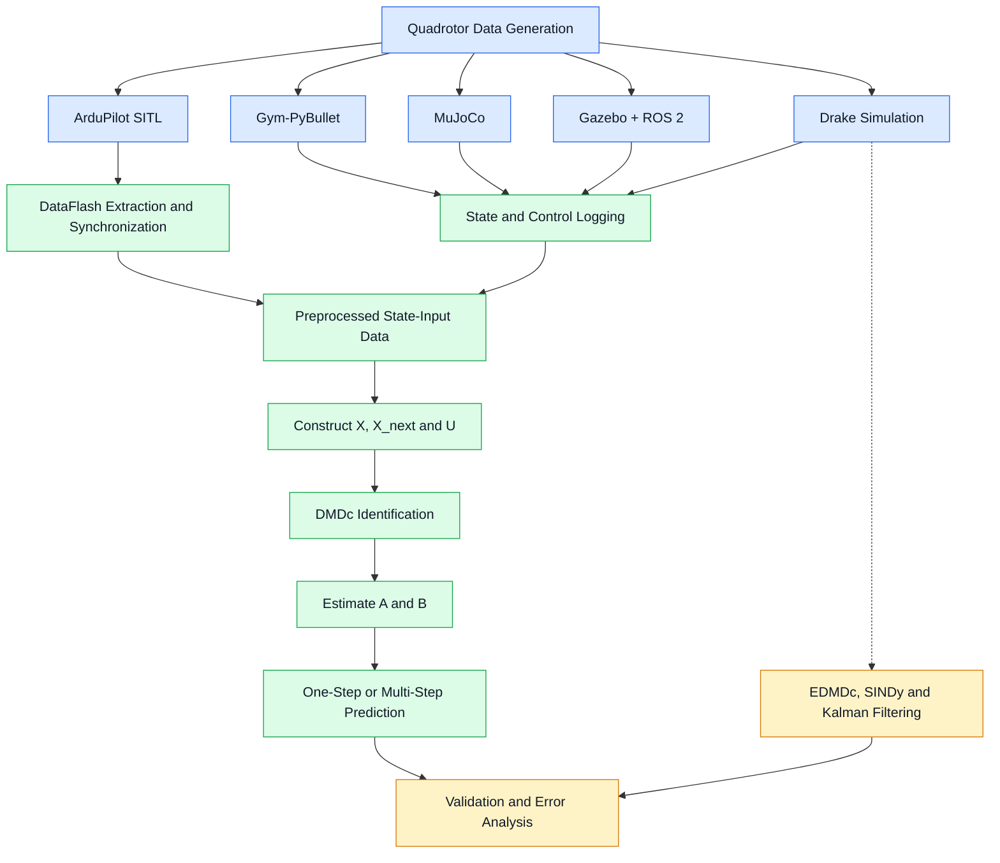
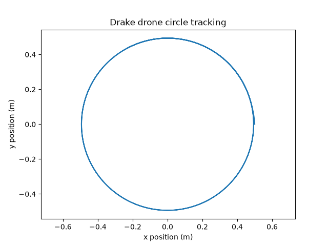
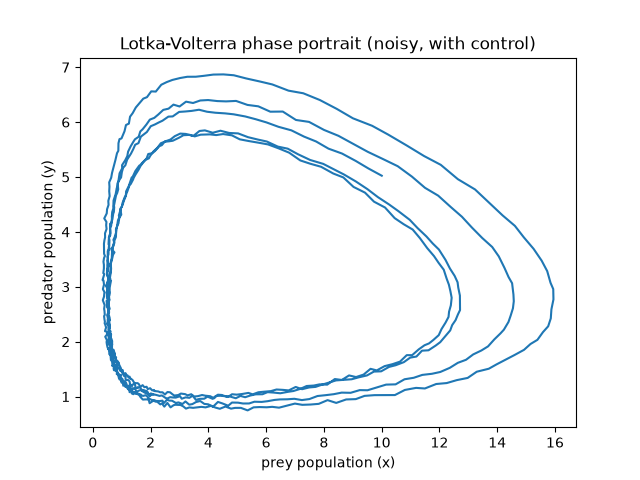
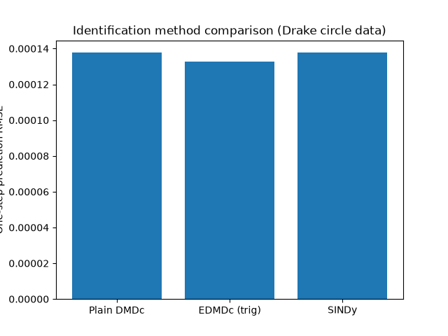
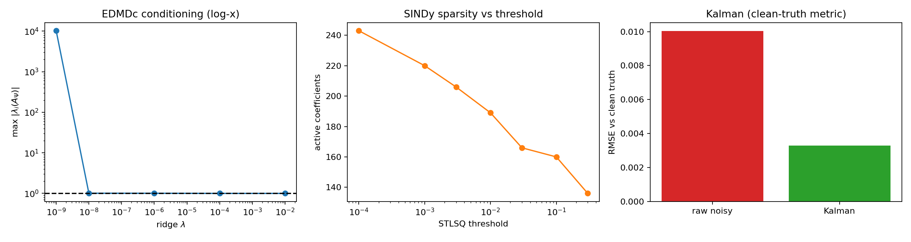
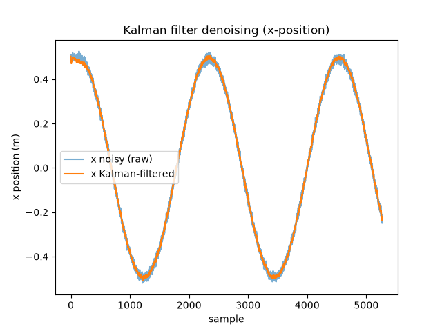

<p align="center">
  
</p>

# Drone System Identification Using DMDc

## Team Members

| Name | Roll Number | Email |
|---|---|---|
| Deeksha Prabhu | CB.SC.U4AIE24015 | deekshaprabhu024@gmail.com |
| Shivanandana | CB.SC.U4AIE24049 | shivanandana83@gmail.com |
| K. Supriya | CB.SC.U4AIE24025 | ksupriya2430@gmail.com |
| V R Sridevi | CB.SC.U4AIE24166 | sridevirajansri@gmail.com |
| Diya Prakash | CB.SC.U4AIE24111 | diyapnair07@gmail.com |

---

### Data-Driven Modeling and Prediction of Quadrotor Dynamics Across Multiple Simulation Environments

This project investigates **data-driven system identification of quadrotor dynamics** using Dynamic Mode Decomposition with Control (DMDc). Flight data is collected from different simulation environments and an autopilot Software-In-The-Loop (SITL) setup, then used to identify mathematical models that approximate the relationship between the drone's current state, control inputs, and future state.

The primary model is

$$
\boxed{x_{k+1}=Ax_k+Bu_k}
$$

where \(A\) represents the state-transition dynamics and \(B\) represents the influence of control inputs.

The project explores this workflow across Gym-PyBullet, MuJoCo, Gazebo, and ArduPilot SITL. An additional Drake-based implementation explores extended DMDc, Sparse Identification of Nonlinear Dynamics (SINDy), Kalman filtering, and nonlinear-system validation.

The implementations preserve the state representation and control-input conventions of their respective environments rather than forcing every simulator into a single state vector.


## Table of Contents

1. [Abstract](#1-abstract)
2. [Introduction](#2-introduction)
3. [Project Objectives](#3-project-objectives)
4. [System Architecture](#4-system-architecture)
5. [Quadrotor Dynamics and State Representation](#5-quadrotor-dynamics-and-state-representation)
6. [DMDc Theory and Mathematical Formulation](#6-dmdc-theory-and-mathematical-formulation)
7. [Simulation Environments and Implementations](#7-simulation-environments-and-implementations)
8. [Experimental Results](#8-experimental-results)
9. [Validation Methodology](#9-validation-methodology)
10. [Limitations](#10-limitations)
11. [Future Work](#11-future-work)
12. [Repository Structure](#12-repository-structure)
13. [Installation and Execution](#13-installation-and-execution)
14. [Technologies and Libraries](#14-technologies-and-libraries)
15. [References](#15-references)
16. [Conclusion](#16-conclusion)

---

# 1. Abstract

Quadrotors are nonlinear, underactuated, and dynamically coupled systems. Their motion depends on the interaction between translational dynamics, rotational dynamics, gravity, and the forces generated by individual rotors. Developing an accurate analytical model requires detailed knowledge of physical parameters and the relationships between motor commands and vehicle motion.

This project investigates an alternative approach based on **data-driven system identification**. Instead of deriving every equation of motion from first principles, the model is estimated from recorded state transitions and control inputs.

The principal identification method is Dynamic Mode Decomposition with Control (DMDc). Given consecutive state measurements and corresponding control inputs, DMDc estimates the matrices \(A\) and \(B\) of a discrete-time state-space model:

$$
x_{k+1}=Ax_k+Bu_k
$$

The methodology is explored across multiple environments, each providing a different perspective on quadrotor dynamics.

* **Gym-PyBullet:** PID-controlled flight experiments using position and velocity states.
* **MuJoCo:** Manually controlled quadrotor experiments using altitude, attitude, and angular-rate states.
* **Gazebo Harmonic with ROS 2 Jazzy:** PID-controlled flight, actuator commands, and translational-state identification.
* **ArduPilot SITL:** Data-driven identification using recorded DataFlash flight logs.
* **Drake:** Full-state quadrotor simulation, DMDc and EDMDc, SINDy, nonlinear-system validation, and Kalman filtering.

The identified models are evaluated using prediction-versus-measurement comparisons, root mean squared error (RMSE), trajectory plots, and, where implemented, eigenvalue analysis.

The project also investigates nonlinear feature representations and state estimation to understand how the basic DMDc framework can be extended beyond a purely linear model.

**Primary objective:** To investigate how effectively mathematical models of quadrotor dynamics can be identified from simulated flight data and used to predict subsequent system behaviour.

**Scope:** This project focuses on system identification, model prediction, and validation. Although an LQR controller is used within the Drake simulation to generate controlled trajectories, a controller designed from the learned DMDc model and validated as a complete closed-loop control system remains future work.

---

# 2. Introduction

A quadrotor is an unmanned aerial vehicle propelled by four independently controlled rotors. By varying the thrust generated by individual motors, the vehicle can change its altitude, orientation, and horizontal motion.

Its motion can be described using six degrees of freedom:

* **Position:** Location along the three spatial axes.
* **Linear velocity:** Rate of change of position.
* **Orientation:** Roll, pitch, and yaw.
* **Angular velocity:** Rotational rates about the body axes.

The dynamics are challenging to model accurately because translational and rotational motion are coupled. For example, a change in pitch alters the direction of the resultant thrust and therefore changes horizontal acceleration.

Traditional modeling approaches often use Newton-Euler or Lagrangian mechanics. These approaches require physical parameters such as mass, inertia, aerodynamic coefficients, and motor characteristics.

Data-driven system identification instead uses observed system behaviour to estimate a mathematical model.

For this project, the general workflow is:

$$
\text{Data Collection}
\rightarrow
\text{Preprocessing}
\rightarrow
\text{System Identification}
\rightarrow
\text{Model Validation}
$$

The same underlying DMDc formulation is applied across multiple environments, but the state variables, actuator representations, data sources, and validation procedures remain simulator-dependent.

This makes it possible to study both the usefulness and the limitations of learning quadrotor dynamics from different sources of simulated flight data.

---

# 3. Project Objectives

The principal objectives are:

1. Generate quadrotor flight data using multiple simulation environments.
2. Record the system states and the corresponding control inputs.
3. Construct consecutive state and input snapshot matrices from the collected data.
4. Implement Dynamic Mode Decomposition with Control for identifying system dynamics.
5. Estimate the state-transition matrix \(A\) and input matrix \(B\).
6. Investigate singular value decomposition and model-order selection where supported by the implementation.
7. Evaluate learned models using one-step and multi-step predictions.
8. Compare predicted trajectories against actual simulated trajectories or recorded flight measurements.
9. Examine model behaviour through RMSE, trajectory plots, singular values, and eigenvalue diagnostics.
10. Explore nonlinear feature lifting and sparse equation identification using the Drake experiments.
11. Investigate Kalman filtering for state estimation under simulated measurement noise.
12. Identify the limitations of linear models and determine potential improvements for future data-driven control applications.

---

# 4. System Architecture

The project follows a common system-identification workflow, with separate data-generation and preprocessing procedures for each environment.

## 4.1 Overall Architecture



## 4.2 Common Identification Pipeline

Each DMDc implementation follows the same basic stages.

### Stage 1: Generate Flight Data

The quadrotor is simulated, controlled, or observed through an autopilot SITL environment.

The control mechanism varies between implementations:

* PID-based reference tracking in Gym-PyBullet.
* Manual commands in MuJoCo.
* PID-based flight control in Gazebo.
* The native ArduPilot flight controller in SITL.
* LQR-controlled circular trajectory tracking in Drake.

### Stage 2: Collect State and Input Measurements

The system records a sequence of states and their corresponding control inputs.

A sample is represented by

$$
(x_k,u_k,x_{k+1})
$$

where:

* \(x_k\) is the current state.
* \(u_k\) is the control input applied at the current step.
* \(x_{k+1}\) is the next state.

The state variables differ between platforms.

### Stage 3: Preprocess the Data

Depending on the environment, preprocessing may involve:

* Extracting measurements from simulation or flight logs.
* Synchronizing measurements with different timestamps.
* Constructing consistent current-state and next-state pairs.
* Transforming actuator outputs into the input coordinates used by the model.
* Standardizing variables.
* Dividing data into training and validation sets.

### Stage 4: Identify the Model

DMDc uses the collected state transitions and control inputs to estimate \(A\) and \(B\).

### Stage 5: Validate the Model

The identified model predicts future states. Predictions are compared against measured states using error metrics and visualization.

The precise validation method depends on the implementation. Some pipelines perform one-step prediction using measured current states, whereas others recursively propagate their own predictions across an entire validation trajectory.

---

# 5. Quadrotor Dynamics and State Representation

## 5.1 General State Description

A complete quadrotor state can be described using position, linear velocity, orientation, and angular velocity:

$$
x_{\mathrm{full}}=
\begin{bmatrix}
x&y&z&
v_x&v_y&v_z&
\phi&\theta&\psi&
p&q&r
\end{bmatrix}^{T}
$$

where:

| Variable        | Description                                     |
| --------------- | ----------------------------------------------- |
| \(x,y,z\)       | Position along the three spatial axes           |
| \(v_x,v_y,v_z\) | Linear velocity components                      |
| \(\phi\)        | Roll angle                                      |
| \(\theta\)      | Pitch angle                                     |
| \(\psi\)        | Yaw angle                                       |
| \(p,q,r\)       | Angular velocity components about the body axes |

Not every implementation uses all twelve variables.

A smaller state can be easier to estimate and interpret, but it may also omit dynamics that are important for accurately predicting the system.

## 5.2 State Representation Across Environments

| Environment    | State Vector                                                                   | State Dimension |
| -------------- | ------------------------------------------------------------------------------ | --------------: |
| Gym-PyBullet   | \([x,y,z,v_x,v_y,v_z]^T\)                                                      |               6 |
| Gazebo         | \([x,y,z,v_x,v_y,v_z]^T\)                                                      |               6 |
| MuJoCo         | \([z_{\mathrm{error}},v_z,\mathrm{roll},\mathrm{pitch},\mathrm{yaw},p,q,r]^T\) |               8 |
| ArduPilot SITL | $[q_0,q_1,q_2,q_3,\omega_x,\omega_y,\omega_z]^T$                             |               7 |
| Drake          | \([x,y,z,\phi,\theta,\psi,v_x,v_y,v_z,\omega_x,\omega_y,\omega_z]^T\)          |              12 |

The ArduPilot implementation represents orientation using four quaternion components rather than three Euler angles.

The MuJoCo implementation focuses on vertical motion, attitude, and angular rates, whereas Gym-PyBullet and Gazebo use a six-dimensional translational state for DMDc.

**These state representations are intentionally different.** A common system-identification method does not require every implementation to use the same state vector.

## 5.3 Control Input

In general, a quadrotor has four independently controlled motors.

The input vector is

$$
u_k=
\begin{bmatrix}
u_1&u_2&u_3&u_4
\end{bmatrix}^{T}
$$

The physical meaning of these values depends on the simulator.

They may represent:

* Rotor RPM values.
* Motor thrust commands.
* Actuator speed commands.
* Raw motor output signals.
* Transformed coordinates derived from individual motor outputs.

These inputs should not automatically be treated as physically interchangeable. For example, a raw motor-output channel is not necessarily equal to actual motor RPM or physical thrust.

## 5.4 State Dimension and Model Matrices

For a system with \(n\) state variables and \(m\) control inputs,

$$
A\in\mathbb{R}^{n\times n}
$$

and

$$
B\in\mathbb{R}^{n\times m}
$$

The main implementations therefore estimate matrices with the following dimensions:

| Environment    | \(A\) Matrix   | \(B\) Matrix  |
| -------------- | -------------- | ------------- |
| Gym-PyBullet   | \(6\times6\)   | \(6\times4\)  |
| Gazebo         | \(6\times6\)   | \(6\times4\)  |
| MuJoCo         | \(8\times8\)   | \(8\times4\)  |
| ArduPilot SITL | $7\times7$   | $7\times4$  |
| Drake DMDc     | \(12\times12\) | \(12\times4\) |

The Drake EDMDc implementation additionally operates in a lifted feature space.

---

# 6. DMDc Theory and Mathematical Formulation

## 6.1 The Discrete-Time State-Space Model

Dynamic Mode Decomposition with Control approximates the system dynamics using

$$
\boxed{x_{k+1}=Ax_k+Bu_k}
$$

The matrices describe two relationships.

**State-transition matrix \(A\)**

$$
Ax_k
$$

captures how the current state contributes to the next state.

**Input matrix \(B\)**

$$
Bu_k
$$

captures how the control inputs influence the next state.

The matrices are estimated from recorded data rather than assumed to be known beforehand.

The resulting model is a linear or locally linear approximation of the underlying dynamics. It does not imply that a real quadrotor is globally linear.

## 6.2 Constructing the Snapshot Matrices

Suppose \(N\) consecutive state transitions have been collected.

Using a column-based mathematical convention, construct the current-state matrix:

$$
X=
\begin{bmatrix}
x_0&x_1&\cdots&x_{N-1}
\end{bmatrix}
$$

The corresponding next-state matrix is

$$
X_{\mathrm{next}}=
\begin{bmatrix}
x_1&x_2&\cdots&x_N
\end{bmatrix}
$$

The control-input matrix is

$$
U=
\begin{bmatrix}
u_0&u_1&\cdots&u_{N-1}
\end{bmatrix}
$$

For \(n\) state variables and \(m\) inputs,

$$
X,X_{\mathrm{next}}\in\mathbb{R}^{n\times N}
$$

and

$$
U\in\mathbb{R}^{m\times N}
$$

The same dataset can be stored with samples as rows in a CSV or NumPy array. The implementation then arranges or transposes the data as required by the identification equations.

## 6.3 Augmented Regression Matrix

The DMDc model requires the state and control input to be considered together.

They are stacked into the augmented matrix:

$$
\Omega=
\begin{bmatrix}
X\\
U
\end{bmatrix}
$$

The state-transition equation becomes

$$
X_{\mathrm{next}}=AX+BU
$$

Define the combined operator

$$
G=
\begin{bmatrix}
A&B
\end{bmatrix}
$$

Then

$$
X_{\mathrm{next}}\approx G\Omega
$$

This converts the identification problem into a least-squares regression problem.

## 6.4 Estimating the System Matrices

The combined operator can be estimated using the Moore-Penrose pseudoinverse:

$$
\boxed{G=X_{\mathrm{next}}\Omega^\dagger}
$$

where \(\Omega^\dagger\) is the pseudoinverse of the augmented matrix.

Once \(G\) has been estimated, it is divided into two parts:

$$
G=
\begin{bmatrix}
A&B
\end{bmatrix}
$$

The first \(n\) columns form \(A\), and the remaining \(m\) columns form \(B\).

This produces the required state-space model.

## 6.5 Singular Value Decomposition

Singular Value Decomposition (SVD) is useful when estimating the pseudoinverse of the augmented matrix.

The decomposition is

$$
\Omega=U_\Omega\Sigma V^T
$$

where:

* \(U_\Omega\) contains left singular vectors.
* \(\Sigma\) contains singular values.
* \(V\) contains right singular vectors.

When a truncated decomposition is used,

$$
\Omega\approx U_r\Sigma_rV_r^T
$$

the corresponding pseudoinverse approximation is

$$
\Omega^\dagger\approx
V_r\Sigma_r^{-1}U_r^T
$$

The estimated operator becomes

$$
G\approx
X_{\mathrm{next}}V_r\Sigma_r^{-1}U_r^T
$$

Truncation retains selected singular directions and discards others. It can reduce the influence of poorly conditioned directions, but an excessively low rank may remove important system dynamics.

The project uses different numerical implementations across its branches. Some explicitly use SVD-based identification and rank selection, while others use NumPy's pseudoinverse, which itself relies on SVD-based numerical computation. These implementations should not be assumed to use identical rank-truncation settings.

## 6.6 Model Prediction

Once the matrices have been identified, the predicted state is

$$
\boxed{\hat{x}_{k+1}=A\hat{x}_k+Bu_k}
$$

There are two important prediction modes.

### One-Step-Ahead Prediction

The actual measured state at time \(k\) and the corresponding input are used to predict the next state.

$$
\hat{x}_{k+1}=Ax_k+Bu_k
$$

This evaluates the model's ability to predict a single state transition.

### Recursive Multi-Step Prediction

The predicted state is fed back into the model:

$$
\hat{x}_{k+1}=A\hat{x}_k+Bu_k
$$

$$
\hat{x}_{k+2}=A\hat{x}_{k+1}+Bu_{k+1}
$$

The process continues across the validation trajectory.

Recursive prediction is more demanding because errors can accumulate at every step. A model that predicts individual transitions accurately may still diverge during a long open-loop rollout.
<!-- BEGIN -->
DMDc assumes $x_{k+1}=Ax_k+Bu_k$. Section 7.5 relaxes this by regressing on a nonlinear dictionary of the state (EDMDc), on a sparse library (SINDy), and by adding a state estimator (Kalman filter).
<!-- END -->

## 6.7 Model Evaluation

The principal error metric used in the project is Root Mean Squared Error.

$$
\operatorname{RMSE}=
\sqrt{\frac{1}{N}\sum_{i=1}^{N}(x_i-\hat{x}_i)^2}
$$

where:

* \(x_i\) is the actual value.
* \(\hat{x}_i\) is the predicted value.
* \(N\) is the number of evaluated samples.

A smaller RMSE indicates a closer numerical match between predictions and measurements for the quantity being evaluated.

RMSE must be interpreted in the context of the state variable, its units, the model's scaling, and the evaluation method. Values from different state representations or feature spaces are not automatically comparable.

---

# 7. Simulation Environments and Implementations

## 7.1 Gym-PyBullet Implementation

**Directory:** `Gympybullet/`

This implementation develops a simulation-based workflow for identifying a mathematical model of quadrotor motion using Dynamic Mode Decomposition with Control (DMDc).

The drone is simulated using the `gym-pybullet-drones` framework and controlled using a PID controller. During flight, the drone's simulated states and applied motor RPM commands are recorded. These measurements are then used to estimate a discrete-time input–output model.

The complete workflow is:

    Reference Position / Trajectory
                  |
                  v
           PID Controller
                  |
                  v
        Four Motor RPM Commands
                  |
                  v
      Gym-PyBullet Drone Simulation
                  |
                  v
        State and Input Data Logging
                  |
                  v
       SVD-Based DMDc Identification
                  |
                  v
          Learned Matrices A and B
                  |
                  v
      Prediction and Error Evaluation

This implementation includes Gym-PyBullet simulation, PID-controlled data collection, DMDc identification, and prediction evaluation.

Lotka–Volterra and SINDy are not included in this implementation.

---

### 7.1.2 Objectives

The main objectives are:

1. Simulate a quadrotor in a three-dimensional physics environment.
2. Control its movement using desired positions or trajectories.
3. Record position, velocity, orientation, angular velocity, and motor commands.
4. Construct state and control-input snapshot matrices.
5. Identify a linear discrete-time model using SVD-based DMDc.
6. Predict drone position and velocity using the identified model.
7. Compare predictions with the recorded PyBullet simulation response.
8. Save the model and diagnostic plots for further analysis.

The identified model is intended as an approximation of the simulated drone response over the conditions represented in the collected dataset. It is not a replacement for the complete nonlinear quadrotor physics model.

---

### 7.1.3 Software and Libraries

| Component | Purpose |
|---|---|
| Python | Implements simulation, data processing, identification, and evaluation |
| `gym-pybullet-drones` | Provides quadrotor environments, drone models, and controllers |
| PyBullet | Simulates rigid-body motion and the response to applied rotor forces |
| NumPy | Performs matrix operations, SVD, and prediction calculations |
| pandas | Creates and reads the flight-data CSV |
| Matplotlib | Generates prediction and singular-value plots |
| `CtrlAviary` | Provides the environment receiving motor RPM commands |
| `DSLPIDControl` | Calculates motor commands from the measured state and reference |

The external framework supplies the simulation environment and PID controller. The project scripts define the experiment, collect data, identify the DMDc model, and evaluate predictions.

---

### 7.1.4 Project Structure

The consolidated project is organized as follows:

    Gympybullet/
    ├── project/
    │   ├── run_pid_dmdc.py
    │   └── dmdc_identify.py
    ├── data/
    │   └── pid_dmdc_log.csv
    ├── results/
    │   ├── dmdc_model.npz
    │   ├── dmdc_position_prediction.png
    │   ├── dmdc_velocity_prediction.png
    │   └── dmdc_singular_values.png
    └── README.md

Additional matrix exports such as `A_matrix.csv` and `B_matrix.csv` may also be maintained. However, the identification-script version described here saves the matrices in `dmdc_model.npz` and does not automatically create those CSV exports.

---

### 7.1.5 Roles of the Two Python Scripts

| Script | Role |
|---|---|
| `run_pid_dmdc.py` | Runs the PID-controlled drone simulation and records the flight data |
| `dmdc_identify.py` | Reads the recorded dataset, identifies the DMDc model, evaluates predictions, and saves results |

The scripts are executed in this order:

    run_pid_dmdc.py
            |
            v
    data/pid_dmdc_log.csv
            |
            v
    dmdc_identify.py
            |
            v
    Identified model and prediction plots

The simulation script generates the measurements. The identification script analyzes those measurements; it does not run the drone physics simulation.

---

### 7.1.6 Simulation Configuration

| Parameter | Value |
|---|---|
| Environment | `CtrlAviary` |
| Drone model | `DroneModel.CF2X` |
| Number of drones | 1 |
| Physics mode | `Physics.PYB` |
| Physics frequency | 240 Hz |
| Control frequency | 48 Hz |
| Initial position | `[0.0, 0.0, 0.10]` m |
| Initial roll, pitch, yaw | `[0.0, 0.0, 0.0]` rad |
| Reset seed | 42 |
| Obstacles | Disabled |
| Video recording | Disabled |
| GUI | Enabled using `--gui` |

The control interval is:

$$
\Delta t = \frac{1}{48} \approx 0.02083 \text{ s}
$$

The physics engine performs five updates per control interval:

$$
\frac{240}{48} = 5
$$

The controller calculates a new action at 48 Hz, while the physics engine advances the drone motion at 240 Hz.

---

### 7.1.7 Reference Position and Trajectory Generation

#### Initial Position-Step Experiment

The original experiment used piecewise-constant position targets:

| Time interval | Desired position `[x, y, z]` in metres |
|---|---|
| `0 ≤ t < 2 s` | `[0.0, 0.0, 0.30]` |
| `2 ≤ t < 5 s` | `[0.0, 0.0, 0.70]` |
| `5 ≤ t < 8 s` | `[0.30, 0.0, 0.70]` |
| `8 ≤ t < 11 s` | `[0.30, 0.0, 0.40]` |
| `t ≥ 11 s` | `[0.0, 0.0, 0.40]` |

These changes create altitude and horizontal-motion transients. The PID controller responds by varying the motor commands, generating state–input data for identification.

#### Circular-Flight Extension

The reference was subsequently modified to include circular motion at a fixed altitude.

The circular position reference is:

$$
p_{\mathrm{ref}}(t) =
\begin{bmatrix}
R\cos(\omega\tau) \\
R\sin(\omega\tau) \\
h
\end{bmatrix},
\qquad
\tau = t - t_{\mathrm{start}}
$$

The corresponding reference velocity is:

$$
v_{\mathrm{ref}}(t) =
\begin{bmatrix}
-R\omega\sin(\omega\tau) \\
R\omega\cos(\omega\tau) \\
0
\end{bmatrix}
$$

The supplied circular-flight configuration uses:

| Parameter | Value |
|---|---|
| Radius | 0.35 m |
| Altitude | 0.70 m |
| Angular speed | 0.35 rad/s |
| Initial hover segment | 0–3 s |
| Circular-reference segment | 3–17 s |
| Return-to-centre hover | After 17 s |
| Default total duration | 22 s |

The yaw reference follows the tangent direction:

$$
\psi_{\mathrm{ref}}(t) = \omega\tau + \frac{\pi}{2}
$$

The 14-second circular segment covers approximately 4.9 radians, or 281 degrees. Therefore, this configuration follows a circular arc rather than completing a full revolution.

The reference changes abruptly between the initial hover, circular segment, and final hover. Tracking transients can occur at these transitions.

---

### 7.1.8 PID Controller Operation

The PID controller forms a closed-loop feedback system.

At each control step:

1. Read the current simulated drone state.
2. Obtain the desired position, velocity, and yaw reference.
3. Calculate tracking errors.
4. Calculate corrective control actions.
5. Generate four motor RPM commands.
6. Apply those commands to the simulated drone.
7. Read the updated state.
8. Repeat.

The position error is:

$$
e_p(t) = p_{\mathrm{ref}}(t) - p(t)
$$

A PID correction combines proportional, integral, and derivative contributions:

$$
c(t) =
K_P e(t)
+
K_I \int_0^t e(\tau)\,d\tau
+
K_D \frac{de(t)}{dt}
$$

- Proportional action responds to the present error.
- Integral action responds to accumulated error.
- Derivative action responds to the rate of error change.

The project uses `DSLPIDControl.computeControlFromState()` to obtain motor commands from the current state and target references.

The four-motor command vector is:

$$
u_k =
\begin{bmatrix}
RPM_{1,k} \\
RPM_{2,k} \\
RPM_{3,k} \\
RPM_{4,k}
\end{bmatrix}
$$

The PID controller determines the action. PyBullet determines the physical motion caused by that action.

The controller does not directly overwrite the drone's actual position.

---

### 7.1.9 Simulation Input and Output

#### High-Level Reference

The desired position or trajectory specifies where the drone should move.

Examples include:

- Hovering at a fixed altitude.
- Moving to a different horizontal position.
- Following a circular reference.

#### Simulation Control Input

The low-level input to the `CtrlAviary` environment is the four-motor RPM command.

    Desired movement
           |
           v
       PID controller
           |
           v
    Four commanded RPMs
           |
           v
    Drone physics simulation

#### Simulation Response

The environment returns an observation containing the updated drone state.

The project records:

- Position.
- Orientation quaternion.
- Linear velocity.
- Angular velocity.
- Applied motor RPM commands.
- Reference values.

For model evaluation, the recorded PyBullet response is treated as simulation ground truth. It is not a real-world flight measurement.

---

### 7.1.10 Flight-Data Logging

The simulation script writes:

    data/pid_dmdc_log.csv

The dataset contains the following quantities:

| Category | Columns | Description |
|---|---|---|
| Time | `time` | Logged control-loop time |
| Position reference | `target_x`, `target_y`, `target_z` | Desired position |
| Position | `x`, `y`, `z` | Recorded simulated position |
| Orientation | `qx`, `qy`, `qz`, `qw` | Orientation quaternion |
| Linear velocity | `vx`, `vy`, `vz` | Recorded simulated linear velocity |
| Angular velocity | `wx`, `wy`, `wz` | Recorded simulated angular velocity |
| Control input | `rpm1`, `rpm2`, `rpm3`, `rpm4` | Commanded motor speeds |

The circular-flight version additionally records reference velocity and target roll, pitch, and yaw.

The logged quaternion and angular-velocity values are available for future analysis, but the current DMDc state uses only position and linear velocity.

---

### 7.1.11 State and Input Definitions for DMDc

The identification script selects these state columns:

    x, y, z, vx, vy, vz

The state vector is:

$$
x_k =
\begin{bmatrix}
p_{x,k} \\
p_{y,k} \\
p_{z,k} \\
v_{x,k} \\
v_{y,k} \\
v_{z,k}
\end{bmatrix}
\in \mathbb{R}^{6}
$$

The selected control-input columns are:

    rpm1, rpm2, rpm3, rpm4

The input vector is:

$$
u_k =
\begin{bmatrix}
RPM_{1,k} \\
RPM_{2,k} \\
RPM_{3,k} \\
RPM_{4,k}
\end{bmatrix}
\in \mathbb{R}^{4}
$$

The target positions are reference signals for PID control. They are not used directly as the DMDc control-input vector in this implementation.

DMDc predicts position and velocity from the measured state and supplied RPM commands. It does not calculate the RPM required to reach a target.

---

### 7.1.12 DMDc Model

The identified discrete-time model is:

$$
x_{k+1} \approx A x_k + B u_k
$$

| Quantity | Dimensions | Meaning |
|---|---|---|
| Current state `x_k` | `6 × 1` | Current position and velocity |
| Input `u_k` | `4 × 1` | Four motor RPM commands |
| Matrix `A` | `6 × 6` | Learned state-transition mapping |
| Matrix `B` | `6 × 4` | Learned input-effect mapping |
| Next state `x_(k+1)` | `6 × 1` | Predicted next position and velocity |

The model combines:

- The contribution associated with the current measured state: `A @ x_k`.
- The contribution associated with the applied input: `B @ u_k`.

These are fitted mappings for the collected dataset. Their entries should not automatically be interpreted as unique physical parameters, especially because attitude and other relevant variables are omitted from the model state.

---

### 7.1.13 Snapshot-Matrix Construction

For `N` recorded states, the identification script constructs current-state and next-state matrices:

$$
X =
\begin{bmatrix}
x_0 & x_1 & \cdots & x_{N-2}
\end{bmatrix}
$$

$$
X' =
\begin{bmatrix}
x_1 & x_2 & \cdots & x_{N-1}
\end{bmatrix}
$$

The input matrix must contain the commands applied during those transitions:

$$
U =
\begin{bmatrix}
u_0 & u_1 & \cdots & u_{N-2}
\end{bmatrix}
$$

Their dimensions are:

$$
X, X' \in \mathbb{R}^{6 \times (N-1)}
$$

$$
U \in \mathbb{R}^{4 \times (N-1)}
$$

The full dataset relationship is:

$$
X' \approx A X + B U
$$

Each column represents one time transition.

Correct timing between state, input, and next state is essential. The alignment issue in the originally shared logging code is documented in Section 7.1.20.

---

### 7.1.14 SVD-Based Identification

The current-state and input matrices are stacked:

$$
\Omega =
\begin{bmatrix}
X \\
U
\end{bmatrix}
\in \mathbb{R}^{10 \times (N-1)}
$$

Define the combined operator:

$$
G =
\begin{bmatrix}
A & B
\end{bmatrix}
$$

Then:

$$
X' \approx G\Omega
$$

The least-squares estimate is:

$$
G = X'\Omega^\dagger
$$

where `Ω†` is the Moore–Penrose pseudoinverse.

The code calculates the pseudoinverse through Singular Value Decomposition:

$$
\Omega = U_{\Omega}\Sigma_{\Omega}V_{\Omega}^{T}
$$

For retained rank `r`:

$$
G \approx X'V_r\Sigma_r^{-1}U_r^{T}
$$

After estimating `G`:

- The first six columns form `A`.
- The last four columns form `B`.

The shared implementation uses rank 10, retaining all ten available directions when sufficiently many samples exist.

Therefore, the current implementation uses SVD for full-state regression; it does not explicitly reduce the six-state model to a smaller latent-state model.

---

### 7.1.15 One-Step Prediction

One-step prediction uses the actual recorded state at every sample:

$$
\hat{x}_{k+1} = A x_k + B u_k
$$

This evaluates:

> Given the current measured state and applied motor input, how accurately does the model predict the immediately next state?

The model is supplied with the actual state again at the following prediction step, preventing previous prediction errors from accumulating through the state sequence.

---

### 7.1.16 Multi-Step Rollout

The rollout starts from the first recorded state:

$$
\hat{x}_0 = x_0
$$

Subsequent predictions use the model's own previous state:

$$
\hat{x}_{k+1} = A\hat{x}_k + Bu_k
$$

This evaluates long-horizon prediction under the recorded motor-input sequence.

The PID controller is not rerun using the predicted states. Therefore, the rollout is not a new closed-loop controller experiment; it is a model simulation driven by logged inputs.

Small model errors can accumulate during rollout, causing position and velocity predictions to drift from the PyBullet trajectory.

---

### 7.1.17 Evaluation Metrics

The script calculates Root Mean Square Error separately for each state component:

$$
RMSE_j =
\sqrt{
\frac{1}{M}
\sum_{k=1}^{M}
\left(\hat{x}_{j,k} - x_{j,k}\right)^2
}
$$

Two RMSE vectors are reported:

1. One-step RMSE.
2. Multi-step rollout RMSE.

The state order is:

    [x, y, z, vx, vy, vz]

| State | RMSE unit |
|---|---|
| `x`, `y`, `z` | metres |
| `vx`, `vy`, `vz` | metres per second |

These metrics compare predicted states with recorded simulation states. They do not measure RPM prediction error.

The current script prints the metrics to the terminal. It does not automatically save them to a separate metrics file.

---

### 7.1.18 Previously Recorded Experimental Results

A previously shared run produced:

| Quantity | Shape |
|---|---|
| State data | `(6, 672)` |
| Input data | `(4, 672)` |
| Current-state snapshots | `(6, 671)` |
| Next-state snapshots | `(6, 671)` |
| Input snapshots | `(4, 671)` |
| Matrix `A` | `(6, 6)` |
| Matrix `B` | `(6, 4)` |

At 48 control updates per second, 672 logged rows correspond to a 14-second run.

These results should not be identified as the default 22-second circular-flight results unless the associated dataset confirms that configuration.

#### Reported Prediction Errors

| State | One-step RMSE | Rollout RMSE | Unit |
|---|---:|---:|---|
| X position | 0.0001316 | 0.1907420 | m |
| Y position | 0.0000229 | 0.0043767 | m |
| Z position | 0.0002484 | 0.1738306 | m |
| X velocity | 0.0105376 | 0.1782020 | m/s |
| Y velocity | 0.0018424 | 0.0174026 | m/s |
| Z velocity | 0.0198657 | 0.1802519 | m/s |

The reported one-step position errors were below 0.25 mm. Rollout errors increased to approximately 19.1 cm in X position and 17.4 cm in altitude.

These are preliminary same-dataset results, not independent test-set results.

They must also be reassessed after correcting the state–input timing issue described below.

A small error for an axis does not necessarily indicate strong predictive capability if that axis experienced little movement during data collection.

---

### 7.1.19 Generated Outputs

| File | Purpose |
|---|---|
| `data/pid_dmdc_log.csv` | Recorded simulated states, references, and motor commands |
| `results/dmdc_model.npz` | Stores `A`, `B`, singular values, and state/input column names |
| `results/dmdc_position_prediction.png` | Compares recorded position with DMDc rollout |
| `results/dmdc_velocity_prediction.png` | Compares recorded velocity with DMDc rollout |
| `results/dmdc_singular_values.png` | Displays singular values of the combined state–input matrix |

#### Position Prediction Plot

Contains comparisons for:

- X position.
- Y position.
- Z position.

#### Velocity Prediction Plot

Contains comparisons for:

- X velocity.
- Y velocity.
- Z velocity.

#### Singular-Value Plot

Shows the numerical structure of the combined matrix `Ω = [X; U]`.

It is a diagnostic for data scaling and rank selection, not a direct prediction-accuracy metric.

---

### 7.1.20 Implementation Checks and Limitations

#### 1. State–Input Timing Alignment

The originally shared simulation code logs `next_state` after applying `rpm`.

Each CSV row therefore contains:

    State after applying action k + action k

However, the originally shared identification code uses:

    X = states[:, :-1]
    X_next = states[:, 1:]
    U = inputs[:, :-1]

This pairs consecutive post-action states with an input from the preceding transition.

For the existing post-step logging format, the input for transitions between recorded rows should instead be selected as:

    U = inputs[:, 1:]

A clearer long-term implementation is to save each transition explicitly:

    Current state before action
    Applied motor RPM
    Next state after action

The model and evaluation metrics should be regenerated after correcting this alignment.

#### 2. Timestamp Convention

The shared logger records the loop time `t` together with the post-step state.

Thus, the recorded state corresponds to the end of the control interval, while `t` marks its beginning.

This convention should be documented or changed so that timestamps consistently identify when each state was measured.

#### 3. Same-Dataset Evaluation

The current identification script fits and evaluates the model using the same recorded trajectory.

This provides a fit check but does not demonstrate generalization.

A stronger evaluation should train on one experiment and test on a separate flight trajectory.

#### 4. Limited State Representation

The model uses position and linear velocity only.

Attitude and angular velocity influence drone acceleration but are not included in the current identified state.

#### 5. Linear Approximation

The model uses constant matrices `A` and `B`.

It cannot fully capture nonlinear rotor thrust, orientation-dependent acceleration, and coupled rotational motion across all operating conditions.

#### 6. Numerical Scaling

Raw motor RPM values are much larger than position and velocity values.

Consequently, the singular values can be dominated by input scale. State and input scaling should be considered before drawing rank-selection conclusions from the SVD plot.

#### 7. Small Singular Values

The shared implementation directly inverts retained singular values.

A numerical tolerance should be introduced to avoid dividing by very small singular values in poorly excited or nearly dependent datasets.

#### 8. Environment Resets

The simulation code resets the environment if termination or truncation occurs.

Transitions across a reset must not be included as ordinary physical transitions in the identification dataset.

#### 9. Physical Interpretation

A fitted coefficient does not automatically identify a unique physical parameter.

Feedback-dependent inputs, omitted variables, and correlations among motor commands can affect the learned matrices.

---

### 7.1.21 Running the Project

Run the scripts from the `Gympybullet` directory using the Python environment containing the required dependencies.

#### Circular-Flight Simulation with GUI

    python project/run_pid_dmdc.py --gui --duration 22

#### Simulation without GUI

    python project/run_pid_dmdc.py --duration 22

#### DMDc Identification

    python project/dmdc_identify.py

The simulation must run before identification so that the flight CSV exists.

The scripts use paths relative to the current working directory. Running them from another directory may save or read files in an unexpected location.

The default commands overwrite the existing flight CSV, model, and prediction plots. Preserve earlier experiments separately when comparing different trajectories.

---

### 7.1.22 Achievements

The implementation establishes:

1. A single-quadrotor Gym-PyBullet simulation.
2. PID-controlled position and trajectory tracking.
3. Logging of simulated states and four motor RPM commands.
4. A six-state, four-input DMDc formulation.
5. SVD-based estimation of the model matrices.
6. One-step prediction evaluation.
7. Multi-step rollout evaluation.
8. Position, velocity, and singular-value plots.
9. A saved numerical model for further analysis.

The main learned relationship is:

$$
\text{Current Position and Velocity}
+
\text{Applied Motor Commands}
\longrightarrow
\text{Next Position and Velocity}
$$

The work demonstrates a complete simulation-to-identification pipeline. Final model-quality claims require corrected state–input timing and independent trajectory validation.

---

### 7.1.23 Future Improvements

Possible improvements within the DMDc workflow include:

- Correcting and explicitly recording state–input–next-state timing.
- Saving metrics and experiment configurations automatically.
- Training and testing on separate trajectories.
- Scaling state and input variables.
- Applying singular-value tolerances or regularized regression.
- Evaluating different retained ranks.
- Including attitude and angular velocity where appropriate.
- Using smoother transitions between reference segments.
- Generating varied trajectories to improve data coverage.
- Comparing against a simple persistence baseline.
- Reporting prediction error over multiple rollout horizons.

These are proposed improvements and should not be reported as completed features unless implemented and tested.

---

### 7.1.24 Framework Acknowledgement

The simulation uses the open-source
[gym-pybullet-drones](https://github.com/learnsyslab/gym-pybullet-drones)
framework and the PyBullet physics engine.

The framework provides the drone environment and PID controller. This project contributes the experiment configuration, reference trajectories, flight-data logging, DMDc identification workflow, and prediction evaluation.

## 7.2 MuJoCo Implementation

**Directory:** `DMDc_Quadrotor_MuJoCo/`

The MuJoCo implementation focuses on identifying the quadrotor's vertical and rotational dynamics from manually controlled simulated flight data.

Unlike the translational-state formulation used in Gym-PyBullet, this implementation includes altitude error, attitude, and body angular rates.

### 7.2.1 Simulation and Data Collection

The quadrotor is represented using the MuJoCo model defined in `quadrotor.xml`.

The simulation supports manually specified movement commands. Keyboard commands are converted through the control logic into individual motor commands.

The collection workflow records the time, state variables, and actual motor inputs applied to the MuJoCo simulation.

The nominal hover motor value is approximately **2.4525** for the configured 1 kg quadrotor model.

### 7.2.2 State Representation

The state vector is

$$
x=
\begin{bmatrix}
z_{\mathrm{error}}&
v_z&
\mathrm{roll}&
\mathrm{pitch}&
\mathrm{yaw}&
p&q&r
\end{bmatrix}^{T}
$$

The eight components are:

| Variable  | Description                                 |
| --------- | ------------------------------------------- |
| `z_error` | Altitude error                              |
| `vz`      | Vertical velocity                           |
| `roll`    | Roll angle                                  |
| `pitch`   | Pitch angle                                 |
| `yaw`     | Yaw angle                                   |
| `p`       | Angular velocity about the first body axis  |
| `q`       | Angular velocity about the second body axis |
| `r`       | Angular velocity about the third body axis  |

The four motor commands form the control vector:

$$
u=
\begin{bmatrix}
u_1&u_2&u_3&u_4
\end{bmatrix}^{T}
$$

The corresponding model dimensions are

$$
A\in\mathbb{R}^{8\times8}
$$

$$
B\in\mathbb{R}^{8\times4}
$$

### 7.2.3 Training and Independent Validation

The current experiment uses separate training and validation datasets:

* `manual_training.csv` — used to identify the DMDc model.
* `manual_validation.csv` — used for independent validation.

The training dataset is used to estimate \(A\) and \(B\). The learned model is then recursively applied to the validation input sequence.

The predicted states are compared against the actual MuJoCo trajectory.

This evaluates the model's ability to reproduce the observed state evolution beyond the samples used for identification.

### 7.2.4 Prediction and Evaluation

The model predicts successive states using

$$
\hat{x}_{k+1}=A\hat{x}_k+Bu_k
$$

The predicted and actual trajectories are compared for all eight state variables.

The validation pipeline produces individual prediction comparisons and reports RMSE values.

### 7.2.5 Current Validation Results

The current eight-state DMDc model produced the following reported validation RMSE values.

| State Variable |   RMSE |
| -------------- | -----: |
| `z_error`      | 0.1235 |
| `vz`           | 0.0102 |
| `roll`         | 0.0077 |
| `pitch`        | 0.0085 |
| `yaw`          | 0.0371 |
| `p`            | 0.0052 |
| `q`            | 0.0083 |
| `r`            | 0.0110 |

These values describe the reported MuJoCo validation experiment. They are not directly comparable to RMSE values from another environment unless the state representation, units, preprocessing, prediction horizon, and evaluation procedure are aligned.

### 7.2.6 Model-Order Investigation

An initial rank-4 model was evaluated.

Independent validation indicated that important dynamics were lost when the model order was reduced to four. The current implementation therefore retains all eight state dimensions.

This illustrates why a model-order decision should be based on validation performance and the dynamics that need to be represented, rather than dimensionality reduction alone.

### 7.2.7 Main Files

| File                      | Purpose                                                 |
| ------------------------- | ------------------------------------------------------- |
| `quadrotor.xml`           | MuJoCo quadrotor model                                  |
| `manual_control.py`       | Manual flight control and data collection               |
| `dmdc_manual_pipeline.py` | Main DMDc identification and validation pipeline        |
| `dmdc_pipeline.py`        | Earlier DMDc baseline implementation                    |
| `inspect_model.py`        | MuJoCo model inspection                                 |
| `run_simulation.py`       | Simulation utility                                      |
| `data/`                   | Training and validation datasets                        |
| `results/`                | Identified model outputs, metrics, and prediction plots |

LQR control is not implemented in this MuJoCo branch.

---

## 7.3 Gazebo Harmonic and ROS 2 Jazzy Implementation

**ROS 2 package:** `quad_dmdc_sim`

The Gazebo implementation uses Gazebo Harmonic and ROS 2 Jazzy to simulate a quadrotor, execute a PID-controlled flight, collect state and actuator data, and identify a translational dynamics model using DMDc.

### 7.3.1 Simulation Environment

The implementation targets:

* Ubuntu 24.04.
* ROS 2 Jazzy.
* Gazebo Harmonic.
* Python 3.
* NumPy and Matplotlib for numerical processing and plotting.

The package is named `quad_dmdc_sim`.

The workflow is

$$
\begin{aligned}
&\text{PID-Controlled Flight}\\
&\quad\downarrow\\
&\text{Gazebo State and Motor Logging}\\
&\quad\downarrow\\
&X,\ X_{\mathrm{next}},\ U\\
&\quad\downarrow\\
&\text{SVD-Based DMDc}\\
&\quad\downarrow\\
&A,\ B\\
&\quad\downarrow\\
&\text{Multi-Step Prediction and RMSE}
\end{aligned}
$$

### 7.3.2 Flight Controller

The PID controller internally uses the full vehicle pose and associated state information to stabilize the drone.

The controller is necessary because a quadrotor must change its attitude to accelerate horizontally. However, the DMDc model deliberately uses only the six translational state variables.

This distinction separates the state representation needed for physical flight control from the smaller state representation selected for system identification.

The controller also includes a correction to the motor-mixing logic. Roll and pitch were previously cross-coupled, and the pitch feedback polarity was inverted. These issues caused unstable behaviour, including flips, spins, and crashes. The corrected controller uses independently and consistently wired roll and pitch channels.

### 7.3.3 State and Input Representation

The DMDc state is

$$
x=
\begin{bmatrix}
x&y&z&v_x&v_y&v_z
\end{bmatrix}^{T}
$$

The control input is

$$
u=
\begin{bmatrix}
u_1&u_2&u_3&u_4
\end{bmatrix}^{T}
$$

where the inputs correspond to the four motor commands.

The model dimensions are

$$
A\in\mathbb{R}^{6\times6}
$$

$$
B\in\mathbb{R}^{6\times4}
$$

The DMDc state excludes roll, pitch, yaw, and angular velocity, even though the controller uses attitude internally.

### 7.3.4 Flight Sequence

The manual flight demonstration follows the intended sequence:

$$
\text{Takeoff}
\rightarrow
\text{Hover}
\rightarrow
\text{Move in X}
\rightarrow
\text{Move in Y}
\rightarrow
\text{Return}
\rightarrow
\text{Descend}
\rightarrow
\text{Stop Motors}
$$

The flight controller stabilizes the simulated drone while the state and motor-command information is available for recording.

### 7.3.5 Data Collection

The data-collection component records consecutive state transitions and their corresponding control inputs.

The output is saved as:

`data/collected_data.npz`

The expected matrix dimensions are:

| Array    | Shape         | Description               |
| -------- | ------------- | ------------------------- |
| `X`      | \(6\times N\) | Current states            |
| `X_next` | \(6\times N\) | Corresponding next states |
| `U`      | \(4\times N\) | Applied motor inputs      |

Each column represents one sample.

### 7.3.6 DMDc Identification

The identification module constructs

$$
\Omega=
\begin{bmatrix}
X\\U
\end{bmatrix}
$$

and estimates

$$
G=X_{\mathrm{next}}\Omega^\dagger
$$

where

$$
G=
\begin{bmatrix}
A&B
\end{bmatrix}
$$

The estimated model is

$$
x_{k+1}=Ax_k+Bu_k
$$

The learned model is used for multi-step prediction, with held-out prediction error reported through RMSE.

### 7.3.7 Generated Outputs

The identification pipeline generates the following outputs:

| File                        | Purpose                      |
| --------------------------- | ---------------------------- |
| `models_out/dmdc_model.npz` | Saved identified DMDc model  |
| `plots/position.png`        | Position prediction analysis |
| `plots/velocity.png`        | Velocity prediction analysis |
| `plots/singular_values.png` | Singular-value analysis      |
| `plots/eigenvalues.png`     | Eigenvalue analysis          |

The script also reports the held-out multi-step prediction RMSE.

A specific numerical RMSE value is not included here because no corresponding result was supplied for this experiment.

### 7.3.8 ROS Communication

The Gazebo model publishes odometry through its model-scoped odometry topic.

The relevant topic is

`/x500_dmdc/odometry`

The implementation uses `nav_msgs/Odometry` rather than relying on a dedicated pose-publisher plugin.

Motor-speed commands are communicated through the model-scoped motor-command topic, with the ROS bridge mapping the actuator information to `actuator_msgs/msg/Actuators`.

The motor command topic is

`/x500_dmdc/command/motor_speed`

These topics connect the simulated vehicle, the flight controller, and the data-collection pipeline.

---

## 7.4 ArduPilot Software-In-The-Loop Implementation

**Directory:** `ardupilot_project/`

The ArduPilot implementation uses recorded DataFlash logs generated through ArduCopter Software-In-The-Loop simulation.

Unlike the other simulation branches, the data pipeline begins with recorded flight-log messages rather than directly logging arrays from a Python simulation.

The objective is to identify the quadrotor's attitude and rotational dynamics from observed attitude, angular-rate, and motor-output information.

### 7.4.1 Data Source

The implementation uses ArduPilot DataFlash `.BIN` logs [8], read with `pymavlink` [9].

The project contains four raw log files.

The DataFlash messages used by the extraction script are:

| Message | Information Extracted | Logged units / use                                                     |
| ------- | --------------------- | ---------------------------------------------------------------------- |
| `ATT`   | Roll, pitch, and yaw  | Degrees; passed to the extractor's Euler-to-quaternion conversion     |
| `RATE`  | `R`, `P`, and `Y`     | Degrees per second; used as angular-rate state                         |
| `RCOU`  | `C1`–`C4`             | Output-channel PWM values in microseconds; motor-output proxies        |

The committed repository contains `ardupilot_project/` but not the ArduPilot
source tree or SITL build. In the local development workspace, the separate
`ardupilot/` checkout contains the source, `Tools/autotest/sim_vehicle.py`, and
an ArduCopter SITL build. Users cloning this repository must obtain and build
ArduPilot separately. The `ardupilot_project/` analysis scripts process
existing logs; they do not launch SITL.

### 7.4.2 Extracting and Synchronizing Flight Data

The script `scripts/extract_final.py` performs the following operations:

1. Reads the input DataFlash log.
2. Extracts the required ATT, RATE, and RCOU messages.
3. Converts attitude angles into quaternion components.
4. Uses the ATT timestamps as the common sampling timeline.
5. Interpolates angular rates and motor-output channels onto that timeline.
6. Maintains quaternion sign continuity between successive samples.
7. Saves the synchronized signals into a CSV file.

In the local ArduPilot source checkout, the logger writes `ATT.Roll`,
`ATT.Pitch`, and `ATT.Yaw` in degrees, and `RATE.R`, `RATE.P`, and `RATE.Y` in
degrees per second (see
`ardupilot/libraries/AP_AHRS/AP_AHRS_Logging.cpp` and
`ardupilot/libraries/AC_AttitudeControl/AC_AttitudeControl_Logging.cpp`; the
source checkout is not committed here).

In `scripts/extract_final.py`, yaw is converted from degrees to radians before
the Euler-to-quaternion calculation; roll and pitch values are passed directly
from the ATT messages to that calculation. The quaternion formula uses radians
for all three angles. Extracted RATE values remain in degrees per second.
`dmdc.py` reports angular-rate RMSE with a `rad/s` label, and `plot_final.py`
labels its angular-rate axes `rad/s`.

The resulting dataset contains

```text
time_us, q0, q1, q2, q3, wx, wy, wz, motor1, motor2, motor3, motor4
```

There are twelve columns:

* One timestamp.
* Seven state variables.
* Four motor-output variables.

### 7.4.3 Quaternion State Representation

The state vector is

$$
x_k=
\begin{bmatrix}
q_0&q_1&q_2&q_3&
\omega_x&\omega_y&\omega_z
\end{bmatrix}^{T}
$$

The extractor constructs a scalar-first quaternion from roll, pitch, and yaw
using a ZYX Euler-angle conversion; its input-angle unit error is described in
Section 7.4.2. The three angular-rate variables are the `RATE` log values in
degrees per second, despite the ω notation.

The quaternion representation avoids the particular singularity associated with Euler-angle parameterizations.

Because $q$ and $-q$ represent the same physical orientation, the preprocessing script checks successive quaternion samples and flips the sign when necessary to maintain numerical continuity.

### 7.4.4 Motor Input Transformation

The four raw output channels are transformed into collective and differential coordinates.

The transformation matrix is

$$
T=
\frac12
\begin{bmatrix}
1&1&1&1\\
1&-1&1&-1\\
1&1&-1&-1\\
1&-1&-1&1
\end{bmatrix}
$$

The transformed inputs are calculated using

$$
U=MT^T
$$

where $M$ contains the original motor-output samples.

The first transformed coordinate is a collective combination, while the remaining coordinates are differential combinations. These are linear combinations of PWM output values, not calibrated thrust or torque inputs.

Their exact physical interpretation depends on the motor ordering and configuration. The transformation alone does not establish the physical sign or meaning of each roll, pitch, or yaw channel.

### 7.4.5 Data Splitting and Normalization

The implementation divides the dataset chronologically:

* First 70%: Training.
* Remaining 30%: Testing.

Chronological splitting preserves the temporal ordering of the time-series data.

The state and transformed input variables are standardized separately using
statistics computed from the training set:

$$
\tilde{z}_j=
\frac{z_j-\mu_j}{\sigma_j},
\qquad z\in\{x,u\}
$$

where $\mu_j$ and $\sigma_j$ are the training-set mean and standard
deviation of variable $j$. A standard deviation below $10^{-12}$ is
replaced with 1 in the scripts.

The same training-derived statistics are applied to the test data, avoiding the use of test-set statistics during model fitting.

### 7.4.6 DMDc Identification

The implementation constructs the augmented matrix from the standardized state and control data.

For seven state variables and four inputs,

$$
A\in\mathbb{R}^{7\times7}
$$

$$
B\in\mathbb{R}^{7\times4}
$$

With state snapshots in columns, the script estimates the combined operator using NumPy's pseudoinverse with `rcond=1e-8`:

$$
\begin{bmatrix}A&B\end{bmatrix}
=X_{2,\mathrm{train}}\Omega^\dagger,\qquad
\Omega=
\begin{bmatrix}
X_{1,\mathrm{train}}\\
U_{1,\mathrm{train}}
\end{bmatrix}
$$

where $X_{1,\mathrm{train}}$ and $X_{2,\mathrm{train}}$ contain consecutive
standardized training-state snapshots and $U_{1,\mathrm{train}}$ contains the
aligned standardized inputs. The resulting combined matrix is separated into
$A$ and $B$.

NumPy's pseudoinverse uses SVD-based numerical computation. This implementation should not be confused with a separate truncated-SVD algorithm that explicitly selects a user-defined model rank.

### 7.4.7 Validation

The current validation is one-step-ahead prediction.

For each held-out pair, with the actual current test state and the aligned test input,

$$
\hat{x}_{k+1}=A\tilde{x}_k+B\tilde{u}_k
$$

Here, $\tilde{x}_k$ and $\tilde{u}_k$ are normalized values. The predicted
quaternion is converted back to the original feature scale, normalized to unit
length when possible, and then returned to normalized coordinates. Predictions
are not fed back into the next step, so this is one-step validation, not a
recursive rollout.

The script reports per-state RMSE and $R^2$ in normalized coordinates. It
also rescales angular-rate RMSE by its training standard deviation and labels
that output `rad/s`; the plotted angular-rate axes use the same label.
Quaternion orientation error is computed as
$2\arccos(|q_{\mathrm{true}}^\mathsf{T}q_{\mathrm{pred}}|)$ in degrees after
normalizing both quaternions. The script also prints eigenvalues and the
spectral radius of $A$.

### 7.4.8 Generated Outputs

The primary output directory is `results/final/`.

| File or Directory                  | Purpose                                       |
| ---------------------------------- | --------------------------------------------- |
| `A.csv`                            | State-transition matrix in normalized coordinates |
| `B.csv`                            | Input matrix in normalized coordinates        |
| `true.csv`                         | Actual held-out standardized states           |
| `pred.csv`                         | Predicted held-out standardized states        |
| `quaternion_prediction.png`        | Actual versus predicted normalized quaternion components |
| `angular_rate_prediction.png`      | One-step angular-rate predictions in normalized state coordinates |
| `orientation_error.png`            | Quaternion orientation error in degrees |
| `inputs.png`                       | Transformed, unnormalized PWM output coordinates |
| `plots/`                           | Additional visualizations generated by `plot_final.py` |

The `plots/` directory contains `actual_vs_predicted_attitude.png`,
`actual_vs_predicted_rates.png`, `attitude_error.png`,
`quaternion_components.png`, and `attitude_3d.png`.

RMSE and $R^2$ results are presented in Section 8.4.

---

## 7.5 Drake-Based Identification and Nonlinear-System Experiments

**Directory:** `drake_koopman_sindy/`

The Drake implementation extends the project beyond the basic DMDc workflow.

It combines a simulated quadrotor, LQR-controlled trajectory tracking, data-driven identification, nonlinear feature representations, sparse equation discovery, state estimation, and vector-field visualization.

Unlike the other implementations, this branch also investigates a separate nonlinear predator-prey system with known governing equations.
<!-- BEGIN -->
Toy Examples Leading to the Drake Experiments

Each toy isolates one idea used later. All numbers were checked numerically.

# Toy 1: DMDc by hand (a 2-state, 1-input system)

Take the true system

$$
A=\begin{bmatrix}0.9&0.1\\0&0.8\end{bmatrix},\qquad
B=\begin{bmatrix}0\\0.5\end{bmatrix},\qquad x_{k+1}=Ax_k+Bu_k .
$$

Three snapshots $(x_k,u_k)\mapsto x_{k+1}$:

$k$	$x_k$	$u_k$	$x_{k+1}$
1	$(1,0)$	1	$(0.9,\;0.5)$
2	$(0,1)$	0	$(0.1,\;0.8)$
3	$(1,1)$	2	$(1.0,\;1.8)$


Since $\det\Omega=1\neq0$ the regression is exact and returns the true $A,B$. The eigenvalues $0.9$ and $0.8$ are inside the unit circle, so the identified system is stable and the state decays like $0.9^k$. The Drake DMDc does the same with a $12\times16$ matrix $G$.

# Toy 2: Why a nonlinear system needs a lift (Koopman)
$$\dot x_1=\mu x_1,\qquad \dot x_2=\lambda\,(x_2-x_1^2).$$

This is nonlinear in $x_1$. Add the observable $y=x_1^2$, so $\dot y=2x_1\dot x_1=2\mu y$. In the lifted coordinates $(x_1,x_2,y)$ the system is exactly linear:

$$
\frac{d}{dt}\begin{bmatrix}x_1\\x_2\\y\end{bmatrix}=
\begin{bmatrix}\mu&0&0\\0&\lambda&-\lambda\\0&0&2\mu\end{bmatrix}
\begin{bmatrix}x_1\\x_2\\y\end{bmatrix}.
$$

Plain DMDc on $(x_1,x_2)$ cannot represent this; EDMDc with the dictionary $\Psi=[x_1,x_2,x_1^2]$ can. The Drake EDMDc applies the same idea with $\sin$ and $\cos$ of the attitude angles.

# Toy 3: Why $\sin\theta$ is added for the quadrotor

Horizontal acceleration depends on thrust tilt, roughly $a_x\propto \sin\theta$. A linear model uses $\sin\theta\approx\theta$. At $\theta=0.3$ rad, $\sin 0.3=0.2955$, so the linear model is off by about $1.5\%$; it gets worse as angles grow. Adding $\sin\theta,\cos\theta$ lets a linear regression represent the tilt-to-acceleration coupling without assuming small angles.

# Toy 4: SINDy recovers a sparse law, and the threshold matters

Library $\Theta=[1,\;x,\;y,\;x^2,\;xy,\;y^2]$, data from Lotka-Volterra ($\alpha=1.1,\beta=0.4,\delta=0.1,\gamma=0.4$), noise-free derivative estimates. STLSQ returns

$$\dot x = 1.099\,x-0.400\,xy,\qquad \dot y=-0.400\,y+0.100\,xy$$

with 4 of 12 coefficients active for thresholds $0.01$ and $0.05$. With threshold $0.1$ the true coefficient $\delta=0.1$ is pruned and the $\dot y$ equation collapses to zero. The rule: the threshold must sit below the smallest true coefficient and above the noise floor.

# Toy 5: One-dimensional Kalman update

Model predicts $\hat x^-=2.0$ with variance $P^-=1$. Sensor reads $z=3.0$ with variance $R=1$.

$$K=\frac{P^-}{P^-+R}=0.5,\qquad \hat x=\hat x^-+K(z-\hat x^-)=2.5,\qquad P=(1-K)P^-=0.5 .$$

Trusting the sensor less (larger $R$) shrinks $K$ and keeps the estimate near the model. The Drake filter does this for 12 states at once with $Q=0.001I$, $R=0.01I$.

# Toy 6: Why EDMDc can become ill-conditioned

For small angles $\sin\theta\approx\theta$ (at $\theta=0.1$: $0.09983$ vs $0.1$, a gap of $1.7\times10^{-4}$) and $\cos\theta\approx1-\theta^2/2$. The lifted columns are almost linear combinations of existing ones, so $\Omega$ is nearly rank deficient and $\Omega^{+}$ has huge entries. This is what produced a maximum eigenvalue near $10^{4}$ in Section 7.5.9, and why a small ridge term fixes it.

<!-- END -->

### 7.5.1 Quadrotor Simulation

The simulation is implemented in

`drake_sim/circle_tracking.py`

A quadrotor plant is instantiated using Drake's `QuadrotorPlant`.

The state vector is

$$
x=
\begin{bmatrix}
x&y&z&
\phi&\theta&\psi&
v_x&v_y&v_z&
\omega_x&\omega_y&\omega_z
\end{bmatrix}^{T}
$$

The state contains twelve variables:

* Three position components.
* Three attitude angles.
* Three linear velocity components.
* Three angular velocity components.

The four control inputs correspond to rotor thrust commands.

### 7.5.2 Hover Operating Point and LQR

The simulation initializes a nominal hover state at an altitude of 1 metre.

The recorded configuration uses a quadrotor mass of approximately \(0.7750\,\mathrm{kg}\).

Assuming equal rotor contributions, the nominal thrust per rotor is

$$
T_{\mathrm{hover}}=\frac{mg}{4}
$$

Using \(g=9.81\,\mathrm{m/s^2}\),

$$
T_{\mathrm{hover}}\approx1.9007\,\mathrm{N}
$$

Drake linearizes the plant around the hover operating point and uses the resulting local linear model to design an LQR controller.

The control law is

$$
u=u_{\mathrm{hover}}-K(x-x_{\mathrm{ref}})
$$

where \(K\) is the feedback gain matrix.

The recorded gain matrix has dimensions \(4\times12\), corresponding to four control inputs and twelve state variables.

**Scope distinction:** LQR is used here to generate controlled simulation data. The project does not establish a completed LQR controller designed from the learned DMDc matrices and validated as the final controller.

### 7.5.3 Circular Trajectory

The reference horizontal position is defined as

$$
x_{\mathrm{ref}}(t)=0.5\cos(0.5t)
$$

$$
y_{\mathrm{ref}}(t)=0.5\sin(0.5t)
$$

The reference altitude is

$$
z_{\mathrm{ref}}(t)=1
$$

This produces a circular reference with radius \(0.5\,\mathrm{m}\) and angular frequency \(0.5\,\mathrm{rad/s}\).

The simulation runs for 30 seconds, and Meshcat provides three-dimensional visualization and trajectory replay.

*Figure 7.5-3. One-step RMSE of the three methods on the Drake circle data

### 7.5.4 Recorded Data

The simulation records current states, next states, and inputs.

| Array              | Shape            | Purpose                   |
| ------------------ | ---------------- | ------------------------- |
| `X_drake.npy`      | \(12\times5475\) | Current states            |
| `Xprime_drake.npy` | \(12\times5475\) | Corresponding next states |
| `U_drake.npy`      | \(4\times5475\)  | Control inputs            |

These arrays are used in subsequent identification experiments.

### 7.5.5 DMDc: Linear Baseline

**File:** `identification/edmdc.py`

The module implements a plain DMDc baseline alongside EDMDc.

For the Drake data, the baseline estimates a linear model with

$$
A\in\mathbb{R}^{12\times12}
$$

$$
B\in\mathbb{R}^{12\times4}
$$

The estimated model is used to calculate one-step fitting error and examine the eigenvalues of the identified state-transition matrix.

The purpose of the baseline is to provide a point of comparison for models that incorporate nonlinear features.

### 7.5.6 EDMDc: Nonlinear Feature Lifting

Extended Dynamic Mode Decomposition with Control (EDMDc) augments the original state representation with nonlinear features.

The implementation adds trigonometric features for selected attitude variables.

For roll, pitch, and yaw, the feature dictionary includes their sine and cosine:

$$
\Psi(x)=
\begin{bmatrix}
x\\
\sin(\phi)\\
\cos(\phi)\\
\sin(\theta)\\
\cos(\theta)\\
\sin(\psi)\\
\cos(\psi)
\end{bmatrix}
$$

The implementation increases the state-feature dimension from 12 to 18.

The learned relationship becomes

$$
\Psi(x_{k+1})
\approx
A_{\Psi}\Psi(x_k)+Bu_k
$$

The lifted model remains linear in its estimated coefficients while representing additional nonlinear observables.

The implementation also includes a polynomial dictionary for selected products of state variables, including the prey-predator interaction term in the Lotka-Volterra experiment.
<!-- BEGIN -->
For an autonomous map $x_{k+1}=F(x_k)$, the Koopman operator $\mathcal K$ acts on scalar observables $g$:

$$(\mathcal K g)(x)=g\big(F(x)\big).$$

$\mathcal K$ is linear even when $F$ is not (Koopman, 1931), but it is infinite dimensional. EDMD (Williams et al., 2015) approximates it on the span of a finite dictionary $\Psi(x)=[\psi_1(x),\dots,\psi_p(x)]^T$ by least squares:

$$\min_{K}\;\big\|\Psi(X')-K\,\Psi(X)\big\|_F^2\;\Rightarrow\;K=\Psi(X')\Psi(X)^{+}.$$

With control, the EDMDc regression used here is

$$
\Psi(x_{k+1})\approx A_\Psi\Psi(x_k)+Bu_k,\qquad
G=[A_\Psi\;\;B]=\Psi(X')\begin{bmatrix}\Psi(X)\\U\end{bmatrix}^{+}.
$$

The first twelve rows of $\Psi(x_{k+1})$ are the original states, so predictions are read off directly and errors can be reported in the original 12-state space. The dictionary only approximates the invariant subspace, so closure is not guaranteed; that is why validation on held-out data (Section 7.5.9) is needed.
<!-- END -->

### 7.5.7 SINDy: Sparse Identification of Nonlinear Dynamics

**File:** `identification/sindy.py`

SINDy attempts to identify a compact collection of mathematical terms that explain observed system dynamics.

The implementation constructs a candidate feature matrix from selected terms such as:

* Constant terms.
* Individual state variables.
* Control inputs.
* Quadratic state products.
* Sine and cosine features.

The feature library is represented by \(\Theta\).

The algorithm estimates the coefficient matrix \(\Xi\) through least-squares regression and Sequentially Thresholded Least Squares (STLSQ).

The procedure repeatedly:

1. Estimates coefficients using least squares.
2. Removes coefficients whose magnitudes fall below a specified threshold.
3. Refits the remaining coefficients.
4. Repeats until the configured iteration limit is reached.

Depending on the configuration, SINDy can estimate continuous-time derivatives or directly fit a discrete-time next-state mapping.

When a time step is supplied, the derivative is approximated using

$$
\dot{x}_k\approx
\frac{x_{k+1}-x_k}{\Delta t}
$$

Without a time step, the implementation directly fits the next state.

The objective is to discover potentially interpretable dynamical equations rather than simply producing an unrestricted linear regression model.
<!-- BEGIN -->
SINDy assumes the dynamics are a sparse combination of library terms:

$$\dot x = \Xi^{T}\Theta(x,u),\qquad \min_{\Xi}\;\|\dot X-\Theta\Xi\|_F^2+\lambda\|\Xi\|_0 .$$

The $\ell_0$ problem is combinatorial, so STLSQ (Brunton et al., 2016) alternates: (i) least squares, (ii) set $|\xi_{ij}|<\tau$ to zero, (iii) refit the survivors on the remaining support, until the support stops changing. The threshold $\tau$ is the single sparsity knob. Library columns should be normalised before thresholding, otherwise $\tau$ means different things for features of different scale (this is why validation_fixes.py divides each column by its norm).
<!-- END -->

### 7.5.8 Lotka-Volterra Nonlinear Validation

**File:** `identification/lotka_volterra.py`

The Lotka-Volterra experiment provides a nonlinear test system with known governing equations.

The states are:

* \(x\): Prey population.
* \(y\): Predator population.

The system is defined as

$$
\frac{dx}{dt}=\alpha x-\beta xy+u_1
$$

$$
\frac{dy}{dt}=\delta xy-\gamma y+u_2
$$

The parameters used in the experiment are

$$
\alpha=1.1,\qquad
\beta=0.4,\qquad
\delta=0.1,\qquad
\gamma=0.4
$$

The system is integrated using SciPy's `solve_ivp`. Small time-varying control signals are applied, and Gaussian noise is added to the generated state data.

The identification methods evaluated include:

* Plain DMDc.
* EDMDc with trigonometric features.
* EDMDc with trigonometric and polynomial features.
* SINDy with a quadratic feature library.

The phase portrait provides a visual comparison of the predator-prey dynamics.

#### Reported Results

| Method                                       | Reported One-Step RMSE |
| -------------------------------------------- | ---------------------: |
| Plain DMDc                                   |                 0.1150 |
| EDMDc, trigonometric features                |                 0.0950 |
| EDMDc, trigonometric and polynomial features |                 0.1388 |
| SINDy                                        |                 0.0286 |

These figures require careful interpretation.

The EDMDc errors are calculated in lifted feature space, while the DMDc and SINDy errors are calculated in the original state space. The values are therefore not a fully equivalent performance comparison.

Additionally, the SINDy output reports eight active terms out of eight candidate features. The result does not establish successful sparse-term elimination, even though the identified coefficients approximate several of the known Lotka-Volterra coefficients.

<!-- BEGIN -->
Interpretation. The phase portrait shows closed orbits: prey and predator oscillate out of phase. A sparse fit with a suitable threshold (0.01 to 0.05 on a noise-free derivative) keeps exactly four of the twelve library terms, $x$, $xy$ in $\dot x$ and $y$, $xy$ in $\dot y$, with coefficients $1.099,-0.400,-0.400,0.100$ against the true $1.1,-0.4,-0.4,0.1$. The earlier "8 of 8 active" result was a threshold problem, not a limit of SINDy. Note that your noisy run must be re-checked with the same threshold before the number is quoted for it.<!-- END -->

### 7.5.9 Comparison Across Identification Methods

**File:** `identification/compare_methods.py`

The comparison script evaluates DMDc, EDMDc, and SINDy using the recorded Drake quadrotor data.

The implementation reports fitting RMSE, eigenvalue diagnostics, lifted feature dimensions, and active-coefficient counts.

The provided results are:

| Method                        | Reported RMSE | Additional Diagnostic                                                  |
| ----------------------------- | ------------: | ---------------------------------------------------------------------- |
| Plain DMDc                    |      0.000229 | Maximum absolute eigenvalue: 1.2627                                    |
| EDMDc, trigonometric features |      0.000215 | Maximum absolute eigenvalue: 9108.1548; lifted dimension: 18           |
| SINDy                         |      0.000229 | 176 nonzero coefficients across 23 candidate features and 12 equations |

**These are reported in-sample fitting errors, not independent test-set errors.**

The EDMDc error is measured in lifted feature space, unlike the original-state error used for the DMDc and SINDy results. Therefore, the RMSE values should not be treated as directly comparable.

The very large EDMDc maximum absolute eigenvalue also raises a model-stability and conditioning concern that requires further investigation before long-horizon prediction or control.

The SINDy count represents nonzero coefficients across the equations, not 176 distinct input features.
 

<!-- BEGIN -->
Interpretation. On a chronological 80/20 split in the original 12-state space, a persistence predictor ($\hat x_{k+1}=x_k$) scores $4.86\times10^{-4}$ on the test segment. DMDc reaches $2.20\times10^{-4}$, so it explains about half of the one-step change but not much more, because the Drake sampling interval is very short and the state changes by at most $7\times10^{-3}$ per step. EDMDc without regularisation is worse on held-out data ($3.02\times10^{-4}$) and has a maximum eigenvalue magnitude of about $10^{4}$, a symptom of the near-collinear lifted columns (Toy 6). With a ridge penalty $\lambda=10^{-4}$ the held-out error returns to $2.20\times10^{-4}$ and the maximum eigenvalue drops to $1.0000$. SINDy on the drone data stays dense (136 to 243 active coefficients out of 276 depending on threshold) with the same $2.20\times10^{-4}$ test error: the 12 states are strongly correlated along the circular orbit, so many terms explain the data equally well. Conclusion: for one-step prediction on this dataset the three methods are statistically indistinguishable; the real differences are in conditioning (EDMDc) and interpretability (SINDy on a known system).
<!-- END -->

### 7.5.10 Kalman Filtering

**File:** `identification/kalman_filter.py`

The Kalman-filter experiment investigates combining a learned state-transition model with noisy measurements.

Gaussian noise with standard deviation \(0.01\) is added to the saved current-state and next-state arrays. A fixed random seed is used for reproducibility.

A linear state-transition model is estimated from the noisy data.

The prediction step is

$$\hat{x}_{k+1|k} = A\hat{x}_{k|k}+Bu_k
$$

The covariance prediction is

$$P_{k+1|k} = AP_{k|k}A^T+Q
$$

The Kalman gain combines the model prediction with measurement information. The measurement update corrects the estimate using the innovation between the observed state and predicted state.

The implementation assumes constant process- and measurement-noise covariance matrices:

$$
Q=0.001I
$$

$$
R=0.01I
$$

#### Reported Results

| Metric               |    Value |
| -------------------- | -------: |
| Raw noisy RMSE       | 0.014245 |
| Filtered RMSE        | 0.010563 |
| Reported Improvement |    25.8% |

The current calculation does not compare both estimates against aligned clean ground-truth states. It therefore does not yet establish a verified 25.8% reduction in true state-estimation error.
<!-- BEGIN -->
For $x_{k+1}=Ax_k+Bu_k+w_k$, $z_k=x_k+v_k$ with $w\sim\mathcal N(0,Q)$, $v\sim\mathcal N(0,R)$:

$$
\begin{aligned}
\hat x_{k+1|k}&=A\hat x_{k|k}+Bu_k, & P_{k+1|k}&=AP_{k|k}A^{T}+Q,\\
K_{k+1}&=P_{k+1|k}\,(P_{k+1|k}+R)^{-1}, & \hat x_{k+1|k+1}&=\hat x_{k+1|k}+K_{k+1}(z_{k+1}-\hat x_{k+1|k}),\\
P_{k+1|k+1}&=(I-K_{k+1})P_{k+1|k}.
\end{aligned}
$$

Here the measurement matrix is $H=I$ (all 12 states are measured). The filter is optimal for linear-Gaussian systems with known $Q,R$; the learned $(A,B)$ carries its own identification error, and $Q,R$ are constants, which is why an Extended or Adaptive Kalman Filter would be the next step.
<!-- END -->
A stronger evaluation would compare the raw and filtered estimates against the same clean reference sequence at matching time indices.

<!-- BEGIN -->
Interpretation. Scoring both signals against the clean Drake states, the raw noisy measurements have RMSE $0.01003$ (as expected for $\sigma=0.01$) and the filtered estimate has RMSE $0.00328$, a $67.2\%$ reduction. This replaces the earlier $25.8\%$ figure, which compared against the next noisy sample rather than the truth. Gains are largest for $z$, $\theta$, $\psi$, $v_z$ and $\omega_y,\omega_z$ (filtered RMSE about $0.001$); $x$, $\phi$, $v_x$ and $\omega_x$ reach about $0.002$ to $0.005$. The weakest state is $v_y$ (filtered $0.0083$), whose identified dynamics are the least predictive. Constant $Q$ and $R$ and a model learned from noisy data remain limitations.
<!-- END -->

### 7.5.11 Vector-Field Visualization

**File:** `identification/meshgrid_viz.py`

The vector-field implementation visualizes the learned dynamics over selected regions of state space.

For Lotka-Volterra, it evaluates the true equations and SINDy-identified equations over a grid of prey and predator population values.

For the Drake quadrotor, it evaluates the EDMDc model over a two-dimensional grid of roll and pitch angles while holding the other state variables at zero and approximating the input with the mean observed input vector.

The resulting arrows visualize the predicted direction and relative rate of change in the selected variables.

The generated plots are:

* `plots/meshgrid_lotka_volterra.png`
* `plots/meshgrid_drake_rollpitch.png`

The drone vector-field visualization is a two-dimensional slice of the learned twelve-state system, not a complete representation of the full dynamics.
 

<!-- BEGIN -->
Interpretation. In the Lotka-Volterra panel, arrows from the true and identified equations should coincide; any divergence away from the training orbit shows extrapolation error. The drone roll-pitch panel is a 2-D slice (other states set to zero, input set to its mean), so it shows how the identified model pushes roll and pitch back towards hover, not the full 12-D flow.
<!-- END -->

<!-- BEGIN -->
### 7.5.12 Methodology Summary
Drake QuadrotorPlanthover linearisation + LQR
Circle referencer = 0.5 m, w = 0.5 rad/s, 30s
Record X, X', U12 x 5475, 4 x 5475
Chronological split80 % train / 20 % test
DMDc baseline
EDMDcsin/cos lift, 12 to 18
SINDySTLSQ, normalised library
Held-out RMSEoriginal 12-state space
Add noise sigma = 0.01
Kalman filterlearned A, B, Q, R
RMSE vs clean truth
Lotka-Volterraknown equations
Validate EDMDc and SINDybefore trusting them onDrake
Vector-field slicesroll-pitch, prey-predator

Design choices and why:

Known-answer check first. Lotka-Volterra has known coefficients, so any identification error is the method's fault, not the data's.
Same data, three methods. All methods see identical snapshots, so differences come from the model class.
Chronological split. The last 20 % of the flight is never used for fitting, which avoids the in-sample optimism noted in earlier sections.
One error space. EDMDc predictions are projected back to the 12 original states before computing RMSE.
Clean-truth metric for the filter. Noise is injected into a known clean signal, so the filter can be scored against the truth.
<!-- END -->
---
# 8. Experimental Results

This section summarizes the results available from the supplied implementations. Numerical metrics are reported only where values were provided.

## 8.1 MuJoCo Validation

The current MuJoCo eight-state model achieved the following reported results.

| State                  | Validation RMSE |
| ---------------------- | --------------: |
| Altitude error         |          0.1235 |
| Vertical velocity      |          0.0102 |
| Roll                   |          0.0077 |
| Pitch                  |          0.0085 |
| Yaw                    |          0.0371 |
| Angular velocity \(p\) |          0.0052 |
| Angular velocity \(q\) |          0.0083 |
| Angular velocity \(r\) |          0.0110 |

The individual state plots provide a visual comparison of the recursive DMDc predictions against the actual MuJoCo validation trajectory.

The rank-4 experiment also demonstrates that reducing the retained model order can remove dynamics needed for accurate prediction.

## 8.2 Gym-PyBullet

The Gym-PyBullet implementation produces an identified model, position and velocity prediction plots, and a singular-value plot.

The documented pipeline uses held-out test data for validation.

A numerical prediction RMSE is not included in the supplied project summary.

## 8.3 Gazebo

The Gazebo implementation saves the identified model and generates position, velocity, singular-value, and eigenvalue plots.

Its identification script reports held-out multi-step prediction RMSE.

A numerical RMSE result was not supplied for inclusion in this README.

## 8.4 ArduPilot SITL

The ArduPilot implementation identifies attitude dynamics using quaternion and angular-rate information extracted from synchronized DataFlash logs.

It evaluates one-step predictions on the held-out chronological test segment and generates attitude, angular-rate, orientation-error, and input plots.

The reported one-step test results are:

| State / metric | RMSE | $R^2$ |
| -------------- | --------: | --------: |
| $q_0$ | 0.045946 | -783.212681 |
| $q_1$ | 0.132508 | -0.270766 |
| $q_2$ | 0.090884 | 0.407436 |
| $q_3$ | 0.001982 | -5.717617 |
| $\omega_x$ | 0.464438 (normalized-state units) | -349.639089 |
| $\omega_y$ | 0.251966 (normalized-state units) | -273.345671 |
| $\omega_z$ | 0.008455 (normalized-state units) | -8.989679 |

The script additionally reports angular-rate RMSE as $1.298957$, $1.217942$, and $0.088337$ for $x$, $y$, and $z$, respectively, labeling these values in rad/s. Quaternion orientation error is reported as 3.9362° RMSE, 3.6520° mean, and 12.8507° maximum. The identified matrix has spectral radius 0.9825389441443607; its eigenvalues are listed in the DMDc script output.

## 8.5 Drake

<!-- BEGIN -->
8.5 Drake

Held-out results (last 20 % of the 30 s flight, original 12-state space, produced by identification/validation_fixes.py):

Method	Train RMSE	Test RMSE	Max |eig(A)|	Active coefficients
Persistence ($\hat x_{k+1}=x_k$)	n/a	$4.86\times10^{-4}$	n/a	n/a
Plain DMDc	$2.32\times10^{-4}$	$2.20\times10^{-4}$	1.0831	192 (dense)
EDMDc (sin/cos), no regularisation	$3.11\times10^{-4}$	$3.02\times10^{-4}$	10229.94	dense
EDMDc, ridge $\lambda=10^{-4}$	$2.33\times10^{-4}$	$2.20\times10^{-4}$	1.0000	dense
SINDy, threshold 0.03 (normalised)	n/a	$2.20\times10^{-4}$	n/a	166 of 276

Noise and filtering (noise $\sigma=0.01$, RMSE against clean states):

Signal	RMSE
Raw noisy measurement	0.010028
Kalman estimate	0.003284 (67.2 % lower)

Validation diagnostics *Left: EDMDc maximum eigenvalue versus ridge $\lambda$. Middle: SINDy active coefficients versus threshold. Right: Kalman RMSE against clean truth.*

Reading the table: the persistence baseline shows how little the state changes per step, so the useful comparison is against persistence, not against zero. Regularised EDMDc and DMDc tie. SINDy matches them while exposing structure only on the Lotka-Volterra system. The earlier DMDc maximum eigenvalue of 1.2627 was measured on the full data set; 1.0831 here is the training segment only.

<!-- END -->

## 8.6 Interpreting Results Across Environments

The implementations differ in several important ways.

| Aspect               | Gym-PyBullet                       | MuJoCo                                | Gazebo                         | ArduPilot SITL               | Drake                                                                |
| -------------------- | ---------------------------------- | ------------------------------------- | ------------------------------ | ---------------------------- | -------------------------------------------------------------------- |
| Primary state        | Position and velocity              | Altitude, attitude, and angular rates | Position and velocity          | Quaternion and angular rates | Full pose, velocity, and angular velocity                            |
| State dimension      | 6                                  | 8                                     | 6                              | 7                            | 12                                                                   |
| Input representation | Motor RPM                          | Motor commands                        | Motor commands                 | Transformed motor outputs    | Rotor thrust                                                         |
| Data source          | PID-controlled simulation          | Manual simulated flight               | PID-controlled simulation      | DataFlash logs               | LQR-controlled simulated trajectory                                  |
| Main method          | DMDc with SVD-based rank selection | DMDc                                  | SVD-based DMDc                 | DMDc using pseudoinverse     | DMDc, EDMDc, and SINDy                                               |
| Validation focus     | Held-out flight data               | Recursive held-out trajectory         | Held-out multi-step prediction | One-step held-out prediction | Primarily reported fitting errors, plus nonlinear-system experiments |

Although all implementations investigate data-driven dynamics modeling, **their state representations and validation procedures differ**.

RMSE values across these implementations should not be ranked directly without first using comparable states, scaling, data splits, and prediction horizons.

---

# 9. Validation Methodology

## 9.1 Training and Validation Separation

The general objective is to use one dataset to identify the model and separate observations to test its predictions.

Training data is used to estimate \(A\) and \(B\).

Validation data is used to evaluate the estimated model.

When a validation trajectory is recursively predicted, the model receives the validation control input at each step while using its own preceding predicted state.

This evaluates whether the model can reproduce a trajectory without repeatedly resetting the prediction to the measured state.

## 9.2 One-Step Versus Multi-Step Validation

One-step validation and multi-step validation answer different questions.

**One-step prediction** examines the next-state prediction error when the actual current state is known.

**Multi-step prediction** evaluates how prediction errors accumulate when the model is applied repeatedly.

The ArduPilot implementation currently uses one-step-ahead prediction, whereas the MuJoCo and Gazebo implementations perform recursive multi-step prediction.

A strong one-step result does not guarantee stable or accurate long-horizon behaviour.

## 9.3 Eigenvalue Analysis

The eigenvalues of the identified state-transition matrix can provide useful information about the model.

For a discrete-time autonomous linear system, the spectral radius is

$$
\rho(A)=\max_i|\lambda_i(A)|
$$

If all eigenvalues lie strictly inside the unit circle, the autonomous linear system is asymptotically stable.

However, this result should be interpreted carefully for an identified quadrotor model.

Eigenvalue analysis of \(A\) alone does not establish the stability of the complete physical system, particularly when the model is approximate, the state is scaled, inputs are present, or a feedback controller has not been analyzed.

## 9.4 Sources of Prediction Error

Prediction errors may arise from:

* The nonlinear nature of quadrotor dynamics.
* Insufficiently varied training trajectories.
* Incomplete state representations.
* Differences between motor commands and actual applied forces.
* Measurement noise and data synchronization.
* Model-order selection.
* Numerical conditioning.
* Extrapolation beyond the conditions represented in the training data.
* Recursive accumulation of prediction errors.

These factors are important when interpreting the results of each implementation.

---

# 10. Limitations

The project demonstrates multiple approaches to data-driven system identification, but several limitations remain.

## 10.1 Linear Approximation of Nonlinear Dynamics

Standard DMDc identifies a linear state-transition model. Quadrotor dynamics are nonlinear, so a single linear model may approximate the system well only over a restricted range of operating conditions.

EDMDc explores a richer feature representation, but an expanded feature space does not automatically guarantee a more stable or accurate model.

## 10.2 Different State Representations

The implementations use different state vectors.

Gym-PyBullet and Gazebo focus on translation, MuJoCo includes attitude and vertical dynamics, and ArduPilot uses quaternion attitude with angular rates.

Consequently, the resulting matrices represent different state-transition relationships and are not directly interchangeable.

## 10.3 Control-Input Semantics

Motor RPM, thrust, actuator commands, and raw output signals are different quantities.

The relationship between these signals and the actual forces applied to the vehicle may depend on motor dynamics, calibration, scaling, and vehicle configuration.

## 10.4 Data Quality and Excitation

Model quality depends on the data used for identification.

Trajectories with limited variation may not sufficiently excite every important dynamic mode. Models trained on narrow motion patterns may generalize poorly to other maneuvers.

## 10.5 Validation Horizon

One-step prediction errors do not demonstrate long-horizon accuracy.

Recursive predictions are more informative about model rollout behaviour, but they are also sensitive to small errors that accumulate over time.

## 10.6 Inconsistent Evaluation Spaces

The Drake EDMDc implementation reports errors in lifted feature space, whereas other reported errors use original-state values.

These figures do not provide an equivalent basis for ranking methods.

A consistent evaluation should compare each model's prediction against the same original-state targets on the same independent test transitions.

## 10.7 Stability and Numerical Conditioning

The reported Drake EDMDc eigenvalue magnitude indicates a potential stability and conditioning issue that needs additional investigation.

Similarly, reduced-rank models must be tested to determine whether removing singular directions preserves the dynamics needed for the intended prediction task.

## 10.8 Limited Physical Validation

The current work is based on simulation and SITL data.

Models identified in simulation may not transfer directly to a physical drone because of differences in actuator response, sensor noise, aerodynamic effects, calibration, and other real-world factors.

## 10.9 Incomplete Closed-Loop Validation

The project identifies models and evaluates their predictions. It does not establish a completed control system that uses the learned DMDc model to control a physical quadrotor.

Controller design using the identified dynamics remains future work.

---

# 11. Future Work

Potential improvements include the following.

### 11.1 Broader Data Collection

Collect additional trajectories with more varied inputs, operating conditions, and movement patterns.

Use multiple training and validation trajectories to evaluate whether the models generalize beyond a single flight.

### 11.2 More Rigorous Validation

Evaluate all applicable methods on independent test trajectories.

Compute comparable errors in the original state space and distinguish one-step prediction performance from recursive multi-step accuracy.

### 11.3 Model-Order Selection

Investigate the effect of SVD truncation on model accuracy, numerical conditioning, and prediction stability.

Compare reduced-order models using consistent validation criteria.

### 11.4 Nonlinear System Identification

Explore EDMDc feature dictionaries and SINDy candidate libraries that better represent nonlinear coupling.

Investigate how feature scaling, dictionary selection, and regularization influence the identified models.

### 11.5 Stability and Long-Horizon Analysis

Study eigenvalues, conditioning, recursive prediction error, and the sensitivity of the model to different training datasets.

Validate whether model behaviour remains reasonable outside the immediate region covered by the training trajectory.

### 11.6 Improved State Estimation

Evaluate Kalman filtering against aligned clean ground-truth data.

Investigate the selection of process- and measurement-noise covariance matrices using more realistic measurement assumptions.

### 11.7 Cross-Environment Comparison

Use comparable reference trajectories and evaluation procedures to examine how data generation and simulator-specific control inputs affect model identification.

Where appropriate, investigate whether the identified dynamics can be adapted between environments.

### 11.8 Data-Driven Control

Investigate the use of identified dynamics for model-based controller design, including candidate LQR and model predictive control approaches.

Such work should include closed-loop simulation, controller-stability analysis, and appropriate validation before any physical deployment.

### 11.9 Simulation-to-Hardware Validation

A later stage may compare models identified from simulation or SITL with measured physical-drone data.

This would help assess how actuator dynamics, sensor noise, and unmodeled physical effects influence model accuracy.

---

# 12. Repository Structure

The current repository contains the following principal directories:

```text
Drones_S5_AB07_Drone_System_Identification_DMDc/
│
├── DMDc_Quadrotor_MuJoCo/
│   ├── quadrotor.xml
│   ├── manual_control.py
│   ├── dmdc_manual_pipeline.py
│   ├── dmdc_pipeline.py
│   ├── inspect_model.py
│   ├── run_simulation.py
│   ├── data/
│   └── results/
│
├── Gympybullet/
│   ├── data/
│   ├── project/
│   ├── results/
│   └── README.md
│
├── ardupilot_project/
│   ├── raw/
│   ├── processed/
│   ├── scripts/
│   │   ├── extract_final.py
│   │   ├── dmdc.py
│   │   └── plot_final.py
│   ├── results/
│   │   └── final/
│   └── models/
│
├── drake_koopman_sindy/
│   ├── drake_sim/
│   │   └── circle_tracking.py
│   ├── identification/
│   │   ├── edmdc.py
│   │   ├── sindy.py
│   │   ├── compare_methods.py
│   │   ├── lotka_volterra.py
│   │   ├── kalman_filter.py
│   │   └── meshgrid_viz.py
│   ├── data/
│   └── plots/
│
├── .gitignore
└── README.md
```

The tree shows the principal files and folders reported for these implementations. Some output files are generated only after the corresponding scripts have been executed.

`ardupilot_project/` is the committed ArduPilot component. The separate `ardupilot/` source checkout and SITL build used in the local workflow are not included in this repository.

### Additional Gazebo Package

The Gazebo implementation uses the ROS 2 package name `quad_dmdc_sim`.

Its documented workflow includes a simulation launch file, manual flight control, data collection, and a DMDc identification module.

The package should be included in the appropriate ROS 2 workspace or repository branch before using the Gazebo commands in the next section. Its committed path should be added to the repository tree when the package is incorporated into this repository.

---

# 13. Installation and Execution

Each implementation has its own runtime environment and dependencies. The commands below should be executed in the corresponding project directory or workspace.

## 13.1 Gym-PyBullet

The implementation uses `gym-pybullet-drones`, PyBullet, Python, and the dependencies specified by the subproject.

Navigate to the PyBullet project directory containing `requirements.txt` and install its dependencies:

```bash
pip install -r requirements.txt
```

Run the PID-controlled simulation and data-collection script:

```bash
python project/run_pid_dmdc.py
```

This generates the recorded flight trajectory at:

```text
data/pid_dmdc_log.csv
```

Run DMDc identification:

```bash
python project/dmdc_identify.py
```

The identification script processes the collected flight data and saves the model and plots in the results directory.

If the source files are nested in a project subdirectory in your checkout, first navigate to the directory containing `project/`, `data/`, and `results/`.

## 13.2 MuJoCo

Navigate to the MuJoCo project directory:

```powershell
cd DMDc_Quadrotor_MuJoCo
```

Activate the Python environment in which the MuJoCo dependencies are installed.

To start manual control and collect flight data:

```powershell
python manual_control.py
```

To run the main DMDc identification and validation pipeline:

```powershell
python dmdc_manual_pipeline.py
```

The pipeline uses the training and validation data expected by the script. If those files have not yet been generated, collect the required data first.

The directory also contains `run_simulation.py` and `inspect_model.py` for simulation and model-inspection tasks.

Run the scripts from the expected project directory so that relative file paths resolve correctly.

## 13.3 Gazebo Harmonic with ROS 2 Jazzy

### Requirements

The Gazebo workflow targets Ubuntu 24.04, ROS 2 Jazzy, and Gazebo Harmonic.

Install the required packages:

```bash
sudo apt update

sudo apt install \
  ros-jazzy-ros-gz-sim \
  ros-jazzy-ros-gz-bridge \
  ros-jazzy-actuator-msgs \
  python3-numpy \
  python3-matplotlib
```

Source ROS 2 in every terminal:

```bash
source /opt/ros/jazzy/setup.bash
```

### Build the ROS 2 Package

Place the `quad_dmdc_sim` package inside a ROS 2 workspace.

```bash
mkdir -p ~/ros2_ws/src

cd ~/ros2_ws/src
```

Copy the package into this directory if it is not already present, then build it:

```bash
cd ~/ros2_ws

source /opt/ros/jazzy/setup.bash

colcon build --symlink-install --packages-select quad_dmdc_sim

source install/setup.bash
```

### Step 1: Launch Gazebo

Start the simulation with the graphical interface:

```bash
source /opt/ros/jazzy/setup.bash

source ~/ros2_ws/install/setup.bash

ros2 launch quad_dmdc_sim sim.launch.py gui:=true
```

In another terminal, inspect the available topics:

```bash
source /opt/ros/jazzy/setup.bash

source ~/ros2_ws/install/setup.bash

ros2 topic list | grep x500_dmdc
```

### Step 2: Run the Flight Demonstration

With Gazebo running, execute:

```bash
source /opt/ros/jazzy/setup.bash

source ~/ros2_ws/install/setup.bash

ros2 run quad_dmdc_sim fly_manual
```

The intended flight sequence is takeoff, hover, horizontal movement, return, controlled descent, and motor shutdown.

### Step 3: Collect DMDc Data

Start a fresh simulation in headless mode:

```bash
ros2 launch quad_dmdc_sim sim.launch.py gui:=false
```

In a second terminal, run the collector:

```bash
source /opt/ros/jazzy/setup.bash

source ~/ros2_ws/install/setup.bash

ros2 run quad_dmdc_sim data_collection
```

The collector saves:

```text
data/collected_data.npz
```

The expected array shapes are:

```text
X       : 6 × N
X_next  : 6 × N
U       : 4 × N
```

### Step 4: Run DMDc Identification

From the package directory containing the data and identification module:

```bash
python3 -m quad_dmdc_sim.run_identification
```

Alternatively, after sourcing the workspace:

```bash
ros2 run quad_dmdc_sim run_identification
```

The resulting model is saved in:

```text
models_out/dmdc_model.npz
```

The generated plots include:

```text
plots/position.png
plots/velocity.png
plots/singular_values.png
plots/eigenvalues.png
```

The script also prints the held-out multi-step prediction RMSE.

### Troubleshooting

**No odometry received**

Inspect the available topics:

```bash
ros2 topic list | grep x500_dmdc
```

Check the odometry message:

```bash
ros2 topic echo /x500_dmdc/odometry --once
```

The model uses `nav_msgs/Odometry` on `/x500_dmdc/odometry` rather than relying on a dedicated pose topic.

**No motor response**

Inspect the motor-command topic:

```bash
ros2 topic info /x500_dmdc/command/motor_speed
```

Confirm that the Gazebo motor plugins and ROS bridge are using the expected model-scoped command topic and actuator message type.

**Gazebo cannot find the model**

The launch configuration sets `GZ_SIM_RESOURCE_PATH` to the installed model directory.

Rebuild and source the workspace after modifying the model:

```bash
cd ~/ros2_ws

colcon build --symlink-install --packages-select quad_dmdc_sim

source install/setup.bash
```

**Headless mode opens the GUI**

Use:

```bash
ros2 launch quad_dmdc_sim sim.launch.py gui:=false
```

The launch file should select server-only simulation when `gui` is disabled.

## 13.4 ArduPilot Data Processing

The repository contains the ArduPilot log-processing project, not the ArduPilot
source tree or SITL build. Users cloning this repository must obtain the
ArduPilot source separately, initialize its submodules, install its SITL
build/runtime prerequisites, and build or otherwise provide the ArduCopter SITL
executable. Follow the official ArduPilot setup instructions. The
commands below describe the local workflow; they do not run automatically as
part of the analysis scripts.

For a new local ArduPilot checkout, the source can be obtained with:

```bash
git clone --recurse-submodules https://github.com/ArduPilot/ardupilot.git
```

Install the SITL build prerequisites and build ArduCopter by following the
official Linux setup instructions. On supported Debian-based Linux
systems, the documented prerequisite and SITL build steps are:

```bash
cd /path/to/ardupilot
Tools/environment_install/install-prereqs-ubuntu.sh -y
. ~/.profile
./waf configure --board sitl
./waf copter
```

These operating-system and build dependencies are separate from the Python
packages needed for log analysis. Ensure that it is cloned in the same parent directory as /ardupilot_project.

### Run a local ArduCopter SITL flight

From the separate local ArduPilot source checkout, activate the
`venv-ardupilot` environment (adjust the path if it is stored elsewhere) and
start SITL:

```bash
cd /path/to/ardupilot
source /path/to/venv-ardupilot/bin/activate
./Tools/autotest/sim_vehicle.py -v ArduCopter --console --map
```

In the MAVProxy console, issue the flight commands:

```text
mode guided
arm throttle
takeoff 10
```

The above are example commands used for the drone takeoff. Use such commands for new data collection if required. The simulated flight generates an ArduPilot DataFlash `.BIN` log. The ArduPilot
source checkout, SITL build, and their build/runtime dependencies are separate
from this repository and from the Python analysis dependencies below.

### Process a DataFlash log and generate outputs

The following Python packages are required by the analysis scripts. Install them
into the active Python environment; this does not install or build SITL:

```bash
python3 -m pip install numpy matplotlib pymavlink
```

From the committed project’s `scripts/` directory, run the following commands.
Put the newly generated log there as `flight08.BIN`, or replace that input
argument with its actual path:

```bash
cd /path/to/clone/dmdc_project/ardupilot_project/scripts
python3 extract_final.py flight08.BIN ../processed/flight08_final.csv
python3 dmdc.py
python3 plot_final.py
```

The checked-in processed CSV is extracted from
the flight08.BIN raw logs. Choose the intended input
log deliberately; extraction overwrites the processed CSV, and the later
analysis scripts overwrite results in `../results/final/`.

If using an existing synchronized dataset, skip extraction and run only the last
two commands. The scripts expect to be run with the working directory set to
`ardupilot_project/scripts/`; the processed CSV and results are addressed
relative to that directory. Outputs are written under:

```text
../results/final/
```

## 13.5 Drake Experiments
<!-- BEGIN -->

Tested on Ubuntu/WSL. The analysis scripts need only NumPy, SciPy and Matplotlib; only circle_tracking.py needs Drake. If pip install drake fails, use a Python version listed on the Drake wheel page (https://drake.mit.edu/pip.html).

bash
sudo apt update && sudo apt install -y python3 python3-venv python3-pip
cd drake_koopman_sindy
python3 -m venv venv
source venv/bin/activate
pip install --upgrade pip
pip install -r requirements.txt
python3 -c "import numpy, scipy, matplotlib; print('analysis stack OK')"
python3 -c "import pydrake; print('Drake OK')"

requirements.txt:

text
numpy>=1.26
scipy>=1.11
matplotlib>=3.8
drake
pysindy        

<!-- END -->
Navigate to the Drake project directory:

```bash
cd drake_koopman_sindy
```

Activate the Python environment used by the project:

```bash
source venv/bin/activate
```

### Step 1: Generate Quadrotor Flight Data

Run the circular trajectory simulation:

```bash
python3 drake_sim/circle_tracking.py
```

Open the Meshcat URL printed by the program to view the simulation.

The script generates the recorded state and input arrays used by the identification experiments.

### Step 2: Run the Identification Experiments

Run the Lotka-Volterra experiment:

```bash
python3 identification/lotka_volterra.py
```

Run the SINDy experiment:

```bash
python3 identification/sindy.py
```

Run the DMDc and EDMDc experiments:

```bash
python3 identification/edmdc.py
```

Compare the identified methods:

```bash
python3 identification/compare_methods.py
```

### Step 3: Run the Kalman Filter

```bash
python3 identification/kalman_filter.py
```

### Step 4: Generate Vector-Field Visualizations

```bash
python3 identification/meshgrid_viz.py
```

The drone-data identification, Kalman-filter, and drone vector-field scripts depend on the data produced by the Drake simulation. Run the simulation first.

Generated data and plots are saved in the corresponding `data/` and `plots/` directories.

---

# 14. Technologies and Libraries

| Technology          | Purpose                                                                                 |
| ------------------- | --------------------------------------------------------------------------------------- |
| Python 3            | Main programming language for data collection, identification, and analysis             |
| NumPy               | Numerical computation, matrix operations, pseudoinverse estimation, and data processing |
| SciPy               | Numerical integration and supporting scientific-computing operations                    |
| Matplotlib          | Prediction plots, error visualization, and phase portraits                              |
| Gym-PyBullet-Drones | Quadrotor simulation using Gym-compatible environments and PyBullet                     |
| MuJoCo              | Physics-based quadrotor simulation                                                      |
| Gazebo Harmonic     | Gazebo physics simulation                                                               |
| ROS 2 Jazzy         | Robotics communication, simulation launch, and actuator-data exchange                   |
| pymavlink           | Reading ArduPilot DataFlash logs                                                        |
| ArduPilot SITL      | Simulated autopilot and flight-data generation                                          |
| Drake               | Quadrotor dynamics, linearization, simulation, and LQR control for trajectory tracking  |
| Meshcat             | Browser-based visualization of the Drake simulation                                     |
| SVD                 | Numerical decomposition used in DMDc identification and model-order investigation       |
| EDMDc               | Extended feature-based system identification                                            |
| SINDy               | Sparse identification of nonlinear equations                                            |
| Kalman Filter       | Model-based state estimation using noisy measurements                                   |
| Git and GitHub      | Version control and project hosting                                                     |

The precise dependencies differ between implementations. A single Python environment should not be assumed to contain everything required by all simulator branches.

---

# 15. References

1. Proctor, J. L., Brunton, S. L., and Kutz, J. N. *Dynamic Mode Decomposition with Control*. SIAM Journal on Applied Dynamical Systems, 15(1), 142–161, 2016. https://doi.org/10.1137/15M1013857

2. [gym-pybullet-drones](https://github.com/learnsyslab/gym-pybullet-drones) — Quadrotor simulation framework used by the Gym-PyBullet implementation.

3. [MuJoCo Documentation](https://mujoco.readthedocs.io/) — Physics simulation framework used by the MuJoCo implementation.

4. [ArduPilot SITL Documentation](https://ardupilot.org/dev/docs/sitl-simulator-software-in-the-loop.html) — Software-In-The-Loop simulation for ArduPilot.

5. [Gazebo Documentation](https://gazebosim.org/docs/) — Gazebo simulation and integration documentation.

6. [ROS 2 Jazzy Documentation](https://docs.ros.org/en/jazzy/) — Robotics middleware used by the Gazebo implementation.

7. [Drake Documentation](https://drake.mit.edu/) — Robotics modeling, simulation, linearization, and control framework used by the Drake implementation.

8. [ArduPilot DataFlash Log Messages](https://ardupilot.org/copter/docs/logmessages.html) — Definitions and units for ArduPilot DataFlash messages, including `ATT`, `RATE`, and `RCOU`.

9. [pymavlink](https://github.com/ArduPilot/pymavlink) — Python tools used to read ArduPilot DataFlash log files.

10. [Building ArduPilot on Linux](https://ardupilot.org/dev/docs/building-setup-linux.html) — Source setup and build prerequisites for ArduPilot SITL.
<!-- BEGIN -->
Koopman, B. O. Hamiltonian Systems and Transformation in Hilbert Space. Proceedings of the National Academy of Sciences, 17(5), 315–318, 1931. https://doi.org/10.1073/pnas.17.5.315
Williams, M. O., Kevrekidis, I. G., and Rowley, C. W. A Data-Driven Approximation of the Koopman Operator: Extending Dynamic Mode Decomposition. Journal of Nonlinear Science, 25, 1307–1346, 2015. https://doi.org/10.1007/s00332-015-9258-5
Brunton, S. L., Budišić, M., Kaiser, E., and Kutz, J. N. Modern Koopman Theory for Dynamical Systems. SIAM Review, 64(2), 229–340, 2022. https://doi.org/10.1137/21M1401243
Brunton, S. L., Proctor, J. L., and Kutz, J. N. Discovering Governing Equations from Data by Sparse Identification of Nonlinear Dynamical Systems. PNAS, 113(15), 3932–3937, 2016. https://doi.org/10.1073/pnas.1517384113
Brunton, S. L., Proctor, J. L., and Kutz, J. N. Sparse Identification of Nonlinear Dynamics with Control (SINDYc). IFAC-PapersOnLine, 49(18), 710–715, 2016. https://doi.org/10.1016/j.ifacol.2016.10.249
de Silva, B. M. et al. PySINDy: A Python Package for the Sparse Identification of Nonlinear Dynamical Systems from Data. Journal of Open Source Software, 5(49), 2104, 2020. https://doi.org/10.21105/joss.02104
Kalman, R. E. A New Approach to Linear Filtering and Prediction Problems. Journal of Basic Engineering, 82(1), 35–45, 1960. https://doi.org/10.1115/1.3662552
Schmid, P. J. Dynamic Mode Decomposition of Numerical and Experimental Data. Journal of Fluid Mechanics, 656, 5–28, 2010. https://doi.org/10.1017/S0022112010001217
Tu, J. H., Rowley, C. W., Luchtenburg, D. M., Brunton, S. L., and Kutz, J. N. On Dynamic Mode Decomposition: Theory and Applications. Journal of Computational Dynamics, 1(2), 391–421, 2014. https://doi.org/10.3934/jcd.2014.1.391
Kutz, J. N., Brunton, S. L., Brunton, B. W., and Proctor, J. L. Dynamic Mode Decomposition: Data-Driven Modeling of Complex Systems. SIAM, 2016.
Mellinger, D. and Kumar, V. Minimum Snap Trajectory Generation and Control for Quadrotors. IEEE International Conference on Robotics and Automation, 2520–2525, 2011. https://doi.org/10.1109/ICRA.2011.5980409
Tedrake, R. and the Drake Development Team. Drake: Model-Based Design and Verification for Robotics. https://drake.mit.edu
Lotka, A. J. Elements of Physical Biology. Williams & Wilkins, 1925. Volterra, V. Variazioni e fluttuazioni del numero d'individui in specie animali conviventi. Memorie della R. Accademia Nazionale dei Lincei, 2, 31–113, 1926.
Van Overschee, P. and De Moor, B. N4SID: Subspace Algorithms for the Identification of Combined Deterministic-Stochastic Systems. Automatica, 30(1), 75–93, 1994. https://doi.org/10.1016/0005-1098(94)90230-5
Anderson, B. D. O. and Moore, J. B. Optimal Filtering. Prentice-Hall, 1979.
<!-- END -->
---

# 16. Conclusion

This project investigates data-driven quadrotor system identification using Dynamic Mode Decomposition with Control across multiple simulation environments and recorded SITL flight data.

The common DMDc formulation provides a systematic way to estimate a discrete-time mathematical model from observed states and control inputs. The resulting matrices describe how the selected state representation evolves under the recorded inputs.

The Gym-PyBullet, MuJoCo, Gazebo, and ArduPilot implementations explore different state representations, actuator signals, data-generation mechanisms, and validation procedures. The Drake experiments extend this work through nonlinear feature lifting, sparse equation identification, nonlinear-system validation, Kalman filtering, and vector-field visualization.

The results demonstrate how the identification workflow can be implemented and evaluated across different simulated systems. They also highlight important challenges involving model order, nonlinear dynamics, numerical conditioning, state representation, validation methodology, and prediction stability.

Further work should prioritize consistent independent validation, recursive prediction analysis, improved data collection, and better comparison of models in the original state space.

**The overall objective is to develop a reliable data-driven understanding of quadrotor dynamics that can serve as a foundation for future model-based control and validation on physical platforms.**
